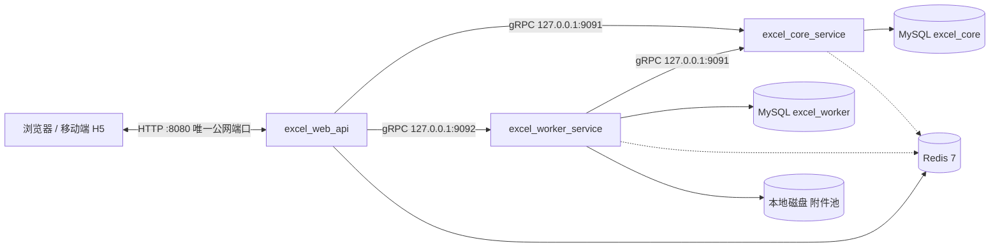

# 部署文档

| | |
|---|---|
| 适用版本 | feature/p0-mvp（2026-11-05，后端对齐终验后） |
| 部署形态 | 单机自托管：应用、MySQL、Redis、附件同机，不做分布式 |
| 公网入口 | `http://<公网IP>:8080`（唯一公网端口，明文 HTTP，无域名/无备案——风险已确认接受，见《整体技术方案-v1.3.md》§9/§11） |
| 上游依据 | 《整体技术方案-v1.3.md》§3.1/§9、《前后端对齐结论-v0.2.md》#4 |

## 1. 部署形态总览

三个 Go 进程 + 两个中间件，全部部署在同一台云服务器上：

| 进程/组件 | 端口 | 暴露范围 | 职责 |
|---|---|---|---|
| excel_web_api | 8080 (HTTP) | **公网（唯一）** | Gin 网关：路由、鉴权编排、限速、静态托管前端、WS 预留；无 MySQL 连接 |
| excel_core_service | 9091 (gRPC) | 仅 127.0.0.1 | 业务主域（iam/share/workspace/structure/records/calc/comment/audit） |
| excel_worker_service | 9092 (gRPC) | 仅 127.0.0.1 | 异步 IO 域（file/importexport/notify/scheduler） |
| MySQL 8 | 3306 | 仅 127.0.0.1 | 两个库：`excel_core`、`excel_worker` |
| Redis 7 | 6379 | 仅 127.0.0.1 | 会话/权限短缓存、限速、PubSub、Streams 事件总线、附件池配额 |
| 本地磁盘 | — | — | 附件池（默认 5GB 配额）+ 导入导出临时区 |



关键机制（影响部署方式，务必理解）：

1. **前端不单独部署**。前端（web/，Vite + React SPA）构建产物经 `scripts/build-all.ps1` 拷入 `excel_web_api/internal/static/dist/`，由 `//go:embed` 编译进 excel_web_api 二进制。升级前端 = 重新编译 excel_web_api。
2. **配置文件用相对路径加载**。三个服务启动时固定读取工作目录下的 `configs/*.yaml`（写死、无 flag、无环境变量覆盖），且 YAML 字段严格校验（多字段/缺字段/类型错都拒绝启动）。**必须以各服务目录为工作目录启动**（systemd `WorkingDirectory`），否则启动即退。
3. **数据库表自动迁移**。core/worker 启动时用 golang-migrate 自动执行内嵌 SQL（只建表，不建库）。**建库必须手动**，见 §4。
4. **Redis 无密码设计**。配置结构只有 `redis_addr` 字段、无密码字段，Redis 不能设 `requirepass`，必须 `bind 127.0.0.1` + 不对外（安全组不放行 6379）。
5. **HTTP/1.1 硬约束**。网关无 HTTP/2/h2c（对齐结论 #4），无 TLS 升级路径；前端首屏并发已按此适配，运维侧不要在前面加不透传 HTTP/1.1 语义的设备。

## 2. 云服务器平台操作清单

以下操作在云厂商控制台完成（阿里云/腾讯云等均适用，个别名词略有差异）。全程**不需要**购买：域名、SSL 证书、备案服务、云数据库 RDS、云 Redis、CDN、负载均衡——本期全部单机自建。

| # | 控制台操作 | 建议值 | 说明 |
|---|---|---|---|
| 1 | 购买服务器 | 轻量应用服务器或 ECS/CVM；**2C4G 起步，建议 4C8G**；系统盘 40GB+ SSD | 三进程 + MySQL + Redis 同机；磁盘需容纳 MySQL 数据 + 附件池 5GB + 导入临时区 |
| 2 | 选择镜像 | **Ubuntu Server 24.04 LTS**（64 位） | 24.04 默认源自带 MySQL 8 与 Redis 7；22.04 源里 Redis 是 6.x，与方案的 Redis 7 不符，不建议 |
| 3 | 设置登录凭证 | SSH 密钥对（推荐）或 root 密码 | 后续所有操作通过 SSH 完成 |
| 4 | 防火墙/安全组放行 | **仅放行 TCP 22 与 TCP 8080** | 22 建议限制来源 IP；8080 按需对公网（0.0.0.0/0）或限源。**3306/6379/9091/9092 一律不放行**——它们只监听 127.0.0.1，放行也无服务响应，但保持默认拒绝是纵深防御 |
| 5 | （可选）快照策略 | 开启自动快照，每日 ≥1 次 | 单机无高可用（方案 §11 已声明无 SLA），快照是最低成本的兜底 |
| 6 | 记录公网 IP | — | 用户访问入口 `http://<公网IP>:8080`；限源场景另行登记办公网出口 IP |

若需降低明文 HTTP 风险，控制台侧最有效的缓解是**安全组限源 IP**（方案 §11 的既定缓解手段）；正式对外运营前再走域名 + 备案 + HTTPS 的完整改造。

## 3. 服务器环境准备

SSH 登录后执行（Ubuntu 24.04）：

```bash
sudo apt update
sudo apt install -y mysql-server redis-server rsync
```

### 3.1 MySQL 8

```bash
sudo systemctl enable --now mysql
sudo mysql_secure_installation   # 按提示设置 root 密码、移除匿名用户等
```

确认仅本地监听：

```bash
sudo ss -lntp | grep 3306        # 应为 127.0.0.1:3306
# 如绑定 0.0.0.0：编辑 /etc/mysql/mysql.conf.d/mysqld.cnf 设置 bind-address = 127.0.0.1 后重启
```

### 3.2 Redis 7

```bash
sudo systemctl enable --now redis-server
sudo ss -lntp | grep 6379        # 应为 127.0.0.1:6379
```

加固（`/etc/redis/redis.conf`，改后 `sudo systemctl restart redis-server`）：

- `bind 127.0.0.1`（默认已如此，确认即可）
- `protected-mode yes`（默认）
- **不要设置 `requirepass`**：应用配置结构无密码字段（见 §1 关键机制 4），设了密码服务将连接失败并启动退出。

### 3.3 运行账号与目录规划

```bash
sudo useradd -r -s /usr/sbin/nologin excel
sudo mkdir -p /opt/excel/bin
sudo mkdir -p /opt/excel/excel_web_api/configs
sudo mkdir -p /opt/excel/excel_core_service/configs
sudo mkdir -p /opt/excel/excel_worker_service/configs
sudo mkdir -p /opt/excel/excel_permission_config
sudo mkdir -p /opt/excel/data/attachments
sudo chown -R excel:excel /opt/excel
```

> `data/attachments`（worker 附件池）服务启动时也会自动创建，这里预建只为授权目录属主；`attach_dir` 建议在生产配置里写绝对路径（见 §5.2）。

## 4. 数据库初始化（手动建库，一次性）

迁移只建表不建库。用 root 登录 MySQL 执行：

```sql
CREATE DATABASE excel_core   DEFAULT CHARACTER SET utf8mb4 COLLATE utf8mb4_0900_ai_ci;
CREATE DATABASE excel_worker DEFAULT CHARACTER SET utf8mb4 COLLATE utf8mb4_0900_ai_ci;
CREATE USER 'excel'@'localhost' IDENTIFIED BY '<强密码>';
GRANT ALL PRIVILEGES ON excel_core.*   TO 'excel'@'localhost';
GRANT ALL PRIVILEGES ON excel_worker.* TO 'excel'@'localhost';
FLUSH PRIVILEGES;
```

两个库必须都建：core 与 worker 各用一库，迁移各自独立（core 18 个版本、worker 8 个版本，服务启动时自动执行，幂等可重跑）。

## 5. 构建发布物

推荐 **方案 A：开发机构建 → 上传二进制**（服务器无需安装 Go/Node/protoc）。

### 5.0 构建机前置（Windows 开发机，一次性）

| 依赖 | 版本 | 用途 |
|---|---|---|
| Go | 1.22+ | 三服务编译（go.work） |
| Node.js | ≥18（建议 20 LTS） | 前端构建（Vite 5） |
| protoc | 任意近期版本 | proto 代码生成前置（`generate-proto.ps1` 不负责安装它，缺失会报 `protoc is required.`） |
| Git | — | 获取仓库 |

仓库中 `gen/`（proto 生成物）不入库，**任何 go 命令之前必须先生成**：

```powershell
# 仓库根目录执行；自动 go install buf / protoc-gen-go / protoc-gen-go-grpc 并生成 gen/
powershell -ExecutionPolicy Bypass -File docs\tools\generate-proto.ps1
```

### 5.1 前端构建 + 产物嵌入

```powershell
powershell -ExecutionPolicy Bypass -File scripts\build-all.ps1
```

该脚本串联：`npm install`（首次）→ `npm run build`（tsc 类型检查 + vite 构建，产物在 `web/dist/`）→ 清空并拷入 `excel_web_api/internal/static/dist/` → 在 excel_web_api 目录 `go build ./...` 验证编译。支持 `-SkipFrontend` 跳过前端段。

> 前端 API 基地址默认同源相对路径（`VITE_API_BASE` 等三个变量均有默认值，仓库不使用 .env 文件），同端口托管下**无需任何前端环境配置**。

### 5.2 交叉编译三服务（linux/amd64）

```powershell
$env:GOOS='linux'; $env:GOARCH='amd64'; $env:CGO_ENABLED='0'
go build -C excel_web_api        -o ..\out\excel-web-api         ./cmd
go build -C excel_core_service   -o ..\out\excel-core-service    ./cmd
go build -C excel_worker_service -o ..\out\excel-worker-service  ./cmd
```

无 cgo 依赖（MySQL 驱动为纯 Go），交叉编译无障碍。三服务均内嵌迁移 SQL 与（web_api）前端产物，二进制自包含。

### 5.3 上传发布物

发布物清单（`gen/`、`web/dist/` 已编译进二进制，**无需上传**）：

```text
/opt/excel/
├─ bin/
│  ├─ excel-web-api
│  ├─ excel-core-service
│  └─ excel-worker-service
├─ excel_web_api/configs/web_api_config.yaml          # 生产版，见 §5.4
├─ excel_core_service/configs/core_service_config.yaml
├─ excel_worker_service/configs/worker_service_config.yaml
├─ excel_permission_config/permissions.json           # 角色权限静态策略
└─ data/attachments/
```

```bash
# 开发机侧上传（示例）
scp out/excel-* user@<公网IP>:/tmp/
scp excel_core_service/configs/*.yaml excel_web_api/configs/*.yaml excel_worker_service/configs/*.yaml user@<公网IP>:/tmp/
scp excel_permission_config/permissions.json user@<公网IP>:/tmp/
# 服务器侧归位（注意各 yaml 必须放到对应服务目录的 configs/ 下）
sudo mv /tmp/excel-* /opt/excel/bin/ && sudo chmod +x /opt/excel/bin/excel-*
sudo mv /tmp/*.yaml 到对应 configs 目录（见上方目录规划）
sudo mv /tmp/permissions.json /opt/excel/excel_permission_config/
sudo chown -R excel:excel /opt/excel
```

### 5.4 生产配置要点

三个 yaml 的字段与开发配置完全同名，只改值。必填字段与校验规则（违反任一条启动即退）：

| 服务 | 字段 | 生产建议值 | 校验 |
|---|---|---|---|
| core | `grpc_addr` | `127.0.0.1:9091` | 必填；**保持 127.0.0.1** |
| core | `mysql_dsn` | `excel:<生产密码>@tcp(127.0.0.1:3306)/excel_core?charset=utf8mb4&parseTime=true` | 必填 |
| core | `redis_addr` | `127.0.0.1:6379` | 必填；启动 Ping 失败即退 |
| core | `permission_config_path` | `/opt/excel/excel_permission_config` | 必填；目录或 JSON 路径均可（自动拼 `permissions.json`），缺失启动失败 |
| core | `admin_token` | **强随机值（必改）** | 可选；默认 `dev-admin-token` 绝不能带上线，用于 core IAM 管理 RPC 鉴权（元数据 `x-admin-token`） |
| web_api | `addr` | `:8080` | 必填 |
| web_api | `redis_addr` | `127.0.0.1:6379` | 必填 |
| web_api | `core_grpc_addr` | `127.0.0.1:9091` | 必填 |
| web_api | `worker_grpc_addr` | `127.0.0.1:9092` | 必填 |
| web_api | `session_cache_ttl_seconds` | `55` | 必填且必须在 **1–59**（<60s 满足会话吊销 1 分钟熔断上限） |
| worker | `grpc_addr` | `127.0.0.1:9092` | 必填 |
| worker | `core_grpc_addr` | `127.0.0.1:9091` | 必填 |
| worker | `mysql_dsn` | `excel:<生产密码>@tcp(127.0.0.1:3306)/excel_worker?charset=utf8mb4&parseTime=true` | 必填 |
| worker | `redis_addr` | `127.0.0.1:6379` | 必填 |
| worker | `attach_dir` | `/opt/excel/data/attachments` | 必填；不存在会自动创建（755） |
| worker | `attach_pool_limit_bytes` | `5368709120`（5GB） | 必填且 >0；全局附件池配额 |

其他注意：

- YAML 校验开启 `KnownFields(true)`：**不能添加文档未列出的字段**（如给 Redis 加 `redis_password` 会直接拒绝启动）。
- `permissions.json` 无需重启即可热更：core 每次鉴权按 `mtime+size` 检测，变化即重载（必须包含 manager/editor/filler/viewer 四角色，格式非法则鉴权报错但不崩溃）。
- 注册/登录/写接口有内置 IP 滑窗限速（注册 10/min、登录 20/min、写 120/min、埋点 60/min），中间件故障时 fail-open，不需要额外配置。

## 6. 进程管理与启动（systemd）

仓库未提供容器/编排资产（无 Dockerfile/docker-compose），标准形态为 systemd 裸进程托管。以下三个 unit 体现了既定启动顺序：**MySQL → Redis → core → worker → web_api**。

`/etc/systemd/system/excel-core.service`：

```ini
[Unit]
Description=excel core service (gRPC :9091)
After=network.target mysql.service redis-server.service

[Service]
User=excel
Group=excel
WorkingDirectory=/opt/excel/excel_core_service
ExecStart=/opt/excel/bin/excel-core-service
Restart=on-failure
RestartSec=3

[Install]
WantedBy=multi-user.target
```

`/etc/systemd/system/excel-worker.service`：

```ini
[Unit]
Description=excel worker service (gRPC :9092)
Requires=excel-core.service
After=excel-core.service

[Service]
User=excel
Group=excel
WorkingDirectory=/opt/excel/excel_worker_service
ExecStart=/opt/excel/bin/excel-worker-service
Restart=on-failure
RestartSec=3

[Install]
WantedBy=multi-user.target
```

`/etc/systemd/system/excel-web-api.service`：

```ini
[Unit]
Description=excel web api gateway (HTTP :8080)
Requires=excel-core.service excel-worker.service
After=excel-core.service excel-worker.service

[Service]
User=excel
Group=excel
WorkingDirectory=/opt/excel/excel_web_api
ExecStart=/opt/excel/bin/excel-web-api
Restart=on-failure
RestartSec=3

[Install]
WantedBy=multi-user.target
```

启动与开机自启：

```bash
sudo systemctl daemon-reload
sudo systemctl enable --now excel-core excel-worker excel-web-api
```

`WorkingDirectory` 是硬要求（配置文件相对路径从它解析）；`ExecStart` 无参数，所有行为由 `configs/*.yaml` 决定。core/worker 启动时自动执行数据库迁移，之后探测 DB/Redis 设置 gRPC health 状态。

## 7. 部署验证

```bash
# 1) 进程存活（固定 200）
curl -s -o /dev/null -w '%{http_code}\n' http://127.0.0.1:8080/healthz

# 2) 依赖就绪：聚合 Redis Ping + core/worker gRPC health，任一失败 503
curl -s -o /dev/null -w '%{http_code}\n' http://127.0.0.1:8080/readyz

# 3) 迁移与表
mysql -u excel -p -e 'SHOW TABLES' excel_core
mysql -u excel -p -e 'SHOW TABLES' excel_worker

# 4) 首页（若 embed 目录仍是占位 index.html，说明前端产物没拷入，重跑 §5.1）
curl -s http://127.0.0.1:8080/ | head -5
```

公网冒烟：浏览器打开 `http://<公网IP>:8080/`，完成一次注册 → 登录 → 新建 Base 的全流程；深链（history 路由直接刷新）也应正常（网关对无扩展名导航路径回退 index.html）。带 hash 的静态资产（如 `assets/index-xxxxxxxx.js`）响应 `Cache-Control: public,max-age=31536000,immutable`，`index.html` 为 `no-cache`，可在浏览器 DevTools 核对。

## 8. 升级与回滚

升级（发布新版本）：

1. 备份数据库与附件（§9）。
2. 开发机重复 §5.1–5.3（前端有改动才需要重跑 5.1；它最终体现在新的 excel-web-api 二进制里）。
3. 停止顺序：`sudo systemctl stop excel-web-api excel-worker excel-core`（先摘流量，后停内部）。
4. 替换 `/opt/excel/bin/` 下二进制（建议保留上一版为 `*.prev`）。
5. 启动顺序：`sudo systemctl start excel-core excel-worker excel-web-api`；core/worker 启动即自动执行增量迁移。
6. 按 §7 验证。

回滚：

- 回滚二进制到 `*.prev` 重启即可，**但 schema 只前进**（服务只执行 MigrateUp，不自动 down），回滚后的旧二进制必须兼容当前 schema——小版本内通常成立；跨多版本回滚前先核对迁移内容。
- 数据兜底靠升级前的 mysqldump + 快照。

## 9. 备份与恢复

> 《整体技术方案-v1.3.md》§9.3 规划了 `deploy/backup.ps1` 脚本，**尚未落地**；当前用以下手工命令 + 平台快照兜底。

```bash
# 数据库（两个库一起）
mysqldump -u excel -p --single-transaction \
  --databases excel_core excel_worker > /var/backups/excel-$(date +%F).sql

# 附件池
tar czf /var/backups/attachments-$(date +%F).tar.gz /opt/excel/data/attachments

# 配置与权限策略
tar czf /var/backups/config-$(date +%F).tar.gz \
  /opt/excel/excel_*/configs /opt/excel/excel_permission_config
```

建议用 cron 每日执行并保留 ≥7 天；恢复 = 空库导入 dump + 解包附件目录 + 重启服务。

## 10. 安全基线（上线自查清单）

- [ ] core 配置 `admin_token` 已替换为强随机值（默认值绝不能上线）
- [ ] MySQL 仅监听 127.0.0.1，账号 `excel` 只授权两个业务库
- [ ] Redis 仅监听 127.0.0.1、未设密码（设计如此，见 §1 关键机制 4）
- [ ] 安全组/防火墙仅放行 22、8080；22 已限源
- [ ] 服务以非 root 账号（`excel`）运行
- [ ] 已知风险已确认：明文 HTTP 传输（缓解：安全组限源；正式运营前域名 + 备案 + HTTPS）、单机无高可用（缓解：快照 + 备份 + 快速重启）
- [ ] 注册滥用缓解已内置：注册开关、IP 限速（治理用 core 管理 RPC，凭 `x-admin-token` 从本机调用）

## 11. 故障排查

| 症状 | 可能原因 | 处理 |
|---|---|---|
| 服务启动立即退出，日志报 config 加载失败 | WorkingDirectory 不对；或 yaml 有未知/缺失/类型错误字段 | 从服务目录启动；对照 §5.4 字段表检查（未知字段也会被拒） |
| 启动立即退出，报 Redis 连接失败 | redis-server 未启动，或误设了 `requirepass` | `systemctl status redis-server`；去掉密码（配置结构不支持密码） |
| 启动立即退出，报 migrate 错误 | 库未创建 / 账号无权限 / DSN 错 | 完成 §4 建库与授权；核对 DSN |
| `/readyz` 503 但 `/healthz` 200 | Redis 不可达，或 core/worker gRPC health 非 SERVING | `journalctl -u excel-core -u excel-worker -e` 看启动探测日志 |
| `/healthz` 正常但页面空白/404 | embed 目录仍是占位 index.html | 重跑 §5.1 并重编 excel-web-api |
| 外网打不开，本机 curl 正常 | 安全组未放行 8080 / ufw 拦截 | 控制台核对 §2 第 4 步；`sudo ufw status` |
| 登录/注册被拒且无业务错误码 | 触发 IP 限速（注册 10/min、登录 20/min） | 等待滑窗恢复；确认为共享出口 IP 场景则属预期 |
| 附件上传失败 | 磁盘满，或附件池配额（5GB）用尽 | 清理磁盘或调大 `attach_pool_limit_bytes` 后重启 worker |
| 权限改了 `permissions.json` 没生效 | 文件格式非法（缺四角色等） | 看服务日志；修正后无需重启（热更按 mtime+size 触发） |

## 附录：速查表

| 项 | 值 |
|---|---|
| 公网入口 | `http://<公网IP>:8080`（明文 HTTP，无域名） |
| 端口清单 | 8080 公网；9091/9092/3306/6379 仅 127.0.0.1 |
| 健康检查 | web_api `GET /healthz`（存活）、`GET /readyz`（就绪）；core/worker gRPC standard health |
| 配置文件 | 各服务目录 `configs/*.yaml`（相对 WorkingDirectory，严格字段校验） |
| 建库 | 手动建 `excel_core`、`excel_worker`（utf8mb4）；建表启动自动迁移 |
| 前端发布 | `web/dist` → embed 进 excel-web-api 二进制（升级前端 = 重编译 web_api） |
| 前置脚本 | 任何 go 命令前：`docs/tools/generate-proto.ps1`；产物构建：`scripts/build-all.ps1` |
| 外部文件依赖 | `permissions.json`（启动必须存在，支持热更）、附件目录（自动创建） |
| WS | 网关已预留同源 `/ws` 路由，当前版本业务未接线（M3 启用），无部署动作 |
