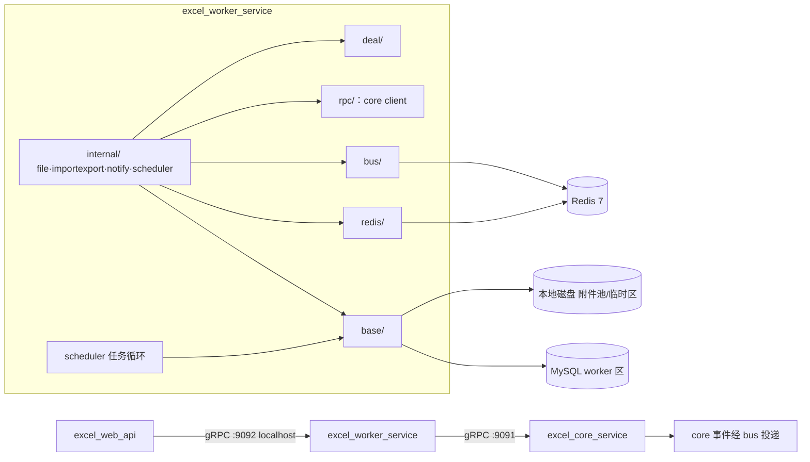
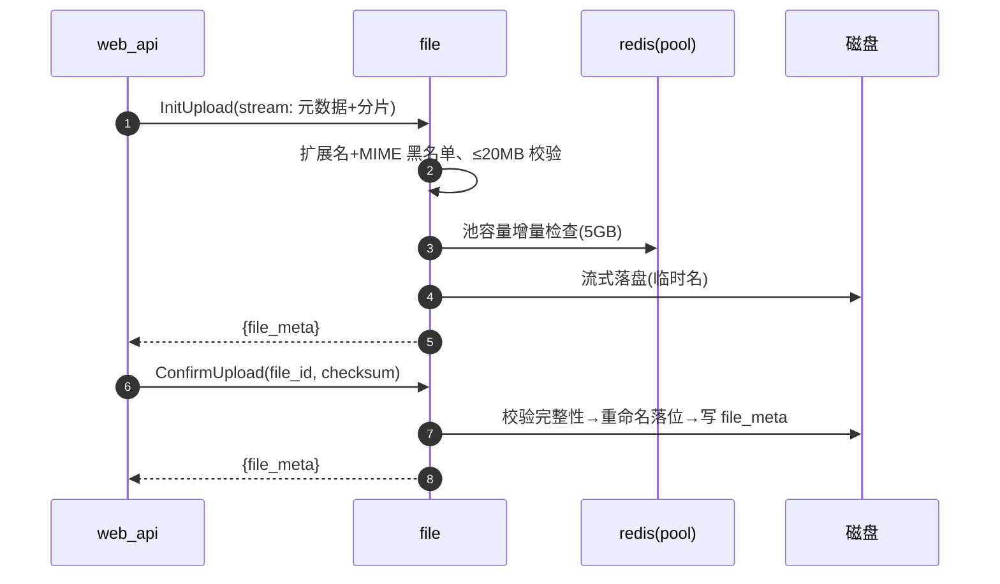
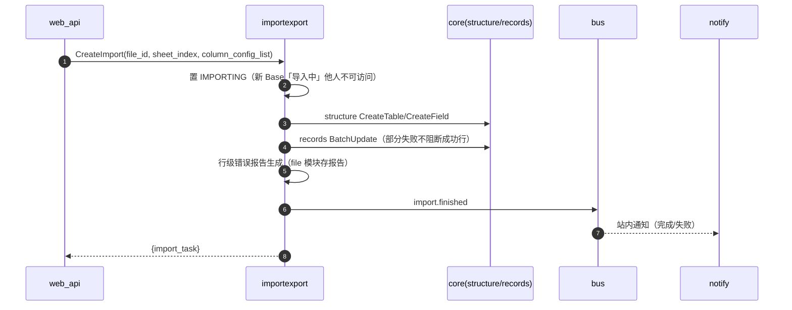
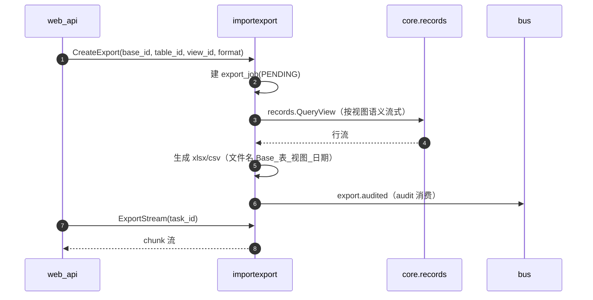
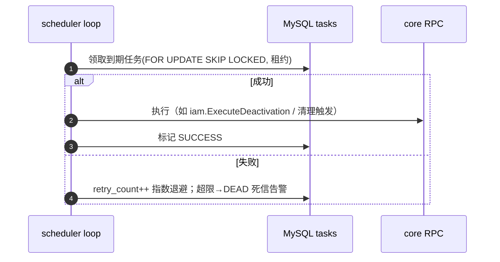

# excel_worker_service 服务技术方案（初版 + 细化）

| 项目 | 内容 |
|---|---|
| 文档版本 | v0.4（规范稿） |
| 关联文档 | 整体技术方案 v1.3、接口文档 v0.6、proto 契约、产品需求文档 v1.3 |
| 定位 | 异步与 IO 域：附件/导入导出/通知/定时任务；gRPC :9092 仅 localhost + 本地任务循环 |
| 承载模块 | file / importexport / notify / scheduler |

## 修订记录

| 版本 | 日期 | 修订内容 | 作者 |
|---|---|---|---|
| v0.1 | 2026-10-29 | 首次发布：初版骨架 + 第 11 章接口级细化（内嵌 proto、17 个 RPC 内部逻辑与重要时序图） | （待填） |
| v0.2 | 2026-10-29 | 增加接口规格总表（P0/P1/P2 分级、幂等/异常策略、下游依赖、逻辑要点） | （待填） |
| v0.3 | 2026-10-29 | 沉淀文件结构规则并重建仓库骨架 | （待填） |
| v0.4 | 2026-10-30 | base 层模块分文件、表前缀 excel_<模块>_；新增代码编写规则 | （待填） |

## 1. 定位与设计原则

1. **异步与 IO 域**：大文件、长时间任务、外设读写都在本进程消化，不阻塞 core 主链路。
2. **不重复角色校验**：权限已由 `excel_web_api` 统一裁决；本进程按注入的 principal 做归属校验（如通知只读本人、导出文件归属）。
3. **任务可靠**：导入/定时任务走 MySQL 任务表 + `FOR UPDATE SKIP LOCKED` 领取 + 租约 + 重试 + 死信；不引入独立调度中间件。
4. **流式优先**：上传/下载/导出/报告全部流式，内存峰值不随文件线性增长。
5. **事件消费幂等**：消费 `comment.*/invite.*/import.finished` 等按 `event_id` 幂等落库/聚合。
6. **分层纪律**：`base/redis/bus/rpc/deal` 业务无关封装；`internal/` 仅业务逻辑。

## 2. 职责边界

### 2.1 做什么

- 附件：两段式上传（黑名单/20MB/池 5GB 计量）、下载与缩略图、展示名、删除（`file`）。
- 导入：xlsx/xls/csv 解析与类型识别、预览、确认后建结构写记录、行级错误报告、状态机与通知（`importexport`）。
- 导出：当前视图 xlsx/csv 流式生成、命名规则、审计事件（`importexport`）。
- 通知：站内通知聚合/未读/已读、在线红点（`notify`）。
- 定时与延迟：注销 7 天/企业 30 天冷静期执行、历史/通知/审计过期清理、链接会话 TTL 兜底、7 秒撤销回收、死信重试（`scheduler`）。

### 2.2 不做什么（红线）

| 不做 | 归属 |
|---|---|
| 不暴露公网、不承接 HTTP | `excel_web_api` |
| 不做角色裁决 | `web_api` + `core.share` |
| 不写记录/结构/审计本体 | `core`（本进程经 gRPC 调用） |
| 不做站外触达（邮件/短信） | PRD D10 仅站内 |
| 不缓存业务状态 | Redis 仅计数/红点辅助 |

## 3. 总体架构与分层



分层职责（与 core 同构，多一个 `rpc/`）：

| 层 | 职责 |
|---|---|
| `base/` | 连接池、任务表、迁移、事务模板 |
| `redis/` | 池计量计数、红点辅助、事件发布 |
| `bus/` | 事件消费注册（幂等）、outbox 发布 |
| `rpc/` | 对 core 的 gRPC client（structure/records/share） |
| `deal/` | 大数工具、编码工具、错误码 |
| `internal/{module}` | handler→service→repo（仅本模块表） |

## 4. 四个模块职责一览

| 模块 | 职责 | 持有数据 | proto（RPC） |
|---|---|---|---|
| file | 附件两段式上传/下载/缩略图/配额 | file_meta + 磁盘附件池 | FileService（7） |
| importexport | 预览/导入状态机/错误报告；导出流 | import_tasks、export_jobs | ImportExportService（6） |
| notify | 站内通知聚合/已读/未读 | notifications | NotifyService（4） |
| scheduler | 冷静期/清理/TTL/撤销回收/死信重试 | tasks、cron_defs | 无对外服务（0） |

合计 RPC：17。

## 5. 关键链路

### 5.1 两段式附件上传



### 5.2 导入状态机



### 5.3 导出流



### 5.4 scheduler 任务循环



## 6. 数据与任务设计

- 表前缀：`excel_file_` / `excel_importexport_` / `excel_notify_` / `excel_scheduler_`；附件本体磁盘、库里只存 meta。
- 任务租约：`lease_until + owner_pid`，超时由其他实例接管（当前单机亦预置语义）。
- 附件池计量：Redis 计数器 + MySQL 落账对账；池满全局拦截（5002）。
- 导入中 Base 隔离：状态在 import_tasks，core 经 gRPC 查询该状态拦截访问。
- 临时文件清理：导入成功/失败后删除 temp；孤儿文件每周巡检（scheduler）。

## 7. 事件清单

| 生产/消费 | 事件 |
|---|---|
| 生产 | import.finished / export.audited / notify.created |
| 消费 | comment.created / comment.mentioned / invite.created / invite.canceled / member.disabled / member.enabled / enterprise.owner_transferred / link.closed / share.changed |
| 消费（E-17） | `enterprise.dissolved`：企业解散→附件、导出件、企业相关通知全量清理 |

## 8. 配置与运维

- `configs/worker_service_config.yaml`：grpc_addr=127.0.0.1:9092、mysql/redis、`attach_dir`、`attach_pool_limit_bytes`（默认 5GB，R2 实测后确认）、导入临时目录。
- 健康检查：`grpc.health.v1`；优雅退出：停止领任务→排空在投任务→退出。
- 指标：任务队列深度、导入成功率、附件池水位、导出耗时 P95。

## 9. 与接口文档、proto 的映射（v0.6）

| proto | RPC | 接口文档 |
|---|---|---|
| file/v1 | 7 | §8.3.9 |
| importexport/v1 | 6 | §8.3.10 |
| notify/v1 | 4 | §8.3.11 |
| scheduler/v1 | 0（内部任务消息） | §4.12 |

## 10. 风险与待定

| 风险/待定 | 缓解 |
|---|---|
| xlsx 大文件内存（5 万行） | excelize 流式 reading；压测 T1 联动 |
| GBK 编码识别误判 | UTF-8 优先 + BOM/GBK 探测兜底；抽样校验 |
| 附件池磁盘耗尽（R2） | 全局拦截 + 水位告警 + admin 清理脚本 |
| 缩略图库许可证 | 仅用宽松许可库，引入前核验（0.3 红线） |
| 导入中 Base 半成品 | 状态机可取消/定时回收未完成任务 |
| 企业解散清理 | E-17 `enterprise.dissolved` 已定稿；worker 三模块幂等消费 |

## 附录：关键设计决策（恢复）

| 编号 | 决策 | 结论 |
|---|---|---|
| AD-WRK-01 | 任务可靠性 | MySQL 任务表 + 租约 + 重试/死信 |
| AD-WRK-02 | 流式 | 上传/下载/导出全流式 |
| AD-WRK-03 | 鉴权边界 | 不判角色，仅归属校验 |
| AD-WRK-04 | 池计量 | Redis 计数 + DB 落账对账 |
| AD-WRK-05 | 临时资源 | 导入临时区 + 孤儿巡检 |
| AD-WRK-06 | 通知 | 事件消费幂等聚合 |

## 11. 接口级细化设计（恢复版 · proto + 指向规格表）

> 逐接口逻辑、调用顺序、依赖与健壮性见「§12 接口规格总表」（逻辑要点列承担逐接口职能）；重要链路时序见 §5。完整消息定义内嵌如下（与 `proto/` 一致）。

### 11.1 file

```proto
// excel.file.v1：附件与导入临时文件（对应接口文档 §4.9、§8.3.9）
syntax = "proto3";

package excel.file.v1;

option go_package = "excel/api/file/v1;filev1";

import "google/protobuf/empty.proto";

service FileService {
  rpc InitUpload(stream InitUploadRequest) returns (InitUploadResponse); // 客户端流：元数据 + 分片
  rpc ConfirmUpload(ConfirmUploadRequest) returns (ConfirmUploadResponse);
  rpc DownloadStream(DownloadStreamRequest) returns (stream FileChunk);
  rpc GetThumb(GetThumbRequest) returns (stream FileChunk);
  rpc RenameFile(RenameFileRequest) returns (RenameFileResponse);
  rpc DeleteFile(DeleteFileRequest) returns (google.protobuf.Empty);
  rpc GetQuota(google.protobuf.Empty) returns (GetQuotaResponse);
}

enum FileUsage {
  FILE_USAGE_UNSPECIFIED = 0;
  FILE_USAGE_ATTACHMENT = 1;
  FILE_USAGE_IMPORT_TEMP = 2; // 导入临时文件
  FILE_USAGE_AVATAR = 3;      // 预留（B3 待定）
}

message FileMeta {
  string id = 1;
  string name = 2;
  string display_name = 3;
  string ext = 4;
  string mime = 5;
  int64 size = 6;
  string uploader = 7;
  int64 created_at = 8;
}

message InitUploadRequest {
  string name = 1;
  string ext = 2;
  string mime = 3;
  int64 size = 4;
  FileUsage usage = 5;
  bytes chunk = 6; // 流式分片（黑名单/20MB/池容量校验）
}
message InitUploadResponse { FileMeta file_meta = 1; }

message ConfirmUploadRequest { string file_id = 1; string checksum = 2; }
message ConfirmUploadResponse { FileMeta file_meta = 1; }

message DownloadStreamRequest { string file_id = 1; }
message FileChunk { bytes chunk = 1; }

message GetThumbRequest { string file_id = 1; }

message RenameFileRequest { string file_id = 1; string display_name = 2; }
message RenameFileResponse { FileMeta file_meta = 1; }

message DeleteFileRequest { string file_id = 1; }

message GetQuotaResponse {
  int64 used = 1;
  int64 limit = 2;
  int64 available = 3;
}
```

### 11.2 importexport

```proto
PR_IMP
```

### 11.3 notify

```proto
PR_NTF
```

### 11.4 scheduler（内部任务消息）

```proto
PR_SCH
```

## 12. 接口规格总表（分级 / 健壮性 / 依赖）

> 分级与符号见《excel_core_service-技术方案》§14.1/14.2（三服务共用）。DB 表缺省 `excel_<模块>_` 前缀；DISK=本地磁盘。

| 接口 | 级 | 幂等/异常 | 调用依赖 | 逻辑要点 |
|---|---|---|---|---|
| FIL-01 InitUpload | P1 | CRI/F(5002) | DB:file_meta RED DISK CFG:config | 流式落盘+黑名单/20MB/池校验 |
| FIL-02 ConfirmUpload | P1 | NAT/F | DB:file_meta RED DISK | checksum→落位→池记账 |
| FIL-03 DownloadStream | P1 | RW/F | DB:file_meta DISK | 流式 |
| FIL-04 GetThumb | P1 | RW/E | DB:file_meta DISK | 首生成后缓存流式 |
| FIL-05 RenameFile | P2 | NAT/F | DB:file_meta | 展示名 |
| FIL-06 DeleteFile | P1 | NAT/F | DB:file_meta RED DISK BUS:task | 软删→异步物理删+回退 |
| FIL-07 GetQuota | P2 | RW/E | RED DB:file_meta | 计数与 DB 对账 |
| IMP-01 PreviewImport | P1 | RW/F | DISK | 编码探测→类型识别→取样 |
| IMP-02 CreateImport | P1 | CRI/F | DB:import_tasks RPC:structure+records BUS:import.finished | 建表→批量写→报告→事件 |
| IMP-03 GetImportStatus | P1 | RW/E | DB:import_tasks | 发起人可见 |
| IMP-04 GetImportReport | P2 | RW/F | DB:import_tasks DISK | 流式报告 |
| IMP-05 CreateExport | P1 | CRI/F | DB:export_jobs RPC:records BUS:export.audited | 拉行流→命名→事件 |
| IMP-06 ExportStream | P1 | RW/F | DB:export_jobs DISK | 仅 DONE 可拉 |
| NTF-01 ListNotifications | P1 | RW/E | DB:notifications | 同 Base 聚合倒序 |
| NTF-02 GetUnreadCount | P0 | RW/E | DB:notifications RED | 网关 Home 依赖 |
| NTF-03 MarkRead | P2 | NAT/F | DB:notifications RED | 单条已读 |
| NTF-04 MarkAllRead | P2 | NAT/F | DB:notifications RED | 全读 |
| SCH-01 注销冷静期 | P2 | EID/R | DB:tasks RPC:iam | 到期执行→退避→死信 |
| SCH-02 企业 30 天 | P2 | EID/R | DB:tasks RPC:iam BUS:enterprise.dissolved | 到期执行→E-17 清理 |
| SCH-03 过期清理 | P2 | EID/R | DB:tasks RPC:core | 90/90/180 分批 |
| SCH-04 链接 TTL | P2 | EID/R | DB:tasks RPC:share | 兜底失效 |
| SCH-05 撤销/临时/死信 | P2 | EID/R | DB:tasks DISK | 回收/清理/重投告警 |

## 文件结构规则（全仓库统一）

1. **模块文件名化**：除通用逻辑外，不同模块的代码分隔在不同文件，文件名以模块名命名（如 `rpc/iam.go`、`rpc/records.go`）。
2. **可复用逻辑归口**：各包内可复用逻辑集中在 `common.go`。
3. **配置命名**：配置文件统一 `<服务>_config` 格式（如 `configs/web_api_config.yaml`、`configs/core_service_config.yaml`、`configs/worker_service_config.yaml`）。
4. **internal 一文件一接口**：`internal/` 以模块名命名文件夹（`internal/iam/`），文件夹内以接口名命名文件、一个文件一个接口（如 `internal/iam/register.go`）；`common.go` 为模块内复用逻辑例外，`doc.go` 仅作包说明。
5. **base 层按模块分文件 + 表前缀**：`base/` 内按模块分文件（`base/iam.go`）；数据库表统一 `excel_<模块名>_` 前缀。A 模块代码只操作 A 模块表；跨模块数据整合/写入尽量在代码逻辑层拆分或聚合，确需跨模块 SQL 时才允许（须注释原因）。
## 代码编写规则（全仓库统一）

1. **函数命名与职责**：函数名必须体现其主要作用；一个函数保持单一功能性。
2. **函数长度**：单函数尽量 ≤500 行；预计超限必须先寻找拆分方案（按步骤/子任务/收窄接口）。确经评估不便拆分方可超限。
3. **符合性**：以上两条在 Code Review 中作为必检项。

## 附录：excel_worker_service 仓库文件结构（按文件结构规则生成，全量）

```text
excel_worker_service/
├─ base/
│   ├─ common.go
│   ├─ db.go
│   ├─ doc.go
│   ├─ file.go
│   ├─ importexport.go
│   ├─ migrate.go
│   ├─ notify.go
│   ├─ scheduler.go
│   └─ tasks.go
├─ bus/
│   ├─ common.go
│   ├─ consumer.go
│   └─ doc.go
├─ cmd/
│   └─ main.go
├─ configs/
│   └─ worker_service_config.yaml
├─ deal/
│   ├─ common.go
│   └─ doc.go
├─ internal/
│   ├─ file/
│   │   ├─ common.go
│   │   ├─ confirm_upload.go
│   │   ├─ delete_file.go
│   │   ├─ doc.go
│   │   ├─ download_stream.go
│   │   ├─ get_quota.go
│   │   ├─ get_thumb.go
│   │   ├─ init_upload.go
│   │   └─ rename_file.go
│   ├─ importexport/
│   │   ├─ common.go
│   │   ├─ create_export.go
│   │   ├─ create_import.go
│   │   ├─ doc.go
│   │   ├─ export_stream.go
│   │   ├─ get_import_report.go
│   │   ├─ get_import_status.go
│   │   └─ preview_import.go
│   ├─ notify/
│   │   ├─ common.go
│   │   ├─ doc.go
│   │   ├─ get_unread_count.go
│   │   ├─ list_notifications.go
│   │   ├─ mark_all_read.go
│   │   └─ mark_read.go
│   └─ scheduler/
│       ├─ common.go
│       ├─ deactivation_cooloff.go
│       ├─ dead_letter_retry.go
│       ├─ doc.go
│       ├─ enterprise_dissolution.go
│       ├─ link_ttl_guard.go
│       ├─ orphan_cleanup.go
│       ├─ retention_cleanup.go
│       └─ undo_reclaim.go
├─ redis/
│   ├─ common.go
│   ├─ counter.go
│   └─ doc.go
├─ rpc/
│   ├─ common.go
│   ├─ doc.go
│   ├─ records.go
│   ├─ share.go
│   └─ structure.go
├─ go.mod
└─ README.md
```

共享（仓库根）：proto/（webapi.v1 + common + 12 服务包）、excel_permission_config/（独立配置仓库）。
说明：附件本体存本机磁盘 attach_dir，不入库。
