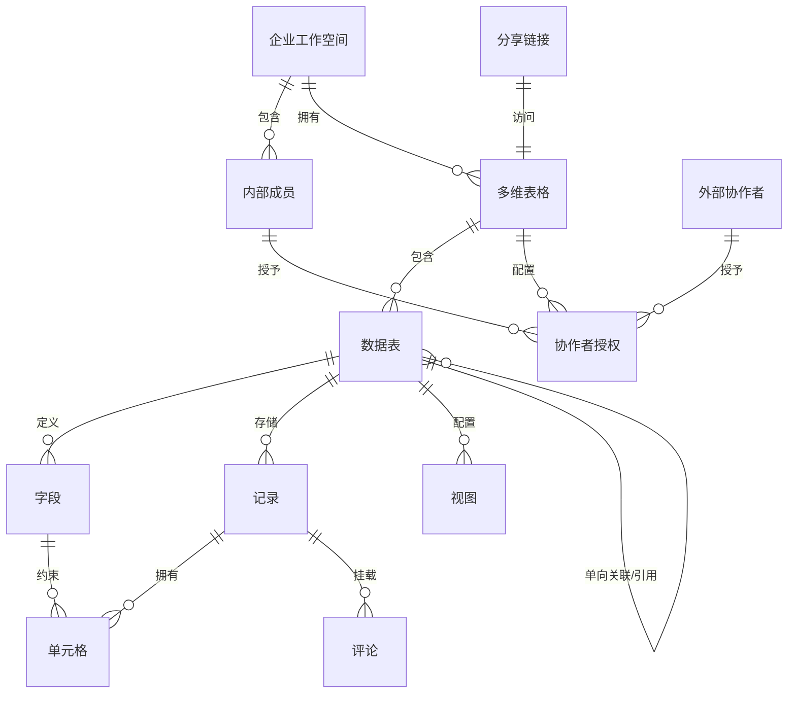

# 协作多维表格（代号）产品需求文档（PRD）

| 项目 | 内容 |
|---|---|
| 文档名称 | 协作多维表格（代号）产品需求文档 |
| 文档版本 | v1.3（评审稿） |
| 产品形态 | 个人试运行项目：单机自托管（一台阿里云轻量应用服务器、公网 IP 直连、无域名），逻辑多租户；桌面 Web 为主、移动端浏览器适配 |
| 目标客户 | 设计上面向中小企业（SMB）团队；当前仅作个人测试运行，不公开商业运营 |
| 文档范围 | P0（MVP）完整需求 + P1 概要规划 |
| 状态 | 待评审 |
| v1.1 更新 | 落实三项评审决策：外部链接权限收紧（D12/D13）、单选/多选选项新建开关（D14）、P1 表单与「可填写」角色边界（D15） |
| v1.2 更新 | 移除手机号与邮箱全部通道（D16–D18）、确认单企业永久模型（D23）；明确单机试运行与零外部付费依赖约束（D19）；落实容量基线、附件黑名单、注销、链接治理、操作审计（D20–D22、D24） |
| v1.3 更新 | 按 demo 试运行定位落实评审意见：外部显式授权封顶「可编辑」（D25）、反滥用加固（D26）、运营者应急通道（D27）、离线只读模型（D28）、移动端降为查看+评论（D29）；单条删除入审计（FR-01-5）、补充 Lookup 可见性规则（FR-03-5/6）、明示「禁导出为威慑非安全边界」（D13/4.2/4.4/FR-11-2）、落地非 80/443 端口与注册开关等运营守则（8.1）；**传输加密不做（维持明文 HTTP 已知风险）、公式函数 26 个全保留** |

> 标注约定：`[TBD]` 表示尚待业务/技术确认的决策；`[假设值，TBD]` 表示本文档先给出建议默认值，评审时可调整；`[已确认]` 表示已按《参数决定表 v0.1》采纳默认值。

---

## 0. 关键决策记录

| 编号 | 决策项 | 结论 |
|---|---|---|
| D1 | 版本分期 | 分 P0/P1 两期交付；**不规划 P2**（开放 API/Webhook、AI 字段、高级审计与水印等均不做） |
| D2 | 部署形态（v1.2 修订） | **单机自托管试运行**：部署于一台阿里云轻量应用服务器，全部应用、数据与文件在同一台机器；通过公网 IP 直连访问，**不申请域名、不做 ICP 备案、不引入任何需付费或企业资质的外部服务**；逻辑上保留企业间多租户隔离；不做产品化私有化交付、不公开商业运营 |
| D3 | 目标客户 | 产品设计按中小企业团队（约 20–500 人规模）的协作与业务管理场景展开 |
| D4 | 账号体系（v1.2 修订） | 完全自建：**仅用户名 + 密码**注册登录；无手机号、无邮箱、无任何第三方登录；自建企业与成员体系 |
| D5 | 商业化 | 不涉及套餐、席位、配额与计费设计；试运行期不收费 |
| D6 | 终端策略（v1.3 修订） | P0 支持桌面端 Web（完整功能）+ 移动端浏览器（查看、评论与通知，不做编辑），不做原生 App（见 D29） |
| D7 | 外部协作（v1.2 修订） | 允许非本企业成员访问被分享表格；其身份为**已注册产品账号但不属于本企业的用户（外部协作者）**，凭账号登录获得身份，无需手机/邮箱验证 |
| D8 | 数据迁入迁出 | P0 支持 .xlsx/.csv 导入（识别字段与类型）、当前视图导出 .xlsx/.csv |
| D9 | 建表起点 | P0 仅空白多维表格；P1 提供官方模板中心 |
| D10 | 通知触达（v1.2 修订） | **仅站内通知中心**；无邮件、无短信、无 IM、无任何站外触达 |
| D11 | 产品命名 | 暂称「协作多维表格（代号）」 |
| D12（v1.1） | 外部链接权限 | 「任何人获得链接」的链接角色**仅限可查看 / 可填写**，不提供可编辑；外部人员需要编辑权时由管理者定向邀请 |
| D13（v1.1，v1.3 修订） | 外部导出与熔断 | **外部协作者一律禁止导出**，无论其角色来源（即使被显式授予可编辑，见 D25）；该限制为**行为威慑与合规标记**，非技术防泄漏边界（如复制粘贴仍可带走所见数据）；管理者关闭链接或缩小分享范围后，外部会话在 1 分钟内失效 |
| D14（v1.1） | 选项治理 | 单选/多选字段提供「允许编辑者在录入时添加新选项」开关，**默认关闭**；「可填写」角色任何情况下均不可新建选项；P1 提供选项合并能力 |
| D15（v1.1） | 表单定位 | P1 表单与 P0「可填写」网格协作**长期并存、非替代关系**；表单为独立分享单元，支持「需登录身份 / 匿名提交」两种模式，上线时分享弹窗按「邀请协作 / 表单收集」分区 |
| D16（v1.2，v1.3 修订） | 账号规则 | 用户名全局唯一、注册后不可修改；**P0 不提供密码找回，遗忘密码即账号废弃**，试运行期除运营者应急人工重置（见 D27）外无人工重置通道；修改密码须凭旧密码 |
| D17（v1.2） | 邀请方式 | 内部成员邀请改为**管理员按用户名添加**：对方登录后在首页接受/拒绝；已属于其他企业的用户名不可添加；外部协作者同理按用户名显式添加 |
| D18（v1.2） | 注册归属 | 注册存在三条路径：有待接受企业邀请的用户名注册后直接加入该企业；持有效「任何人」链接注册成为无企业归属账号；无邀请的站点直接注册必须同时创建企业 |
| D19（v1.2，v1.3 修订） | 试运行与反滥用 | 零外部付费/资质依赖；**不接入图形/行为验证码等第三方风控，仅以容量配额 + 登录失败锁定 + IP 级限速 + 注册开关约束滥用**（见 D26）；尽力服务、无 SLA、无备份承诺，界面展示试运行声明 |
| D20（v1.2） | 容量基线 | 单表 ≤ 50,000 行、单 Base ≤ 50 张表、单表 ≤ 100 字段、单 Base ≥ 50 人同时在线为设计目标（单机性能需实测）；操作历史 90 天、通知 90 天、操作审计 180 天 |
| D21（v1.2） | 附件治理 | 单文件 ≤ 20MB、单记录 ≤ 10 个；全站共享附件池 ≤ 5GB `[假设值，TBD，取决于服务器磁盘]`；维护可执行/脚本类扩展名 + MIME 黑名单；压缩包允许上传但不做解压查杀，下载页提示风险 |
| D22（v1.2） | 注销 | P0 不开放企业自助解散，由所有者联系运营者人工受理并设 30 天只读冷静期；个人账号支持自助注销，7 天冷静期，其资产先按离职规则交接 |
| D23（v1.2） | 单企业永久模型 | **一个账号最多属于一个企业，且永久不支持加入多家企业/切换企业**；被移除后仅可重新加入原企业，加入其他企业需另行注册账号；架构不做多企业预留 |
| D24（v1.2） | 链接治理与审计 | 链接关闭后重开沿用原 URL，另提供「重置链接」生成新 URL、旧链立即作废；**企业管理员可强制关闭任意「任何人」外部链接（P0）**；动作级操作审计仅所有者/管理员可见，保留 180 天 |
| D25（v1.3） | 外部显式授权封顶 | 外部协作者经定向邀请获得的显式角色**上限为「可编辑」**，任何情况下不可授予「可管理」；链接角色不受影响（「任何人」链接本就仅 可查看/可填写） |
| D26（v1.3） | 反滥用加固 | 登录失败锁定改为**「用户名 + IP」联合计次**，防止他人用错误密码锁死指定账号；注册、登录、记录提交、评论与@ 按 **IP 限速**（本地内存级计数即可）；运营者可随时通过本地配置**关闭公开注册**（已注册账号登录不受影响；关闭后「任何人」链接仅已登录账号可进入）；仍不接入任何验证码 |
| D27（v1.3） | 运营者应急通道 | 试运行期**仅运营者本人**可人工重置任意账号密码、代执行企业所有者身份转移（用于所有者遗忘密码等死锁场景）；每次动作记录时间/对象/结果，进入操作审计（FR-01-5） |
| D28（v1.3） | 离线模型 | P0 离线行为定为**离线只读**：断网时仅可浏览已加载数据、不产生新编辑；断网前已提交未送达的编辑在本地排队，恢复后自动重传，冲突按 FR-06-3 处理（修订 2.2 恢复路径与 FR-06-4） |
| D29（v1.3） | 移动端范围修订 | P0 移动端浏览器仅为**查看、评论与通知**，不提供新增/编辑记录等写操作（可填写者的填报在桌面端完成）；修订 D6、2.1、3.4 与 FR-12 |

---

## 1. 背景与目标

### 1.1 背景与问题

中小企业的大量业务数据仍以三种方式管理：

1. **本地 Excel/WPS 文件**：通过微信/邮件传来传去，存在多版本冲突、无法并行编辑、数据易覆盖丢失、外出无法访问等问题；
2. **传统电子表格在线化产品**：以单元格为中心，缺少字段类型约束、关联关系、视图、记录级权限，业务人员难以把它当作「轻量业务系统」使用；
3. **重型 IT 系统（CRM/ERP/项目管理系统）**：实施成本高、调整不灵活，中小企业大量长尾场景（排期、台账、信息收集、内容日历、招聘管理等）没有合适工具承接。

团队真正需要的是一种**以结构化数据为中心、业务人员可自行搭建、支持多人实时协作、可按角色控制访问范围**的在线数据工具。

### 1.2 产品定位

面向中小企业的**在线多人协作多维表格**：业务人员无需写代码，即可在数分钟内搭建结构化数据表格，并与团队成员（及必要时的外部客户/供应商）实时协作、按需组织视图、控制数据访问范围，并能方便地迁入和导出 Excel 数据。

> **运营形态说明（v1.2）**：当前为个人试运行版本，部署于单台云服务器、通过公网 IP 访问（无域名），不申请 ICP 备案、不引入任何需付费或企业资质的外部服务，不承诺可用性 SLA 与数据备份。产品能力设计仍按中小企业团队协作场景展开，详见第 8 章试运行约束。

### 1.3 目标用户与典型场景

| 用户 | 使用诉求 | 典型场景 |
|---|---|---|
| 团队负责人 / 业务搭建者 | 快速搭建业务表、控制谁能看改、汇总查看 | 项目进度管理、销售线索跟进、招聘看板、内容排期 |
| 团队执行成员 | 方便地录入、更新自己负责的数据，收到协作提醒 | 更新任务状态、登记客户信息、提交周报数据 |
| 外部人员（客户/供应商/候选人） | 用一个轻量账号（用户名注册、无需加入企业）登录后，通过链接填报或查看指定内容 | 供应商报名、客户信息收集、候选人信息登记 |
| 企业管理员 | 管理成员账号，处理人员离职与数据交接 | 邀请/停用成员、离职成员表格资产交接 |

### 1.4 产品目标（可观察的结果）

P0 上线后，应可观察到以下结果：

- 业务人员可在无培训/少量帮助的情况下，从空白表格完成字段搭建并录入数据；
- 多个成员同时编辑同一表格时，彼此的修改在正常网络下秒级可见，且不发生数据静默覆盖丢失；
- 表格所有者能通过角色与链接精确控制访问范围，外部人员只能访问被显式分享的表格；
- 错误修改可通过记录级操作历史被发现并回滚；
- 存量 Excel 用户可通过导入完成迁移，并可随时将数据导出为 Excel，不被产品锁定。

### 1.5 产品契约

| 要素 | 定义 |
|---|---|
| 主要用户 | 需要共同维护结构化业务数据的中小企业团队 |
| 触发点 | 团队产生一项需要多人共同维护、跟踪、汇总的数据管理任务 |
| 核心任务 | 搭建多维表格 → 邀请协作者 → 多人实时录入与更新 → 按视图查看与协作沟通 → 管控权限 → 导出/沉淀数据 |
| 完成条件 | 被邀请者通过链接进入表格，在其权限范围内完成操作并实时看到彼此修改；管理者可随时调整权限、追溯与回滚修改 |
| 信任基础 | 权限服务端强制生效；编辑不丢失、冲突可感知；删除有确认、修改有历史；数据可导出 |

---

## 2. 范围

### 2.1 版本路线总览

#### P0（MVP）：最小可用闭环

| 模块 | P0 内容 |
|---|---|
| 账号与企业 | 用户名+密码注册登录（无手机/邮箱）、创建企业、按用户名邀请与停用成员、企业管理（资产交接、操作审计） |
| 表格核心 | 多维表格（Base）、多张数据表、字段管理、记录增删改查、展开记录 |
| 字段类型 | 多行文本、数字、单选、多选、日期、人员、附件、超链接、公式、单向关联、引用（Lookup） |
| 视图 | 表格视图；多视图保存；筛选、排序、分组、字段显隐、冻结列、行高 |
| 实时协作 | 在线成员、实时光标/选区、自动保存、离线提示与重连、同单元冲突处理 |
| 沟通 | 记录级评论、@提醒、回复、解决评论 |
| 通知 | 仅站内通知中心（无邮件/短信等站外触达） |
| 权限与分享 | 四级角色（可管理/可编辑/可填写/可查看）、成员邀请、链接分享（企业内/任何人）、外部协作者 |
| 安全与恢复 | 记录级操作历史（字段级 before/after、回滚）、删除即时撤销 |
| 数据迁移 | .xlsx/.csv 导入（预览、字段识别、错误报告）；视图导出 .xlsx/.csv |
| 终端 | 桌面 Web 完整功能；移动端浏览器仅查看、评论与通知（见 D29） |

#### P1：能力增强（概要需求见第 6 章）

视图扩展（看板/画册/日历/甘特/表单）、仪表盘、自动化流程、模板中心、回收站、字段权限与锁定视图、高级字段类型、部门与用户组、分享链接安全增强、全局记录搜索等。

#### 明确不做（本期及 P1 均不包含）

- 开放平台（OpenAPI、Webhook、第三方集成市场）；
- AI 能力（智能字段、AI 生成/总结等）；
- 原生移动 App、桌面客户端；
- 产品化私有化/专有云交付（当前单机部署仅为试运行运营方式，不作为交付产品）；
- 手机号/邮箱注册登录、验证码登录及邮件/短信等任何站外通知通道；第三方账号登录（飞书/钉钉/企业微信等）；
- 一个账号加入多家企业、企业切换；
- 高级安全审计、数据水印；
- 套餐、计费、支付与订阅；
- 工作流审批、IM 聊天等非表格能力。

### 2.2 P0 最小完整用户旅程

**主旅程（内部协作）**

1. 创建者用用户名+密码注册账号并创建企业工作空间；
2. 新建空白多维表格，创建若干数据表与字段（或从 .xlsx 导入）；
3. 通过用户名添加内部成员（对方登录后接受邀请），或开启企业内链接分享；
4. 成员进入表格，实时新增/编辑记录、切换视图、筛选排序；
5. 在记录上评论并 @ 同事，对方在站内通知中心收到提醒并跳转处理；
6. 发现错误修改时，通过记录操作历史查看并回滚；
7. 需要对外交付时，将当前视图导出为 Excel。

**外部数据收集旅程**

1. 管理者开启「任何人获得链接 → 可填写」分享，复制链接发给客户；
2. 客户在浏览器打开链接，登录已有账号，或用用户名+密码即时注册（无需创建企业、无需加入企业）；
3. 客户新增记录，仅能看到和继续编辑自己提交的记录；
4. 管理者在同一张表中实时看到所有外部提交，并可内部继续协作。

**恢复路径（最重要的失败场景）**

- 误删记录：删除后出现即时撤销提示；已确认的历史误改通过操作时间线定位并回滚；
- 断网：进入离线只读状态（已加载数据可继续浏览）；断网前未送达的编辑在本地排队，恢复网络后自动重传，冲突时显式提示用户选择（见 D28）。

### 2.3 入口与完成证据

| 项 | 内容 |
|---|---|
| 入口条件 | 用户拥有账号并已登录；或持有有效的分享链接（未登录时引导登录/注册） |
| 完成证据（内部） | 表格中出现协作数据，在线成员头像实时更新，被@人收到通知，修改可在历史中追溯 |
| 完成证据（外部） | 外部提交的记录实时出现在管理者表格中，且外部人员看不到他人数据 |

---

## 3. 产品模型

### 3.1 核心对象定义

| 对象 | 定义 | 关键规则 |
|---|---|---|
| 产品账号 | 以用户名 + 密码注册的全局登录身份 | 用户名全局唯一、注册后不可改；账号可以归属 0 或 1 个企业（永久不支持多企业，见 D23）；无企业归属的账号可作为外部协作者 |
| 企业工作空间 | 租户边界，数据隔离单位 | 一个账号最多属于一个企业；企业间数据完全隔离；直接注册站点时自动创建 |
| 内部成员 | 企业内账号，角色为所有者/管理员/成员 | 经用户名邀请并接受后入企；可被邀请为任意多维表格的协作者 |
| 外部协作者 | 不属于本企业的已登录账号（含无企业归属账号、其他企业的账号） | 不占用企业成员席位，不能浏览企业信息，仅能访问被显式分享或开放链接的 Base |
| 多维表格（Base） | 一个独立协作文档，包含若干数据表 | Base 是分享、权限配置、收藏、删除的单位 |
| 数据表（Table） | Base 内的一张结构化表 | 一个 Base 可含多张数据表，通过标签页切换；表间可建立关联 |
| 字段（Field） | 列，含名称、类型与配置 | 第一张表第一列固定为「主字段」 |
| 记录（Record） | 行，一条业务数据 | 是评论与操作历史的挂载对象 |
| 单元格（Cell） | 一条记录在某个字段上的值 | 实时协作的最小合并单元 |
| 视图（View） | 同一批数据的一种展示与组织配置 | P0 仅表格视图；视图配置包括筛选/排序/分组/显隐/冻结/行高 |
| 评论（Comment） | 挂在记录上的协作讨论，支持回复与@ | 拥有该 Base 访问权（含可查看）即可评论 |
| 分享链接（ShareLink） | 用于非定向邀请访问 Base 的链接 | 含「分享范围 + 链接角色」两项配置，可随时关闭 |

### 3.2 对象关系



### 3.3 信息架构

```text
登录/注册
├─ 无企业归属账号（外部协作者）
│  └─ 外部首页（仅「与我共享」+ 待处理企业邀请 + 通知中心，不能新建 Base）
└─ 企业工作空间（内部成员）
   ├─ 首页（最近访问 / 我创建的 / 与我共享）
   │   └─ 多维表格（Base）
   │       ├─ 数据表标签页（Table A / Table B / +）
   │       ├─ 视图标签页（视图1 / 视图2 / +）
   │       ├─ 记录展开面板（字段值 + 评论）
   │       └─ 分享与权限设置弹窗
   ├─ 通知中心（含企业邀请待办）
   └─ 企业管理（仅所有者/管理员：成员管理、表格资产、对外分享清单、操作记录、企业设置）
```

### 3.4 主要界面布局

**Base 工作台（桌面端）**

```text
┌──────────────────────────────────────────────────────────────┐
│ [Base 名称]          保存状态     [协作者头像组] [分享] [更多▾] │ 顶栏
├──────────────────────────────────────────────────────────────┤
│ 数据表: 表1 ▾  表2  +          │ 视图: 视图1 ▾ 视图2 +  筛选 排序 分组 显隐 │
├──────────────────────────────────────────────────────────────┤
│ ☐ │主字段（冻结）│ 字段A │ 字段B │ 字段C │ ...                 │
│ ☐ │ REC-001     │       │       │       │                     │
│ ☐ │ REC-002     │       │       │       │                     │
│ └─ 分组/统计行（分组时）                                      │
│ [+ 新增记录]                                                 │
└──────────────────────────────────────────────────────────────┘
```

**展开记录面板（右侧抽屉）**

```text
┌─ 记录详情 ───────────────┐
│ 主字段值（可编辑）        │
│ ───────────────          │
│ 字段A：[编辑控件]         │
│ 字段B：[编辑控件]         │
│ ...（含视图隐藏字段）      │
│ ───────────────          │
│ 评论区                   │
│ [输入框，支持 @]          │
│ └ 评论1 / 回复 / 解决     │
│ [◀ 上一条 | 下一条 ▶]    │
└──────────────────────────┘
```

**移动端浏览器**：记录以宽列表/卡片流纵向排列，点击进入记录详情页查看与评论（无编辑能力，见 D29）；顶部为视图切换入口；不展示字段配置等结构性操作入口。

---

## 4. 角色与权限模型

### 4.1 企业级角色

| 企业角色 | 人数 | 权限 |
|---|---|---|
| 所有者 | 唯一 1 人 | 全部企业管理权限；可转移所有者身份；**P0 不提供自助解散企业入口**，解散需联系运营者人工受理（见 FR-01-4） |
| 管理员 | 不限 | 邀请/停用成员、调整成员角色、查看企业内全部 Base 清单（名称/创建人）、转移 Base 所有权、删除任意 Base、查看对外分享清单并强制关闭外部链接；不默认获得 Base 内容编辑权 |
| 成员 | 不限 | 登录使用；仅能看到显式分享给自己或自己创建的 Base |

成员状态：`待接受（已按用户名发起邀请，等待对方注册并接受）→ 已激活 → 已停用`。停用后立即失去全部访问权，其名下 Base 自动转移给企业所有者；被移除/停用后仅可重新加入原企业，不能加入其他企业（见 D23）。

### 4.2 Base 级四级角色与权限矩阵

| 操作能力 | 可管理 | 可编辑 | 可填写 | 可查看 |
|---|---|---|---|---|
| 查看记录（权限范围内，见下注） | ✅ | ✅ | 仅自己创建的记录 | ✅ 全部 |
| 新增记录 | ✅ | ✅ | ✅ | ❌ |
| 编辑记录 | ✅ | ✅ 全部 | 仅自己创建的记录 | ❌ |
| 删除记录 | ✅ | ✅ | ❌ | ❌ |
| 复制/粘贴（单元格级；二维区域粘贴与拖拽填充为 P1） | ✅ | ✅ | 仅新增行 | ❌ |
| 创建/编辑/删除视图配置 | ✅ | ✅ | ❌（可切换已有视图） | ❌（可切换） |
| 评论、回复、@ | ✅ | ✅ | ✅（自己可见的记录上） | ✅ |
| 新增/修改/删除字段 | ✅ | ❌ | ❌ | ❌ |
| 新增/复制/删除/重命名数据表 | ✅ | ❌ | ❌ | ❌ |
| 导入 Excel/CSV（改变结构） | ✅ | ❌ | ❌ | ❌ |
| 导出当前视图（仅内部成员，见注 4） | ✅ | ✅ | ❌ | ❌ |
| 查看记录操作历史 | ✅ | ✅ | 仅自己创建的记录 | ❌ |
| 回滚字段历史值 | ✅ | ✅ | 自己创建记录上 | ❌ |
| 管理协作者、修改分享设置 | ✅ | ❌ | ❌ | ❌ |
| 重命名/复制/删除 Base | ✅ | ❌ | ❌ | ❌ |

注：

1. **「可填写」的完整定义**：可以新增记录；仅可查看与继续编辑**本人创建**的记录（判定依据为记录创建人身份）；不可删除记录、不可看到他人记录、不可导出、不可改结构与视图配置。该角色面向外部填报，也可对内部成员使用。
2. Base 的创建者自动获得「可管理」。一个用户在同一 Base 上只有一个有效角色，取**显式授权与链接角色中的较高权限**（判定规则见 4.5）。
3. 所有权限以服务端校验为准，前端隐藏入口仅为体验优化，不作为安全边界。
4. **导出能力仅对内部成员开放**：外部协作者无论通过链接还是显式邀请获得角色（即使被显式授予可编辑），一律不可导出；其界面不出现导出入口，服务端对导出请求按「内部成员」身份二次校验（见 D13）。该限制为**行为威慑与合规标记，非技术防泄漏边界**（如复制粘贴、展开查看仍可带走所见数据）。

### 4.3 链接分享

| 配置项 | 可选值 |
|---|---|
| 分享范围 | ① 关闭链接分享；② 企业内获得链接的人；③ 任何人获得链接（含外部人员） |
| 链接角色（范围②企业内） | 可查看 / 可填写 / 可编辑（链接**不可**授予「可管理」） |
| 链接角色（范围③任何人） | **仅可查看 / 可填写**（见 D12）；外部人员需要编辑权时，由可管理者通过用户名定向邀请为显式协作者（显式角色上限「可编辑」，见 D25） |
| 链接状态 | 开启中 / 已关闭；关闭后旧链接立即失效，**已建立的外部会话在 1 分钟内全部失效**（见 D13）；关闭后重新开启**沿用原 URL**；可随时点「重置链接」生成新 URL，旧 URL 立即作废（见 D24） |

- 范围②要求访问者已登录为本企业成员，否则引导登录；
- 范围③要求访问者**登录产品账号**（无账号可在跳转页用用户名+密码即时注册，成为无企业归属账号；运营者关闭注册开关期间，未登录访问提示「当前未开放新注册」，见 D26）；登录态即其身份，用于标识记录创建人与站内通知送达；范围③不提供可编辑选项；
- 分享范围由③改为②或①时，存量外部协作者立即失去访问权（页面侧 1 分钟内完成会话失效），其已创建的记录保留；
- 「可管理」角色才能修改分享设置、复制链接、重置链接、关闭分享；企业管理员可在企业管理后台强制关闭（见 FR-01-2、FR-09-2）。

### 4.4 外部协作者规则

1. 外部协作者是已登录的产品账号，但不属于本企业：可以是无企业归属账号，也可以是其他企业的成员账号；不接触本企业通讯录与其他 Base；
2. 一个账号在同一 Base 的身份唯一，权限来源为链接角色或被显式添加的 Base 角色；外部协作者的显式角色上限为「可编辑」，任何情况下不可授予「可管理」（见 D25）；
3. 外部协作者可在「人员」字段中被选择（仅限其已有访问权的 Base）；
4. 外部协作者收到的 @ 与回复仅进其站内通知中心：在线时即时可见，离线时在其下次登录后可见；
5. 当链接范围由「任何人」改为「企业内」或关闭时，外部协作者立即失去访问权（已建立会话 1 分钟内失效）；已由其创建的记录保留在表中，创建人信息保留显示；
6. **外部协作者一律不可导出数据**，无论角色来自链接还是显式邀请（见 D13、4.2 注 4）；该限制为行为威慑与合规标记，非技术防泄漏边界；
7. 无企业归属账号可通过企业邀请加入**一个**企业（接受后成为内部成员）；已属于其他企业的账号不能再加入本企业（见 D23）；
8. P1 表单上线后，「外部协作者 + 可填写」模型继续保留，不做权限迁移或废弃；一次性、匿名化的外部采集改由表单承担（见 D15、第 6 章）。

### 4.5 权限判定规则

```text
访问者打开 Base
  ├─ 未登录 → 登录/注册页（持「任何人」链接注册的账号不创建企业，直接回到该 Base）
  └─ 已登录
       ├─ 本企业「已激活」成员
       │    → 取「显式协作者角色」与「企业内链接角色」中较高者；两者皆无则拒绝
       └─ 非本企业成员（外部账号）
            ├─ 有显式 Base 授权 → 取显式角色
            ├─ 无显式授权但链接范围为「任何人」→ 取链接角色（仅可查看/可填写）
            └─ 皆无 → 展示「无访问权限」页（访问申请流程为 P1）
```

所有数据写操作（新增/编辑/删除/结构变更/导出）在服务端按最终角色与行级范围（可填写）二次校验，越权请求返回明确错误且不落库。

---

## 5. 功能需求（P0）

### FR-01 账号、企业与成员管理

**目的**：建立租户边界与可信身份，支撑后续一切协作与权限行为。

#### FR-01-1 注册与登录

| 项 | 规则 |
|---|---|
| 触发 | 未登录用户访问站点或打开受保护链接 |
| 凭据 | 仅**用户名 + 密码**；无手机号、邮箱、验证码及第三方登录 |
| 用户名规则 | 4–20 位，字母开头，仅含字母/数字/下划线；全局唯一（忽略大小写判定）；**注册后不可修改**；显示名可随时修改 |
| 密码规则 | 8–32 位，须含字母与数字；加盐哈希存储，不明文保存 |
| 注册路径与企业归属（见 D18） | ① 该用户名**存在待接受的企业邀请**：注册成功后不创建企业，登录后在首页接受邀请加入企业；② 持有效「任何人」分享链接进入注册：创建**无企业归属账号**，注册后直接回到该 Base；③ 站点直接注册（无邀请）：必须同时填写企业名称（2–30 字）创建企业，创建人为所有者。运营者可随时关闭公开注册（注册开关，见 D26）：关闭后仅路径①可注册，路径②未登录访问提示「当前未开放新注册」，路径③不再提供注册入口，已注册账号登录与使用不受影响 |
| 登录方式 | 用户名 + 密码；登录态保持 30 天 `[已确认]`，可手动退出；多设备登录不踢线 `[已确认]` |
| 找回密码 | **不提供**。遗忘密码即账号废弃，试运行期除**运营者应急人工重置**（仅运营者本人可执行，动作进入审计，见 D27）外无人工重置通道；注册成功页与登录页须显著提示该规则 |
| 修改密码 | 登录后在个人设置中凭旧密码修改 |
| 无企业账号限制 | 首页仅显示「与我共享」Base、待处理企业邀请、通知中心；不能新建 Base/企业；接受企业邀请后转为内部成员 |
| 异常 | 用户名已存在 → 提示直接登录；同一「用户名 + IP」组合连续输错密码 5 次锁定 15 分钟（联合计次，防止他人用错误密码锁死账号，见 D26）；注册、登录、记录提交、评论与@ 按 IP 全局限速（见 7.5）；不接入验证码类风控（见 8.1） |

#### FR-01-2 成员管理（企业管理后台）

| 功能 | 规则 |
|---|---|
| 邀请成员 | 管理员/所有者输入用户名发起邀请（可逐个添加）；被邀请用户名出现在列表，状态「待接受」：已注册账号在其首页/通知中收到邀请，可接受或拒绝；尚未注册的用户名可先占邀，对方按路径①注册后收到邀请；接受后角色为成员。已属于其他企业的用户名不可添加并明确提示（见 D23） |
| 邀请撤回 | 邀请可随时撤回，撤回后对方首页待办消失；对方已接受则不适用撤回，改用停用 |
| 角色调整 | 可将成员调整为管理员/成员；所有者身份唯一，转移需二次确认 |
| 停用成员 | 二次确认；停用后立即失去全部访问权；其创建的 Base 自动归属企业所有者；可在成员列表恢复启用（恢复后重新加入原企业） |
| 成员列表 | 展示用户名、显示名、角色、状态、加入时间；仅所有者/管理员可见 |
| 对外分享管控 | 所有者/管理员可查看本企业全部处于「任何人」开放状态的 Base 清单（Base 名、可管理者、开放角色、开启时间），并可**强制关闭**任一外部链接（无需该 Base 协作角色）；关闭时向该 Base 可管理者发站内通知，动作进入操作审计（见 FR-01-5、D24） |

#### FR-01-3 个人设置

- 维护头像、显示名（企业内外展示用，1–20 字符）；
- 凭旧密码修改密码；
- 申请注销账号（规则见 FR-01-4）；
- 退出登录。

#### FR-01-4 账号注销与企业解散

| 场景 | 规则 |
|---|---|
| 个人账号注销 | 设置内自助申请 → **7 天冷静期**（期间可随时撤回）→ 到期执行：删除登录凭据与个人资料（显示名、头像）；账号名下若有企业内 Base，按离职规则先归属企业所有者；无企业账号在各 Base 的显式授权失效，其创建的记录与评论保留，创建人统一显示为「已注销账号（用户名）」；注销不可恢复 |
| 企业解散 | **P0 不提供自助入口**。所有者在企业设置中看到「如需注销企业，请联系运营者」；由运营者人工核验：所有者身份、企业内无其他已激活成员（或已全部停用/移除）、无未结争议；受理后企业进入 30 天「待注销」只读冷静期（所有者可撤回、可继续导出）；到期删除全部 Base、附件、评论、历史与审计记录；运营者通过站内公告/登录页通知完成状态 `[TBD：试运行期通知方式]` |

#### FR-01-5 操作审计

| 项 | 规则 |
|---|---|
| 记录事件（动作级） | 数据导出（操作人、时间、Base/数据表/视图名、格式、记录条数）、数据导入（操作人、时间、文件名、成功/失败行数）、Base/数据表删除、**记录删除（含单条与批量，操作人、时间、对象名、条数）**、外部链接被强制关闭、成员停用/启用、所有者转移（含运营者代转移，见 D27）、运营者应急重置密码、Base 所有权管理员接管/删除、运营者受理企业解散（D22）、注册开关切换（D26） |
| 不记录 | 表格具体内容、单元格数据 |
| 可见范围 | 仅企业所有者/管理员，在企业管理后台「操作记录」页查看；普通成员与外部协作者不可见；审计记录不可被管理员删除 |
| 保留与导出 | 保留 180 天 `[已确认]`；支持按操作人/时间筛选，并可导出为 CSV（仅审计信息，不含业务数据） |

**异常**：企业名称 2–30 字；停用自己、降级自己、停用/转移最后一个所有者的操作均禁止并解释原因；所有者转移前须先指定继任者。

---

### FR-02 首页与多维表格管理

**目的**：提供工作入口与 Base 资产管理。

#### FR-02-1 首页

| 区域 | 规则 |
|---|---|
| 新建 | 首页主按钮「新建空白多维表格」，点击后进入新 Base，默认含 1 张数据表、3 个默认字段（主字段+2 个文本字段）`[已确认]` |
| 列表分组 | 「最近访问」（按最后访问时间倒序，最多 50 个）、「我创建的」、「与我共享」 |
| 列表项 | Base 名称、数据表数量、我的角色、最后修改时间、修改人；支持星标置顶 |
| 搜索 | P0 仅支持按 Base 名称搜索（记录内容搜索为 P1） |
| 空状态 | 新用户展示新建引导与一段 30 秒产品说明动图/图文 `[形式 TBD]` |
| 企业邀请待办 | 被按用户名邀请但尚未接受的成员，首页顶部展示「XX 企业邀请你加入」卡片，可接受/拒绝；拒绝后该邀请作废 |

**无企业归属账号首页（外部协作者）**：不展示新建入口与企业管理，仅含「与我共享」Base 列表、企业邀请待办卡片、通知中心；接受企业邀请后整体切换为企业工作空间界面。

#### FR-02-2 Base 操作

| 操作 | 规则 |
|---|---|
| 重命名 | 可管理；顶栏名称就地编辑，实时保存 |
| 复制 Base | 可管理；在同一企业内生成副本（含全部表结构、数据、视图、选项颜色），评论与操作历史不复制；副本命名「原名称 的副本」 |
| 删除 Base | 可管理；弹窗二次确认，明确告知「删除后所有协作者立即不可访问，P0 版本不可恢复」；删除后跳转首页 |
| 管理员接管 | 企业管理员可在后台将任意 Base 所有权转移给其他成员或删除（用于离职交接），操作记录在企业管理页留痕 |
| 访问控制 | 无权限用户不出现该 Base；直接访问 URL 展示无权限页 |

---

### FR-03 数据表与字段管理

**目的**：让业务人员定义数据结构，并获得类型约束与结构化录入体验。

#### FR-03-1 数据表管理

- Base 内以底部（或顶部）标签页切换数据表；
- 可管理角色可：新增数据表、重命名、复制表（复制结构+数据+该表视图，不复制评论）、删除表（二次确认，Base 内最后一张表不可删除）；
- 每张表在标签页上显示未保存修改的轻微状态（保存机制见 FR-06）。

#### FR-03-2 字段通用规则

1. 每张表第一列为**主字段**：不可删除、不可隐藏、不可拖动换位；可改名为业务含义（如「任务名称」）；P0 主字段允许类型：多行文本、数字、单选、公式；主字段值作为关联字段与引用中的显示值。
2. 新增字段：点击末列「＋」，选择类型、填写名称（同表内字段名不可重名，忽略首尾空格）、完成类型配置后生效。
3. 字段操作：重命名、改类型（走 7.1 转换规则）、复制字段（复制配置不复制数据）、删除字段（二次确认，警告数据与相关公式/引用将失效）。
4. 字段宽度可拖拽调整；字段描述（hover 字段名显示说明文本）P0 支持，便于 toB 团队约定口径。
5. 单表字段数上限 100 `[假设值，TBD]`。

#### FR-03-3 P0 字段类型规格

| 字段类型 | 配置项 | 存储/显示与录入规则 |
|---|---|---|
| 多行文本 | — | 最长 10,000 字符 `[已确认]`；支持换行；记录列表中单行省略，hover/展开查看全文 |
| 数字 | 格式：整数/保留 n 位小数（0–4）/百分比/货币（¥、$、€、£ 可选）；千分位开关 | 非法字符不可录入；超精度按四舍五入；空值与 0 区分显示 |
| 单选 | 选项列表、颜色（系统调色板自动分配，可改）；开关「允许编辑者在录入时添加新选项」（**默认关闭**，见 D14） | 下拉选择或搜索已有选项；开关开启时，可管理/可编辑在搜索无匹配时可直接新建选项（系统自动分配颜色；选项名去首尾空格、忽略大小写判重）；开关关闭时，无匹配结果提示「无匹配选项，请联系表格管理员添加」；**可填写角色在任何开关状态下均不可新建选项**；每行一个值 |
| 多选 | 同单选 | 可选中 0–N 个选项，以标签展示；可逐个移除；录入新建选项的规则同单选 |
| 日期 | 是否含时间；日期格式（YYYY/MM/DD、YYYY-MM-DD、YYYY年M月D日） | 日历选择器；支持键盘输入解析；最小值 1900-01-01 `[已确认]` |
| 人员 | 是否允许多选；可选范围=该 Base 全部协作者（含外部协作者） | 下拉按用户名/显示名搜索；选中后显示头像+显示名；被停用成员显示「已停用成员」置灰标签且不随人员选择器出现；已注销账号不可被选择 |
| 附件 | — | 单记录最多 10 个、单文件 ≤ 20MB；受全站共享附件池容量约束（见 7.3）；支持图片缩略图预览、原图查看、下载、重命名显示名、删除；上传经扩展名 + MIME 双校验黑名单拦截（见 D21），压缩包允许上传但不解压查杀，下载时提示「压缩包内容请自行确认安全」 |
| 超链接 | — | 值含「显示文本 + URL」；URL 必须为 http/https 开头，录入时自动补全 `https://`；列表显示文本，点击新窗口打开（编辑态下点击不跳转） |
| 公式 | 公式表达式 | 见 FR-03-4；只读、自动计算 |
| 单向关联 | 目标数据表（同 Base 内）、是否允许多条 | 见 FR-03-5 |
| 引用（Lookup） | 依赖的关联字段 + 被引用字段 | 见 FR-03-6；只读 |

#### FR-03-4 公式字段

- 通过 `{字段名}` 引用同一行其他字段；编辑时提供字段名与函数联想插入；
- P0 函数库（共 26 个函数，另含运算符 `&`）：
  - 逻辑：`IF` `AND` `OR` `NOT` `ISBLANK`
  - 数学：`SUM`（同行多字段相加）`AVERAGE` `MAX` `MIN` `ABS` `ROUND` `INT` `MOD`
  - 文本：`CONCATENATE`、`&`、`LEFT` `RIGHT` `MID` `LEN` `FIND` `SUBSTITUTE`
  - 日期：`TODAY` `NOW` `YEAR` `MONTH` `DAY` `DATEDIF`
- 校验：字段不存在、类型不匹配、除零、循环引用（含通过关联/引用形成的环）均不允许保存，光标定位到错误位置并说明原因；
- 计算失败的单元格显示 `#ERROR`，hover 显示原因（如「除数为空」）；
- 公式字段不参与手输，不能作为关联显示字段；其历史值随源字段变化重算。

#### FR-03-5 单向关联字段

- 配置时选择本 Base 内任意一张目标数据表；
- 录入：在下拉面板中搜索目标表主字段值，可选择一条或多条（按配置）；支持翻页（虚拟滚动）；
- 可见性：下拉候选与已选标签显示均受查看者对目标记录可见范围的约束，不可见的目标记录不进入候选（避免借关联泄露目标表信息）；
- 显示：已关联记录以标签展示主字段值，点击可跳转展开该目标记录；
- 一致性：目标记录被删除时，关联关系自动解除，本单元格相应变空（不级联删除任何数据）；目标主字段被修改时显示同步更新；
- 关联的建立/解除即普通单元格编辑，受编辑权限控制并进入操作历史。

#### FR-03-6 引用字段（Lookup）

- 必须基于本表一个已存在的关联字段，选择目标表的一个字段进行引用；
- 只读展示被关联记录的当前值，源值变更时自动刷新；多条关联时按顺序并列展示；
- 可见性：引用只渲染查看者对目标记录有可见权限的值，不可见目标记录对应的引用位置按空值显示，不借引用泄露目标表数据；
- 关联字段被删除时，依赖它的引用字段一并提示删除（确认后删除）；
- 引用值不可手动编辑、不可导出为可回填格式（导出时为当时的计算文本）。

#### FR-03-7 字段类型修改与选项维护

- 修改类型时按 7.1 转换规则预览影响（受影响记录数、将清空的值），需可管理角色确认后生效；
- 单选/多选选项：重命名即时同步全部记录；调整颜色仅展示变化；删除选项需二次确认，使用该选项的记录对应值清空；选项可拖拽排序；录入时能否新建选项受字段开关控制（默认关闭，规则见 FR-03-3）；对存量碎片选项的「选项合并」治理能力规划于 P1；
- 公式、引用、关联三类字段之间不允许互转，只能删除后新建。

---

### FR-04 记录编辑

**目的**：提供高效、可靠、可批量的结构化数据录入体验。

#### FR-04-1 基础编辑

| 能力 | 规则 |
|---|---|
| 新增记录 | 表尾「+ 新增记录」、最后一行按方向下键、快捷键；新增后焦点落到主字段 |
| 编辑 | 单击选中、双击/F2/回车进入编辑；回车提交并下移、Tab 提交并右移、Esc 取消本次编辑 |
| 复制粘贴 | 支持选区复制为 TSV；支持单元格级粘贴（单值/单行）；目标列为只读类型（公式/引用）时跳过并在粘贴后提示跳过格数；粘贴单选值匹配不到选项时该格置空并计入提示；Excel/Sheets 二维区域粘贴与按需自动新增行延期至 P1（见第 6 章） |
| 行操作 | 勾选一行或多行：删除（二次确认，删除动作进入企业操作审计，见 FR-01-5）、复制记录（含全部字段值，评论不复制） |
| 手动排序 | 无排序规则时可拖拽行调整顺序；存在排序/分组规则时禁止拖拽并提示「当前为排序视图」 |
| 撤销 | 支持撤销本人本次登录会话内的最近编辑操作（Ctrl/Cmd+Z）；刷新页面后不可撤销，跨会话纠错走操作历史 |
| 行高与换行 | 支持紧凑/中等/高三种行高（视图级配置）；长文本按行高截断显示 |

#### FR-04-2 展开记录

- 点击行首展开按钮打开右侧抽屉：按字段顺序展示并可编辑**全部字段**（含当前视图隐藏字段、公式/引用只读展示）、附件集中预览、评论区；
- 底部支持「上一条/下一条」按当前视图顺序切换；
- 展开状态下他人对该记录的修改实时刷新，正在编辑的字段如被他人先行提交，按 FR-06 冲突规则提示。

#### FR-04-3 删除与即时撤销

- 删除一条/多条记录后，页面底部出现提示「已删除 n 条记录」，保留「撤销」按钮 7 秒 `[已确认]`；
- 超过撤销窗口后，P0 不可恢复（完整回收站为 P1）；删除不写入任何剩余记录的操作历史；**单条与批量删除动作**（操作人、时间、对象、条数）均进入企业操作审计，仅所有者/管理员可查（见 FR-01-5）。

#### FR-04-4 校验与异常

- 必填：P0 不提供字段级必填配置 `[P1 随表单/字段权限一起提供]`；
- 各类型非法输入规则见 FR-03；所有提交失败（网络/权限/校验）时行内显示错误态，编辑内容不丢失；
- 单表记录数上限 50,000 行 `[假设值，TBD]`，达到上限后禁止新增并提示联系管理者。

---

### FR-05 表格视图

**目的**：同一份数据满足不同角色的查看与组织需要，且视图配置互不干扰数据本身。

#### FR-05-1 视图管理

- 每张表可创建多个视图，至少保留 1 个；默认创建「表格」视图；
- 可管理/可编辑可新建、重命名、复制、删除视图；视图对所有 Base 协作者可见（P0 无私有视图、无视图锁定，均为 P1）；
- 可填写/可查看可切换查看任意视图，但不能修改配置。

#### FR-05-2 视图配置项

| 配置 | P0 规则 |
|---|---|
| 字段显隐 | 可隐藏任意非主字段；隐藏不影响数据，仅影响展示与导出 |
| 字段顺序 | P0 不支持视图级独立排序：字段在表级有统一顺序（拖动列首修改表级顺序，对所有视图生效）；视图仅控制显隐与冻结 `[产品决策，P1 评估视图级排序]` |
| 冻结列 | 默认冻结主字段；可设置冻结到任意列；水平滚动时冻结列固定 |
| 筛选 | 最多 5 条条件 `[已确认]`，条件间为「且（AND）」；条件按字段类型提供：文本（包含/不包含/为空/不为空）、数字（=/≠/>/</区间/为空）、单选（属于/不属于/为空）、多选（包含任一/包含全部/为空）、日期（等于/早于/晚于/区间/今天/为空）、人员（包含/为空）、附件（有/无附件）、关联（有关联/无关联）、公式（按结果类型给条件） |
| 排序 | 最多 3 级；每级选字段与升/降序；空值统一排在最后；启用排序时手动拖行禁用 |
| 分组 | P0 支持按 1 个字段分组（单选、多选、人员、日期按月/周/日 `[已确认]`）；分组可折叠，组头显示组名与记录数；启用分组时记录按组归位，禁止手动排序 |
| 行高 | 紧凑/中等/高 |
| 生效方式 | 所有配置即时保存并同步给同视图在线协作者；配置栏展示已启用条件数量徽标 |

#### FR-05-3 结果与状态

- 视图仅改变「呈现与组织」，筛选掉的记录仍存在且可被编辑（通过展开记录上一条/下一条只在当前视图范围内切换）；
- 视图配置所依赖的字段被删除时：相关筛选/排序/分组条件自动移除并轻提示「字段已删除，视图条件已更新」。

---

### FR-06 实时多人协作

**目的**：多人同时操作时，彼此可见、编辑不丢、冲突可感知。

#### FR-06-1 在线状态与存在感

- 顶栏头像组展示当前在线协作者（含外部协作者，以身份标签区分）；
- 每位协作者分配专属颜色；他人当前选中的单元格/区域以其颜色描边并在旁显示姓名；
- 他人正在编辑的单元格显示「编辑中」描边，此时本机该单元格为只读态，避免同屏抢改。

#### FR-06-2 自动保存与同步

- 全程无保存按钮：编辑在提交（回车/失焦）时自动保存；顶栏保存状态显示「保存中…/已保存」；
- 正常网络下，他人修改在本端 1 秒内可见 `[假设值，TBD]`；
- 结构性变更（新增/删除字段、改类型、删表、删记录）实时广播：他人界面相应区域平滑更新，正在操作的对象消失时给出明确提示而非白屏。

#### FR-06-3 并发冲突处理（可观察行为）

| 场景 | 产品行为 |
|---|---|
| 两人先后编辑同一单元格 | 后提交者覆盖先提交者；先提交者下次看到新值；每次变化均进入操作历史可回滚 |
| A 打开编辑态未提交，B 已提交新值 | A 提交时弹出冲突提示：「该单元格已被 [B] 修改为 [新值]」，提供「使用对方的值（放弃我的）」「仍用我的覆盖」「复制我的内容后再决定」三个动作；禁止静默覆盖 |
| A 编辑某记录时 B 删除了该记录 | A 提交时提示「该记录已被删除」，其编辑内容保留在弹窗中可复制；不自动重建记录 |
| A 编辑某字段时 B 删除/转换了该字段 | 该列在 A 界面消失/变更，A 的未提交编辑被阻止并说明原因 |
| 两人同时新增选项一致的单选项 | 系统归一为同一个选项，不产生重复选项 |
| 两人同时执行结构性操作（删字段/删表） | 先到先得；后到者操作失败并提示对象已被删除 |

#### FR-06-4 网络异常与离线

| 状态 | 行为 |
|---|---|
| 断网 | 顶栏出现黄色离线条「网络已断开，恢复后将自动同步」；**离线只读**：已加载数据可继续浏览，但不支持新增记录或新编辑；断网前已提交未送达的编辑在本地排队并标记待同步（见 D28） |
| 恢复连接 | 自动重连并顺序重传本地排队的编辑；逐条反馈成功/冲突；冲突按 FR-06-3 处理，任何失败编辑都不丢失、可复制 |
| 长时间未同步（>5 分钟 `[已确认]`） | 提示用户刷新页面，刷新前给出未同步内容清单与复制入口 |
| 多标签页 | 同一账号多标签编辑同一 Base 视为同一用户的多个会话，分别参与冲突判定 |

---

### FR-07 评论

**目的**：把讨论锚定在具体数据上，减少沟通错位。

#### FR-07-1 规则

| 项 | 规则 |
|---|---|
| 挂载对象 | 评论挂在记录上，在展开记录面板内展示与发布 |
| 权限 | 可查看及以上角色可评论（可填写仅限自己可见的记录） |
| 能力 | 发表评论、回复（两级：评论+回复，不支持多级嵌套）、@ 一名或多名协作者（仅本 Base 协作者，含外部协作者）、删除自己发表的评论（删除不可恢复）、将评论标记为「已解决」/「重新打开」 |
| 解决状态 | 已解决评论默认折叠并置灰，统计「已解决/未解决」数量；删除记录时其评论一并删除 |
| 提醒 | @ 与回复按 FR-08 产生通知；纯评论无 @ 时不产生通知 |
| 展示 | 记录列表中含未解决评论的记录显示评论图标与未读数；展开后定位评论区 |

---

### FR-08 通知中心

**目的**：让协作事件在产品内及时、可追溯地触达当事人，且不打扰无关人员。试运行期不存在任何站外触达通道。

#### FR-08-1 通知事件矩阵

| 事件 | 站内通知 | 接收人 |
|---|---|---|
| 在评论中被 @ | ✅ 即时（在线时）；离线时下次登录可见 | 被@人 |
| 自己的评论被回复 | ✅ 即时（在线时）；离线时下次登录可见 | 被回复评论的作者 |
| 被解决评论重新@自己 | 复用@规则 | 被@人 |
| 被添加为 Base 协作者 / 角色被变更 / 被移除 | ✅ | 当事人 |
| 收到企业加入邀请 / 邀请被撤回 | ✅ | 被邀请用户名对应的账号 |
| 自己创建的分享链接被管理者强制关闭 | ✅ | 链接创建者（Base 可管理者） |
| 数据导入完成/失败 | ✅ | 发起导入者 |
| 成员被停用/所有者转移等企业管理动作 | ✅ | 被操作成员 |

#### FR-08-2 通知中心

- 全局铃铛入口：未读红点与计数；列表按时间倒序聚合同 Base 事件；
- 点击通知跳转到对应 Base → 记录并定位评论/高亮变化；对象已被删除时通知标注「原记录已删除」不可点击；
- 单条标记已读、全部已读；通知保留 90 天 `[已确认]`；通知不可关闭、不提供站外转发；
- 因无邮件/短信通道，协作者不在线时通知仅在其下次登录后可见，产品不在他处做送达承诺。

---

### FR-09 分享与协作者管理

**目的**：让表格所有者精确控制「谁能以什么身份访问」。

#### FR-09-1 协作者管理（分享弹窗）

| 功能 | 规则 |
|---|---|
| 添加协作者 | 可管理者通过用户名/显示名搜索添加**内部成员**；添加外部协作者时输入对方注册用户名（对方须已注册账号；仅可授予 可查看/可填写/可编辑 三选一，不可授予可管理，见 D25）；添加后向对方发站内通知 |
| 角色调整/移除 | 可管理者可随时调整角色、移除协作者；移除即时生效；移除外部协作者不影响其已创建的数据 |
| 列表信息 | 展示头像、用户名/显示名、角色（内部/外部标签）、访问来源（显式邀请/链接） |
| 自我保护 | 不可移除或降级自己；Base 至少保留 1 名可管理者 |

#### FR-09-2 链接分享

- 弹窗内配置「分享范围 + 链接角色」（选项见 4.3）；「任何人」范围下角色选择器仅出现 可查看 / 可填写；
- 复制链接；范围切换即时生效，关闭或收窄范围后外部会话 1 分钟内失效；
- 提供「重置链接」操作：生成新 URL 且旧 URL 立即作废，已建立外部会话按熔断规则失效（见 D24）；
- 当选择「任何人 + 可填写」时，弹窗内展示风险提示：「任何拿到链接并登录的注册用户都可新增记录，但只能看到自己提交的内容」；当选择「任何人 + 可查看」时提示：「表格全部内容将对所有持链并登录的注册用户可见」；
- 弹窗内对外部链接展示固定说明：「外部协作者不可导出数据；需要合作方可编辑时，请改用按用户名定向邀请」；
- 企业管理员可在企业管理后台查看处于「任何人」开放状态的 Base 清单并**强制关闭**（P0，见 FR-01-2），关闭事件通知本 Base 可管理者并进入审计。

#### FR-09-3 无权限与失效页面

- 无权限：说明「你没有访问该表格的权限」，已登录用户展示申请权限按钮（P0 点击后复制申请人信息供联系管理员，P1 做申请流）；
- 链接失效（已关闭/Base 已删除）：分别提示「链接已失效」「表格已被删除」。

---

### FR-10 操作历史与恢复

**目的**：toB 数据可追溯、错误可纠正，建立团队信任。

#### FR-10-1 记录操作历史

| 项 | 规则 |
|---|---|
| 入口 | 展开记录 → 操作历史（可管理/可编辑可见；可填写仅对自己创建的记录可见；可查看不可见） |
| 内容 | 按时间倒序展示字段级变更：时间、操作人、字段名、变更前 → 变更后；记录创建动作作为首条；关联建立/解除、附件增删、人员变化均记录 |
| 不记录 | 评论内容（评论单独呈现）、仅视图配置变化（视图配置不挂记录） |
| 历史保留 | 90 天 `[已确认]`；超期自动清理 |
| 回滚 | 任意一条历史变更支持「将该字段恢复为此值」；回滚本身是一次新编辑，带操作者与时间进入历史，不覆盖历史链；公式/引用字段不可回滚（随源数据重算） |
| 外部人 | 外部协作者创建记录后即便失去访问权，其历史条目与创建人标识仍对内部可管理者保留展示 |

#### FR-10-2 删除恢复

- P0 仅提供删除后 7 秒即时撤销（见 FR-04-3）；超期不可恢复；
- 完整回收站（Base/数据表/记录级，保留 30 天）为 P1。

---

### FR-11 导入与导出

**目的**：消除迁移门槛与数据锁定顾虑。

#### FR-11-1 导入 .xlsx/.csv

权限：可管理者发起；结果是在首页生成一个**新的多维表格**（P0 不支持向已有表追加导入，P1 评估）。

流程与规则：

1. 上传文件：支持 .xlsx、.xls、.csv；单文件 ≤ 20MB、总行数 ≤ 50,000 `[假设值，TBD]`；.csv 编码按 UTF-8 优先、GBK 兜底识别 `[已确认]`；
2. .xlsx 多工作表时选择要导入的工作表（P0 一次导入一个工作表，多表需多次 `[已确认]`）；
3. 预览与配置：
   - 「首行作为字段名」开关（默认开；关闭时字段名为 列A/列B…）；
   - 自动识别列类型：数字（含百分比/千分位）、日期（常见格式）、超链接；无法可靠识别的列统一为多行文本，用户可在预览中逐列改类型；
   - 每列可选择「导入 / 忽略」；首列默认成为主字段；
4. 类型处理：按 7.1 转换规则转换；无法转换的值（如文本列含脏值导入数字列）置空，并在完成后给出错误报告（行号、列名、原值、处理结果），报告可下载；
5. 进行中状态：大文件导入期间允许离开，完成后按 FR-08 发站内通知；导入未完成前生成的 Base 标记「导入中」，他人不可访问；
6. 失败：文件损坏/加密/超过上限直接拦截并说明；部分行失败不影响成功行入库。

#### FR-11-2 导出

| 项 | 规则 |
|---|---|
| 权限 | 仅**内部成员**且角色为可管理/可编辑可导出；可填写、可查看不可导出；**外部协作者即使被显式授予可编辑也不可导出**（外部不可授予可管理，见 D25、4.2 注 4、D13）；该限制为行为威慑与合规标记，非技术防泄漏边界 |
| 范围 | 导出**当前视图**：遵循筛选结果、字段显隐、字段顺序；分组/排序在 Excel 中尽量保持（分组以分组列排序体现） |
| 格式 | .xlsx 或 .csv 二选一；.csv 不支持多类型，全部输出文本 |
| 值呈现 | 公式/引用导出计算后的当前值；人员导出显示名（多人用逗号分隔）；单选/多选导出选项文本；附件导出文件名列表；日期按字段配置格式；超链接导出 URL |
| 文件命名 | `Base名称_数据表名_视图名_YYYYMMDD.xlsx` |
| 审计 | 导出动作进入企业操作审计（操作人、时间、范围、条数，仅所有者/管理员可见，保留 180 天；见 FR-01-5） |

---

### FR-12 移动端浏览器适配

**目的**：外出场景下可查看、可评论，不把移动端做成编辑端（决定见 D29）。

- 支持环境：iOS Safari 15+、Android Chrome 近两年版本；竖屏为主；
- 可使用：用户名登录访问（含外部账号）、浏览记录列表与切换已有视图、展开记录查看字段值、评论与@、站内通知跳转、查看在线协作者与保存状态；
- 不可使用（入口隐藏）：新增/编辑记录、删除记录、字段/数据表结构管理、视图配置（筛选排序分组）、导入导出、复制 Base 等一切写操作（编辑在桌面端完成；外部「可填写」协作者的填报也在桌面端完成）；
- 交互：记录以全宽行卡片纵向滚动，主字段+首行摘要展示；附件支持查看与下载（受系统能力限制）。

---

## 6. P1 功能规划（概要，后续单独立项细化）

| 模块 | 概要范围 |
|---|---|
| 视图扩展 | 看板视图（按单选/人员分列拖拽）、画册视图（附件封面卡片）、日历视图（日期字段）、甘特视图（开始/结束日期、里程碑、依赖关系） |
| 表单视图（D15） | 独立问卷式填报页，与 P0「可填写」网格**长期并存、非替代**：题目映射字段、自定义题目顺序与说明、必填、封面与提交成功页、提交次数限制（限填 1 次/允许多次）、提交通知。表单为**独立分享单元**：表单链接不改变 Base 分享范围；支持「需登录账号」与「匿名提交」两种模式——匿名访问者不进入 Base 协作者列表、不能借表单链接访问 Base，其提交记录创建人记为「匿名提交（表单名）」；登录模式下创建人=提交时登录账号（无手机/邮箱等其他身份通道） |
| 分享入口调整（随表单上线） | 分享弹窗分区为「邀请协作成员」（四级角色，含可填写）与「用表单收集数据」（创建/获取表单链接）；可填写入口附提示：「适合需要多次提交并管理自己记录的协作者；一次性收集请使用表单」 |
| 仪表盘 | 基于表/视图的柱状图、条形图、折线图、饼图、指标卡、明细表；图表随数据实时更新；仪表盘可随 Base 分享 |
| 自动化 | 触发：记录新增、记录满足条件、定时；动作：发送站内通知、更新字段值、新增记录；支持手动开关与最近执行记录（不引入邮件/短信等站外动作） |
| 模板中心 | 官方模板（项目管理、CRM 线索、库存台账、招聘管理、内容排期等 20+ `[TBD]`）；企业内自定义模板另议 |
| 回收站 | Base/数据表/记录分级回收，保留 30 天，可按角色恢复 |
| 权限增强 | 字段级权限（按角色隐藏/只读）、锁定视图（仅管理者可改配置）、个人视图、记录级条件权限 |
| 高级字段 | 复选框、邮箱、电话、自动编号、创建时间/最后修改时间、创建人/修改人、评分、进度条、双向关联、汇总（Rollup）函数 |
| 筛选与分组增强 | 嵌套 AND/OR 条件组、多级分组、分组统计（求和/平均/计数） |
| 组织能力 | 部门与用户组、Base 文件夹、记录内容全局搜索 |
| 分享安全增强 | 链接密码、链接有效期、访问申请审批流、企业外部分享管理员强控 |
| 选项治理 | 选项合并：将多个选项合并为目标选项，全表相关记录值自动替换并留痕（配合 D14 治理碎片选项） |
| 体验增强 | 批量编辑字段值、表格内数据校验/必填配置、拖拽填充、Excel/Sheets 二维区域粘贴与按需自动新增行（P0 仅选区复制 TSV 与单元格级粘贴） |

---

## 7. 共享规则与异常

### 7.1 字段类型转换规则（改字段类型时）

| 源 → 目标 | 转换规则 |
|---|---|
| 任意 → 多行文本 | 按显示格式转为文本（日期按字段格式、选项取选项名、人员取姓名、附件取文件名、关联取主字段值） |
| 文本 → 数字 | 去千分位与货币符号后解析；解析失败或为空 → 空值；百分比文本按数值/100 转换 |
| 数字 → 文本 | 按数字显示格式输出文本 |
| 文本 → 日期 | 按常见格式解析（YYYY-MM-DD、YYYY/MM/DD、YYYY年M月D日）；失败 → 空值 |
| 日期 → 文本 | 文本按格式输出；不提供 → 数字转换 `[已确认]` |
| 单选 ↔ 多选 | 单选→多选：单值变为单元素；多选→单选：多值记录保留第一个选项、其余丢弃（预览中明确告知丢弃数量）；无匹配清空 |
| 单选/多选 → 文本 | 选项名拼接（多选逗号分隔） |
| 文本 → 单选/多选 | 按文本与选项名精确匹配归一；匹配不到 → 空值（不自动新建选项） |
| 人员 → 文本 | 姓名拼接；反向不允许 |
| 附件 → 文本 | 文件名拼接；反向不允许 |
| 关联/公式/引用 | 不允许转为其他类型；只能删除后新建 |
| 转换涉及公式字段引用 | 被引用字段类型变化后公式重新校验：类型不匹配的公式标记 `#ERROR` 并通知字段管理者 |

### 7.2 空值与校验通用规则

- 所有类型均允许空值（P0 无必填）；空值参与公式时按函数语义处理（如 `SUM` 忽略空值，算术运算遇空值得 `#ERROR`）；
- 文本字段去除首尾意外空格后保存，字段名去首尾空格判重；
- 数字不允许 NaN/Infinity；日期不接受非法日历日（如 2 月 30 日）。

### 7.3 命名与容量约束

容量为产品侧软上限（达到即拦截并提示），数值除注明外为设计基线，单机部署下需经实测确认（见 D19、D20、第 9 章）：

| 对象 | 约束 |
|---|---|
| 用户名 | 4–20 位，字母开头，仅含字母/数字/下划线；全局唯一（忽略大小写）；注册后不可修改 |
| 密码 | 8–32 位，须含字母与数字 |
| 企业名称 | 2–30 字符 |
| 成员显示名 | 1–20 字符 |
| Base 名称 | 1–50 字符，默认「未命名多维表格」 |
| 数据表/字段/视图/选项名称 | 1–30 字符；同表内字段、同表内视图、同字段内选项不可重名 |
| 单 Base 数据表数 | ≤ 50 张 |
| 单表字段数 | ≤ 100 个 |
| 单表记录数 | ≤ 50,000 行（约 4 万行时在界面提前提示） |
| 单 Base 同时在线 | 设计目标 ≥ 50 人（超出不拒绝，不保证流畅度） |
| 附件 | 单文件 ≤ 20MB，单记录 ≤ 10 个；**全站共享附件池 ≤ 5GB** `[假设值，TBD，取决于服务器磁盘]`，池满后全站暂停上传并提示联系运营者 |
| 评论长度 | ≤ 2,000 字符 |
| 导入文件 | ≤ 20MB、≤ 50,000 行（见 FR-11-1） |
| 记录操作历史 / 通知保留 | 各 90 天，超期自动清理 |
| 操作审计保留 | 180 天（见 FR-01-5） |

### 7.4 删除规则汇总

| 对象 | 操作者 | 确认方式 | 恢复方式（P0） |
|---|---|---|---|
| 记录 | 可编辑及以上（可填写不可删） | 批量/单条确认提示 | 7 秒内撤销 |
| 字段 | 可管理 | 展示影响面（记录数、关联公式/引用数量）二次确认 | 不可恢复（仅值可从操作历史手工找回 90 天内） |
| 数据表 | 可管理 | 输入/二次确认；最后一张表禁止删除 | 不可恢复 |
| 视图 | 可编辑及以上 | 单击确认 | 不可恢复 |
| 评论 | 作者本人/可管理者 | 无撤销 | 不可恢复 |
| Base | 可管理/企业管理员 | 强提示二次确认 | 不可恢复（P1 回收站） |
| 成员停用 | 所有者/管理员 | 二次确认 | 可重新启用，资产不自动回退 |
| 个人账号 | 账号本人 | 注销申请 + 7 天冷静期（可撤回） | 冷静期内可撤回；到期后不可恢复（见 FR-01-4） |
| 企业 | 仅运营者人工受理 | 30 天只读冷静期 | 冷静期内所有者可撤回；到期后全量删除、不可恢复（见 FR-01-4） |

### 7.5 网络与服务异常通用处理

- 所有写操作失败：保留用户输入、显示可重试状态，禁止出现「内容消失」；
- 服务端 5xx：顶部轻提示「服务暂时不可用，正在重试」，自动重试 3 次后转手动重试；
- 会话过期：弹窗引导重新登录，登录后回到原页面；外部账号凭用户名+密码重新登录后恢复其可访问范围；
- 权限在操作过程中被降级（如管理者将某人降为可查看）：下次写请求返回无权限，前端即时切换为只读态并提示「你的权限已变更」。
- IP 级全局限速：注册、登录、记录提交、评论与@ 等高频写操作按 IP 计数限速，超限返回明确提示（含对非内部成员的评论/@ 频控，见 D26）。

### 7.6 通用空状态

| 场景 | 空状态 |
|---|---|
| 空表 | 插图 + 「从第一行开始」引导 + 「导入 Excel」入口 |
| 筛选无结果 | 「没有符合筛选条件的记录」+ 清除筛选按钮 |
| 分组空组 | 不产生空组（无值记录归入「空」分组） |
| 无评论 | 「围绕这条记录发起讨论，@ 同事及时提醒」 |
| 通知中心 | 「暂无通知」 |
| 与我共享为空 | 引导文案，无功能入口堆砌 |

---

## 8. 产品级非功能要求与试运行约束

### 8.1 试运行运营约束（v1.2 新增，优先级最高）

本项目为个人试运行、仅作测试用途，运营层面遵循以下硬约束：

1. **单机部署**：应用、数据库、附件文件全部运行在同一台阿里云轻量应用服务器；不做分布式、不做异地备份；
2. **无域名、无备案**：通过 `http://公网IP:端口` 直接访问，**仅使用非 80/443 的高位端口（建议 8080 `[假设值，TBD]`）**，不申请域名、不配置 DNS 解析（域名与 80/443 端口会触发未备案拦截，全程不使用）；因此**无法配置常规 HTTPS 证书**，登录密码与协作数据在公网以明文 HTTP 传输——该风险试运行期已知悉并接受（v1.3 评审确认**不做传输加密**），建议在云安全组中限制来源 IP；正式对外运营前必须先解决域名、备案与 HTTPS；
3. **零外部付费/资质依赖**：不接入短信、邮件推送、第三方登录、对象存储、CDN、图形/行为验证码、第三方字体/统计/错误上报 SDK 等任何需要付费或企业资质的外部服务；前端静态资源全部自托管；
4. **反滥用靠容量配额 + 本地限速 + 注册开关**：即 7.3 的各项软上限、附件池容量、登录失败锁定（用户名+IP 联合计次，见 D26）、IP 级全局限速与运营者注册开关；不提供验证码防刷，注册与外部链接的滥用风险由运营者人工发现并通过停用账号/关闭链接处置；
5. **无 SLA、无备份承诺**：尽力提供服务，可能随时停机、重启或清数据；登录页、注册页与首页固定展示「个人试运行产品，不保证服务持续与数据留存，重要数据请自行导出备份」声明；
6. **运营者职责**：即项目个人本人，负责服务器启停、附件黑名单维护、企业解散人工受理（FR-01-4）、滥用处置、注册开关管理（D26）、应急密码重置与所有者转移（D27）、定期本地备份（mysqldump + 附件目录打包，或轻量服务器免费快照——仅作运营自保，不构成对用户的备份承诺）；试运行终止时的数据处置见第 9 章。

### 8.2 体验与安全行为要求

以下为面向用户体验的行为约束（非技术实现方案），数值除注明外均为 `[假设值，TBD]`：

| 类别 | 要求 |
|---|---|
| 协作规模 | 设计目标：单个 Base ≥ 50 人同时在线；同表 5 万行规模下常规浏览、筛选、编辑可流畅进行（单机性能须实测，不达标时以实测值修订 7.3） |
| 响应性能 | 1 万行规模表格常规网络下首屏可交互 ≤ 3 秒；他人编辑内容正常网络下 1 秒内可见；输入编辑无卡顿（虚拟滚动） |
| 可用性 | **试运行期无可用性承诺、无 SLA**；计划停机/重启尽量提前在登录页公告 |
| 浏览器兼容 | Chrome、Edge、Safari、Firefox 最近两个大版本；桌面最佳分辨率 1280×720 及以上 |
| 移动兼容 | iOS Safari 15+、Android Chrome 近两年版本；经公网 IP 的 HTTP 访问在移动端浏览器可能有安全提示，属预期行为 |
| 安全 | 密码加盐哈希存储；全部数据读写服务端鉴权，越权请求返回明确错误并留日志；外部访问强制登录；已知限制：HTTP 明文传输、无站外身份验证、无验证码防刷（见 8.1） |
| 数据可携带 | 支持 .xlsx/.csv 导出（P0），试运行数据不被锁定，用户可随时自助迁出 |
| 语言 | P0 仅简体中文界面；字段内容支持多语言文本 |
| 合规与声明 | 仅测试运行、不向公众提供经营性服务；注册不收集手机号/邮箱等个人敏感信息；提供用户协议页与试运行免责声明，提供账号注销入口（见 FR-01-4） |
| 无障碍/深色模式 | P0 不承诺，后续评估 |

---

## 9. 待确认问题清单（Open Questions）

v1.0–v1.1 的 Q-A～Q-J 已全部关闭，结论沉淀于决策记录 D12～D29（容量基线 D20、附件 D21、注销 D22、链接 D24、单企业 D23、审计 FR-01-5、外部链接 D12/D13、选项 D14、表单 D15、v1.3 新增 D25～D29；手机/邮箱通道取消后，原 Q-C 验证码信任期、Q-H 邮件域名等问题自动消解）。

当前（v1.3）仅剩与单机试运行直接相关的待确认项：

| 编号 | 问题 | 影响 |
|---|---|---|
| R1 | 单机配置（CPU/内存/磁盘规格）下，5 万行、50 人在线、首屏 3 秒的设计目标实测是否达标；不达标时 7.3 软上限的下调值 | 性能指标真实性 |
| R2 | 全站附件池终值（建议 5GB）：服务器可用磁盘确认值；池满后的运营处置（仅拦截上传，还是运营者定期清理） | 存储与上传可用性 |
| R3 | 附件黑名单首版清单（建议：.exe/.msi/.bat/.cmd/.ps1/.scr/.com/.jar/.apk/.app/.vbs/.js/.html/.lnk 等）的确认与后续维护方式 | 上传安全 |
| R4 | 服务端口终值（建议 8080）与云安全组策略：是否进一步限制来源 IP；HTTP 明文传输已确认为试运行接受项（不做传输加密，见 8.1 第 2 条） | 部署与网络安全 |
| R5 | 试运行终止时的数据处置：提前公告期长度、终止前导出提醒方式、终止后数据保留与销毁时间点 | 用户信任与合规 |
| R6 | 企业解散人工受理入口：产品内「联系运营者」展示的具体联系方式（如固定的用户名/公告页）及受理时限承诺 `[TBD]` | FR-01-4 可执行性 |

---

## 附录：术语表

| 术语 | 含义 |
|---|---|
| Base（多维表格） | 一个协作文档单位，含多张数据表、视图与协作者配置 |
| 数据表 | Base 内一张结构化二维表 |
| 字段 / 记录 / 单元格 | 列 / 行 / 行列交叉值 |
| 主字段 | 每张表第一列，不可删除/隐藏，用作关联显示值 |
| 视图 | 针对同一批数据的筛选、排序、分组、显隐等展示配置集合 |
| 关联字段 | 指向本 Base 内另一张表记录的字段 |
| 引用（Lookup） | 借由关联字段展示目标表字段值的只读字段 |
| 产品账号 | 以用户名+密码注册的全局登录身份；不收集手机号/邮箱；一个账号最多归属一个企业 |
| 无企业归属账号 | 注册时未创建、也未加入企业的账号；可作为外部协作者访问被分享的 Base，首页仅含共享内容与通知 |
| 内部成员 | 企业工作空间内已激活账号（所有者/管理员/成员） |
| 外部协作者 | 不属于本企业的已登录账号（无企业归属账号或其他企业的账号），凭账号登录访问被分享 Base |
| 运营者 | 试运行期项目个人本人，承担服务器运维、人工受理企业解散、滥用处置等职责 |
| 可填写角色 | 可新增记录且仅能查看/编辑本人所创建记录的 Base 角色 |
