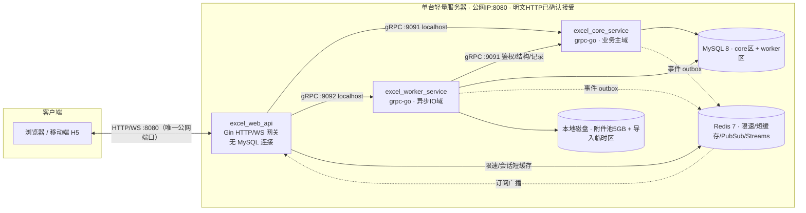
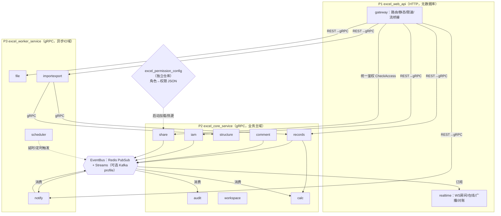
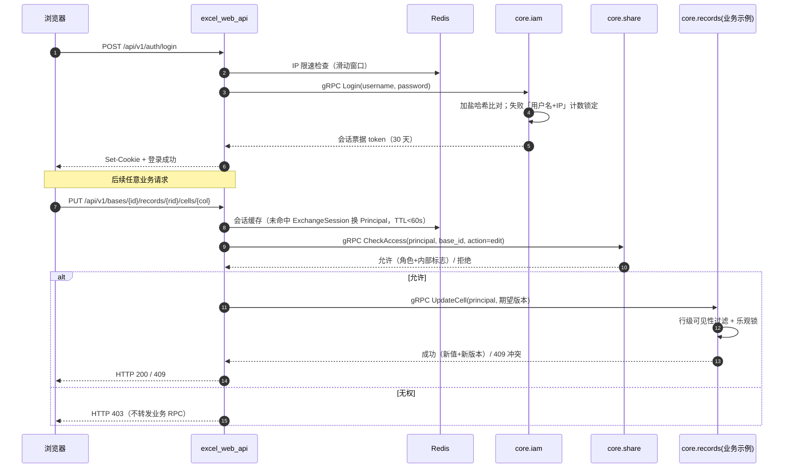
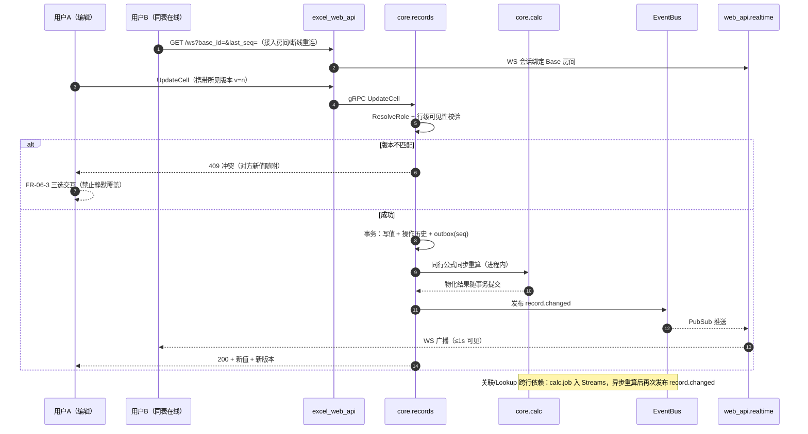
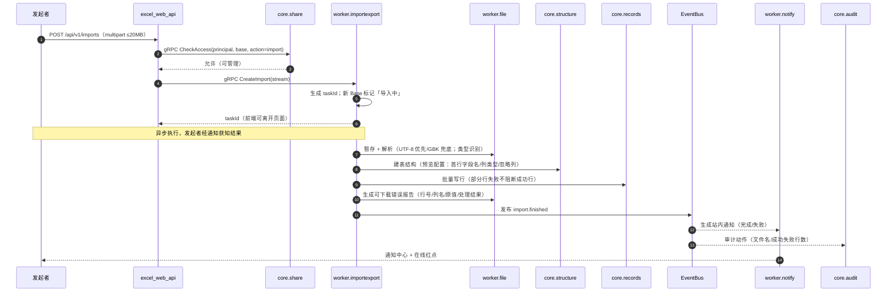
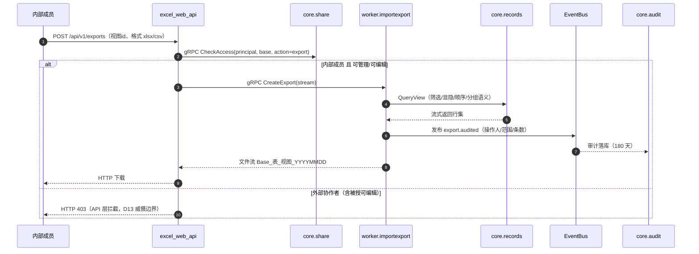
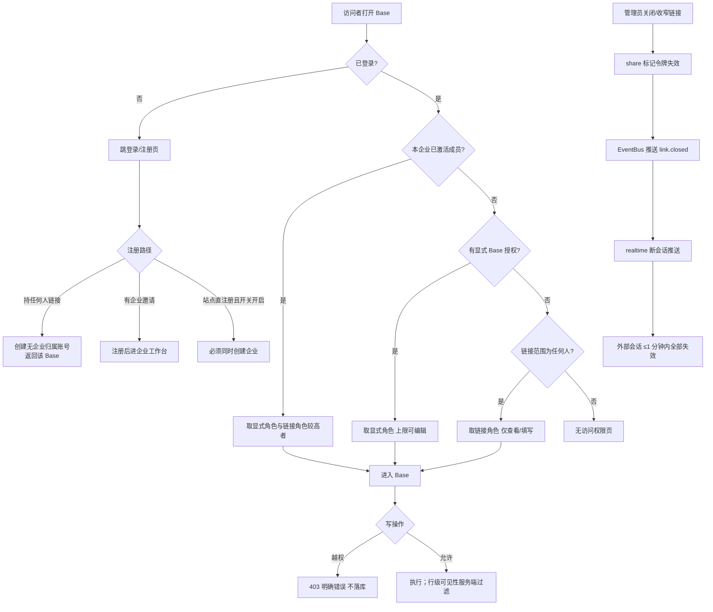

# 协作多维表格（代号）整体技术方案

| 项目 | 内容 |
|---|---|
| 文档名称 | 协作多维表格（代号）整体技术方案 |
| 文档版本 | v1.3 |
| 文档状态 | 正式稿 |
| 关联文档 | 产品需求文档 v1.3（评审稿）、开发模块划分-技术方案 v0.2、参数决定表 v0.1、接口文档 v0.6 |
| 密级 | 内部 |
| 编制日期 | 2026-10-27（编制人待填） |

## 修订记录

| 版本 | 日期 | 修订内容 | 作者 |
|---|---|---|---|
| v1.0 | 2026-10-27 | 首次发布：三进程总体架构、技术选型、接口需求、服务职责与依赖、部署运维 | （待填） |
| v1.1 | 2026-10-28 | 评审修订：鉴权上移 API 层 + JSON 权限配置仓库；api/service 分层（rpc/redis/base/deal/bus）；禁止跨模块 SQL | （待填） |
| v1.2 | 2026-10-28 | 新增全仓库命名基线（admin/manager/operator、_list/_map、LinkContext 等，与接口文档 v0.6 联动） | （待填） |

## 1. 引言

### 1.1 目的

本方案定义「协作多维表格（代号）」的**整体技术架构**，明确各服务的**技术选型、职责边界、相互依赖与接口需求**，作为后续详细设计与开发的基线。本方案不涉及每个模块内部的具体逻辑实现（表结构、算法、界面实现等不在本文范围）。

### 1.2 范围

- 包含：进程与服务划分、框架与中间件选型、对外（HTTP/WS）与对内（gRPC/事件）接口清单、服务间依赖与时序、部署与运维基线、目录结构。
- 不包含：模块内的数据结构与算法实现、前端页面方案、数据库表结构细节、P1 功能设计。

### 1.3 读者

研发工程师、技术评审人、后续维护者。

### 1.4 术语

复用 PRD 附录术语表；本文新增术语见附录 A。

## 2. 设计约束与目标

### 2.1 业务硬约束（对齐 PRD 8.1）

1. 单机自托管：应用、数据、附件同机部署，不做分布式与异地备份。
2. 无域名、无备案：公网 IP + 高位端口（建议 8080）直连；**不做传输加密**（明文 HTTP 为已确认接受的已知风险）。
3. 零外部付费/资质依赖：前端静态资源自托管；不接第三方登录/存储/CDN/推送/风控/统计服务；引入的开源库逐项核验许可证。
4. 反滥用本地化：容量软上限 + 「用户名+IP」登录锁定 + IP 限速 + 注册开关，不接验证码。
5. 无 SLA、无备份承诺：产品内固定展示试运行声明；admin 自备 mysqldump + 附件目录备份。
6. 试运行 admin 通道：注册开关、应急重置密码、企业所有者转移、人工受理企业解散。

### 2.2 架构规则（v0.2 六条落实）

1. **HTTP 服务不直连数据库**：`excel_web_api` 不持有 MySQL 连接，数据操作全部收敛在 RPC 服务。
2. **进程压缩为 3 个**：web_api / core_service / worker_service，降低单机资源压力。
3. **命名统一**：HTTP 服务 `excel_xxx_api`；RPC 服务 `excel_xxx_service`。
4. **公式等计算结果后端权威**：前端仅做交互与即时提示（调研结论见下 2.3 与 v0.2 第 5 节）。
5. **Redis 默认引入，Kafka 可选**：限速/缓存/PubSub/Streams 由 Redis 承担；Kafka 经 EventBus 接口预留。
6. **最小耦合**：跨进程仅 gRPC/事件总线；同进程模块仅通过收窄接口通信。
7. **统一鉴权在 API 层**：权限校验全部由 `excel_web_api` 完成，RPC 提供统一鉴权接口 `share.CheckAccess`；业务 RPC 仅执行行级可见性过滤。
8. **权限策略文件化**：角色→权限静态策略以 JSON 维护在独立配置仓库 `excel_permission_config`，core 启动加载并热更新；用户与 Base 的运行时授权关系仍存 MySQL（FR-09 要求运行时写库）。
9. **禁止跨模块 SQL**：每个模块只写本模块表的 SQL；交集/并集等合并逻辑在代码层通过模块接口聚合。

### 2.3 性能与规模设计目标（对齐 8.2、F01）

| 指标 | 目标 |
|---|---|
| 单 Base 同时在线 | ≥ 50 人 |
| 单表规模 | 50,000 行常规浏览/筛选/编辑流畅 |
| 首屏可交互 | 1 万行规模 ≤ 3 秒 |
| 他人编辑可见 | ≤ 1 秒（经事件总线广播） |
| 商用组件禁忌 | 禁止 AGPL/GPL/商业表格内核与公式引擎（调研实证见 v0.2 第 5 节：HyperFormula 为 GPLv3+付费商业双许可，不可用） |

## 3. 总体架构

### 3.1 部署架构图（UML 部署图）



### 3.2 组件模块图（UML 组件图）



### 3.3 三进程一览

| 进程 | 类型 | 主要框架 | 端口 | 承载模块 | 数据存放 | 公网暴露 |
|---|---|---|---|---|---|---|
| excel_web_api | HTTP | Gin + gorilla/websocket + grpc-go（client） | 8080 | gateway、realtime | 无持久化；仅 Redis | 是 |
| excel_core_service | RPC | grpc-go | 9091(localhost) | iam、share、audit、workspace、structure、records、calc、comment | MySQL core 区 | 否 |
| excel_worker_service | RPC | grpc-go + 任务循环 | 9092(localhost) | file、importexport、notify、scheduler | MySQL worker 区 + 本地磁盘 | 否 |

### 3.4 关键架构决策

| 编号 | 决策 | 结论 | 理由 |
|---|---|---|---|
| AD-01 | 入口形态 | 单一 HTTP 网关 + 两 RPC 进程 | 唯一公网面，安全边界收敛 |
| AD-02 | 跨进程通信 | gRPC（同步）+ 事件总线（异步） | 类型契约强、解耦实时与任务 |
| AD-03 | 计算结果归属 | 后端权威物化 | 支撑筛选/排序/导出/历史一致性 |
| AD-04 | 事件总线 | Redis（默认）/ Kafka（可选） | 单机资源权衡，接口可切换 |
| AD-05 | HTTP 无库 | web_api 零 MySQL | 规则 1：数据面全部下沉 RPC |
| AD-06 | 鉴权位置 | API 层统一校验 + RPC 统一接口 + JSON 策略配置仓库 | 单一裁决点、策略与代码分离 |
| AD-07 | 数据边界 | 模块内 SQL + 代码层聚合 | 禁止跨模块 JOIN，解耦存储 |

## 4. 服务职责与技术选型

### 4.1 excel_web_api

#### 4.1.1 定位与职责

唯一公网入口，承担「身份识别、限速、协议转换、实时推送」四类职责，**不承载业务规则、不做授权裁决、不持久化数据**：

- 静态资源托管（前端构建产物，自托管）。
- REST 路由 → gRPC 转发（grpc-go 客户端桥接），统一错误与国际化文案。
- WebSocket 协作长连接：房间、在线状态、颜色分配、光标/选区、编辑广播、断线对账（经 Redis PubSub 入流）。
- IP 级滑动窗口限速（Redis）；会话票据解析与短缓存（<60s）。
- 文件上传/下载流桥接（HTTP 流 ↔ gRPC 流）。
- 健康检查 `/healthz`、`/readyz`；优雅退出与重启时通知客户端重连。
- 统一权限校验：请求经会话解析后先调 `share.CheckAccess`（结果 Redis 短缓存 <60s）；越权即 403，不转发业务 RPC。

#### 4.1.2 技术选型

| 组件 | 选型 | 许可证 | 理由 |
|---|---|---|---|
| 语言 | Go 1.22+ | BSD | 高并发、低内存、部署单二进制 |
| HTTP 框架 | Gin | MIT | 生态成熟、路由中间件齐全 |
| WebSocket | gorilla/websocket | BSD 类（核验后引入） | 事实标准库，生产验证充分 |
| RPC 客户端 | grpc-go | Apache-2.0 | 与服务端同栈，流式桥接 |
| Redis 客户端 | go-redis v9 | BSD-2 | 限速/缓存/PubSub 统一接入 |
| 数据库驱动 | 无 | — | 红线：本进程不连 MySQL |

#### 4.1.3 承载模块职责摘要

| 模块 | 职责摘要 |
|---|---|
| gateway | 路由注册、REST↔gRPC 映射、统一错误码、静态资源、限速、健康检查、流桥接、统一鉴权编排（CheckAccess 后放行） |
| realtime | WS 接入与鉴权绑定、基座房间（Base+表）、在线状态与存在感、光标/选区/「编辑中」、变更广播、断线补发对账（只读调 core.records） |

#### 4.1.4 接口与依赖

- 对外：HTTP REST（见 6.2）、WebSocket `/ws`。
- 对内发起：`core.iam`（会话解析）、`core.share.CheckAccess`（统一鉴权）、`core.records/structure/workspace/comment`、`worker.file/importexport/notify`（鉴权通过后转发）。
- 启动依赖：Redis（降级为内存限速）、core_service 与 worker_service 就绪。

### 4.2 excel_core_service

#### 4.2.1 定位与职责

**业务主域（OLTP 核心）**：承载登录后的全部高频写读链路——身份、授权、资产、数据、计算、评论。数据务必强一致（写事务 + outbox）。

#### 4.2.2 技术选型

| 组件 | 选型 | 许可证 | 理由 |
|---|---|---|---|
| RPC 框架 | grpc-go + 拦截器（恢复/日志/追踪） | Apache-2.0 | 契约化、流式、跨进程标准 |
| 数据访问 | database/sql + sqlx | MIT | 轻量手写 SQL，可控 5 万行查询 |
| MySQL 驱动 | go-sql-driver/mysql | MPL-2.0 | 官方推荐纯 Go 驱动 |
| 迁移 | golang-migrate | MIT | schema 版本化 |
| Redis 客户端 | go-redis v9 | BSD-2 | share 短缓存、事件发布 |
| ID 生成 | oklog/ulid | MIT | 全局唯一业务 ID |
| 公式引擎 | 自研纯 Go 库（26 函数） | 自有 | 后端权威物化，避免第三方许可证风险 |

#### 4.2.3 模块职责摘要

| 模块 | 职责摘要 |
|---|---|
| iam | 注册/登录/会话；密码加盐哈希；「用户名+IP」失败锁定；企业与成员/邀请/停用；注销冷静期；注册开关；admin 应急通道 |
| share | 统一鉴权接口 `CheckAccess`（API 层唯一调用口）；内部聚合角色裁决与行级范围；静态权限策略 JSON 加载与热更新；外部会话 1 分钟失效；企业强关链接 |
| audit | 动作级操作审计 180 天；查询/导出 CSV；事件消费与不可删除约束 |
| workspace | 首页聚合（最近访问/我创建/与我共享/星标/名称搜索）；Base 新建/复制/删除/接管；无企业账号首页裁剪 |
| structure | 数据表/字段/视图结构；选项治理（D14 开关）；类型转换与影响预览；容量软上限校验 |
| records | 单元格读写唯一入口；乐观锁与冲突（FR-06-3）；行级可见性；粘贴/撤销；记录历史 90 天与回滚；视图查询引擎（筛选/排序/分组/分页） |
| calc | 公式/引用/Lookup 求值（26 函数）；依赖图与循环检测；同行同步重算 + 跨行异步重算；`#ERROR` 语义 |
| comment | 两级评论/回复；@ 解析；解决/重开；记录删除级联 |

#### 4.2.4 接口与依赖

- 对外：8 个 gRPC 服务（见 6.3）。
- 同步依赖：`share.CheckAccess` 为统一鉴权入口；对外仅被 web_api/worker 调用（业务侧不再自行调用 share）。
- 权限策略：启动时加载 `excel_permission_config` 的 JSON 策略（角色→权限矩阵），支持运行期热更新。
- 异步：发布事件至 EventBus；calc 消费 `calc.job`；audit 消费审计事件。
- 数据：MySQL core 区。

### 4.3 excel_worker_service

#### 4.3.1 定位与职责

**异步与 IO 域**：承担上传下载、导入导出、站内通知、定时任务等低交互频度但 IO/计算密集的工作，避免阻塞业务主域。

#### 4.3.2 技术选型

| 组件 | 选型 | 许可证 | 理由 |
|---|---|---|---|
| RPC 框架 | grpc-go（含流式） | Apache-2.0 | 文件流/导出流桥接 |
| xlsx 解析生成 | excelize | BSD-3（以仓库 LICENSE 为准） | 纯 Go，读写 xlsx |
| CSV 编码 | 自研 UTF-8 优先/GBK 兜底检测 | 自有 | 轻量，避免重量级编码库 |
| 图像缩略图 | Go 标准库 + 宽松许可缩放库（核验后引入） | MIT/BSD 类 | 附件预览 |
| 定时/延迟任务 | 自循环 + MySQL 任务表（FOR UPDATE SKIP LOCKED） | 自有 | 不引入独立调度组件 |
| Redis 客户端 | go-redis v9 | BSD-2 | 事件发布、未读计数缓存 |
| 数据访问 | database/sql + sqlx | MIT | 与 core 一致 |

#### 4.3.3 模块职责摘要

| 模块 | 职责摘要 |
|---|---|
| file | 附件上传/下载/缩略图；扩展名+MIME 双黑名单；单文件 20MB/单记录 10 个/全站池 5GB 计量；展示重命名；本地磁盘存储 |
| importexport | xlsx/xls/csv 解析与类型识别；导入状态机（新 Base、「导入中」不可访问、错误报告可下载）；当前视图导出（内部成员断言 + 审计事件 + 文件命名规则） |
| notify | 站内通知聚合/未读/已读；通知事件矩阵落库；90 天清理；在线红点经 PubSub 推给 web_api |
| scheduler | 注销 7 天与企业 30 天冷静期执行；历史/通知/审计过期清理；链接会话 TTL 强失效兜底；任务重试与死信留痕 |

#### 4.3.4 接口与依赖

- 对外：4 个 gRPC 服务（见 6.3）。
- 同步依赖：调用 `core.structure`（导入建结构）、`core.records`（批量写/视图查询）；权限已由 API 层校验，本进程不再调用 share。
- 异步：发布 `import.finished`、`export.audited`、`notify.created`；消费 `calc.job` 之外的任务事件。
- 数据：MySQL worker 区 + 本地磁盘附件池。

## 5. 中间件与环境选型

### 5.1 存储与中间件

| 组件 | 用途 | 关键决策 |
|---|---|---|
| MySQL 8（utf8mb4） | 唯一 OLTP 持久化 | 单实例；逻辑分 core 区与 worker 区；**各模块表前缀 `excel_<模块名>_`**；mysqldump 备份对齐 8.1.6 |
| Redis 7（单节点） | 限速计数、会话/角色短缓存、PubSub 实时广播、Streams 事件总线、未读计数 | 默认开启 RDB+AOF 可关；全部数据可丢弃重建 |
| Kafka（可选 profile） | EventBus 的 Streams 替代实现 | demo 默认不部署；单节点 KRaft；切换条件见 5.2 |
| 本地磁盘 | 附件池（5GB）、导入临时区、导出暂存 | file 模块独占；定期巡检孤儿文件 |
| docker-compose | 编排 3 进程 + 2 中间件 | 全部开源镜像，零外部依赖 |

### 5.2 Redis 与 Kafka 的使用边界

- Redis 承担：限速（INCR+EXPIRE 滑动窗口）、会话/角色缓存 TTL<60s、实时消息 PubSub、持久事件 Streams（默认保留 7 天）、未读红点计数。
- Kafka 启用条件（任一）：进程拆分多机部署、事件源/消费者规模上升、需要长期事件回放、团队已有 Kafka 运维。切换只替换 `eventbus` 包实现，业务代码不变。
- 两者都不承载：业务表数据、附件二进制、审计原文（一律 MySQL/磁盘）。

### 5.3 前端与环境红线

- 前端构建产物自托管进 web_api 镜像/静态目录；不引第三方 CDN/字体/统计/错误上报 SDK（8.1.3）。
- 表格网格自研虚拟滚动；公式前端仅做联想与即时提示，不引入 HyperFormula（GPLv3+商业，调研实证）等前端计算引擎。
- 所有引入第三方库在合并前核验许可证并登记（见 `docs/第三方库清单` 待建）。
- 权限策略配置独立仓库 `excel_permission_config`：角色→权限矩阵 JSON，core 启动加载、运行期热更新；外部协作者/链接等动态授权仍存 MySQL（FR-09 运行时写库）。

## 6. 接口需求

### 6.1 通用约定

- REST（web_api）：JSON；统一响应 `{code, message, data}`；错误映射：400 校验、401 未登录、403 无权限、409 冲突/并发、413 超限、429 限速、5xx 服务不可用（对齐 7.5）。
- 鉴权：Cookie/Authorization 承载不透明会话票据；**权限校验统一在 web_api 完成**——解析 Principal 后先调 `share.CheckAccess`，通过才转发业务 RPC，越权统一 403 与明确文案。
- gRPC（服务间）：传输 grpc-go；仅 localhost；元数据携带 `principal`（user_id、enterprise_id、internal、link_context/LinkContext）；错误用标准 status code + details；业务 RPC 信任网关已鉴权，只做行级可见性过滤与数据归属校验。
- 事件：统一头部 `event_id/type/version/base_id/seq/occurred_at/producer`；消费者按 `event_id` 幂等；事件只增不改，靠 version 演进。
- 版本：proto 语义化版本（破坏性变更升 v2）；HTTP 冻结 `/api/v1`；事件 schema 带 version。
- 数据库边界：每个模块只执行本模块表的 SQL，禁止跨模块 JOIN/子查询；交集/并集等合并逻辑在代码层通过模块接口聚合。
- 权限策略：角色→权限静态策略存 `excel_permission_config`（JSON），动态授权关系存 MySQL。

### 6.2 HTTP 接口清单（分组示意，明细后补）

| 分组 | 方法与路径（示意） | 目标 gRPC 模块 |
|---|---|---|
| 认证 | POST /api/v1/auth/{register,login,logout}；GET /auth/me | iam |
| 企业/成员 | GET/POST/DELETE /api/v1/enterprises/members；POST /invites | iam |
| 首页/Base | GET /home；POST /bases；PATCH/DELETE /bases/{id} | workspace |
| 表/字段/视图 | POST /tables；PATCH /fields/{id}；POST /views；PUT /views/{id}/config | structure |
| 记录 | GET /records?view=；POST /records；PUT /records/{id}/cells；DELETE /records；POST /records/{id}/undo | records |
| 历史/评论 | GET /records/{id}/history；POST /records/{id}/comments；POST /comments/{id}/resolve | records/comment |
| 分享 | GET/PUT /shares；POST /shares/link/reset | share |
| 通知 | GET /notifications；POST /notifications/read | notify |
| 文件 | POST /files；GET /files/{id}/download；GET /files/{id}/thumb | file |
| 导入导出 | POST /imports；GET /imports/{id}；POST /exports | importexport |
| 审计 | GET /enterprises/audits；GET /enterprises/audits/export.csv | audit |
| 实时 | GET /ws?base_id=&table_id=&last_seq= | realtime |

### 6.3 gRPC 接口清单（关键方法示例）

| 进程 | 模块 | 示例方法 | 说明 |
|---|---|---|---|
| core | iam | Register/Login/Logout/ExchangeSession/InviteMember/DisableMember/SetRegisterSwitch/AdminResetPassword | 会话与 admin 通道 |
| core | share | CheckAccess/ResolveRole/AddCollaborator/UpdateLink/ResetLink/CloseLink/ForceCloseByManager | 统一鉴权接口（API 层唯一调用口） |
| core | audit | Append/Query/ExportCSV | 审计写入与导出 |
| core | workspace | GetHome/CreateBase/CopyBase/DeleteBase/TransferBase | Base 资产 |
| core | structure | CreateTable/UpdateField/ConvertField/CreateView/UpdateView/DeleteField | 结构与转换 |
| core | records | QueryView/GetRecord/UpdateCell/BatchUpdate/Delete/Undo/GetHistory/Rollback/GetEventsSince | 写路径+对账 |
| core | calc | Evaluate/Recompute | 公式求值（内部为主） |
| core | comment | List/Create/Reply/Resolve/Delete | 评论 |
| worker | file | InitUpload/UploadChunk/DownloadStream/MakeThumb/Delete/GetQuota | 附件流 |
| worker | importexport | CreateImport/GetImportStatus/CreateExport/ExportStream | 导入导出任务 |
| worker | notify | List/UnreadCount/MarkRead/MarkAllRead | 通知查询 |
| worker | scheduler | 内部任务面（无外部调用方） | 定时/延迟任务 |

### 6.4 事件接口清单

| 事件 | 生产者 | 消费者 | 通道 | 说明 |
|---|---|---|---|---|
| record.changed | core.records | realtime、calc | PubSub(+Streams 存档) | 单元格/批量/结构联动广播 |
| record.deleted | core.records | realtime、audit | Streams | 记录删除审计（FR-01-5 新增） |
| calc.job | core.records/calc | calc（跨行重算） | Streams | Lookup/关联依赖重算 |
| comment.created / comment.mentioned | core.comment | notify | Streams | 评论与 @ 通知 |
| invite.created / member.disabled | core.iam | notify、audit | Streams | 邀请/停用 |
| link.closed / share.changed | core.share | realtime、audit | PubSub+Streams | 会话 1 分钟熔断与审计 |
| import.finished | worker.importexport | notify、audit | Streams | 导入完成/失败 |
| export.audited | worker.importexport | audit | Streams | 导出审计 |
| notify.created | worker.notify | realtime（在线红点） | PubSub | 站内即时触达 |
| audit.append | core/worker 各模块 | core.audit | Streams | 统一审计入口 |
| enterprise.dissolved | core.iam | worker.file / worker.importexport / worker.notify | Streams | 企业注销到期，跨进程清理附件/导出件/通知 |
| deactivation.initiated | core.iam | worker.scheduler | Streams | 账号注销受理，7 天到期任务 intake |
| dissolution.initiated | core.iam | worker.scheduler | Streams | 企业注销受理，30 天冷静期到期任务 intake |

### 6.5 接口约束

- 权限校验全部在 `excel_web_api` 层完成：解析会话得 Principal → 调 `share.CheckAccess`（角色级）→ 通过才转发业务 RPC；越权 403 直返。
- RPC 业务接口不重复角色校验，仅按传入 Principal 执行行级可见性过滤（可填写仅本人记录）与数据归属校验。
- `share.CheckAccess` 是唯一统一鉴权接口；角色→权限静态策略取 `excel_permission_config`（JSON 配置仓库），动态授权关系取 MySQL。
- 外部协作者导出拦截：web_api 在 `POST /exports` 以 action=export 判定拒绝；D13 仍属行为威慑与合规标记。
## 7. 关键交互时序（UML 时序图 / 活动图）

### 7.1 登录与会话鉴权（含一次业务写请求）


### 7.2 单元格编辑、实时广播与公式重算



### 7.3 导入 .xlsx


### 7.4 导出当前视图与审计


### 7.5 权限判定与外部会话熔断（UML 活动图）



## 8. 非功能性设计

| 维度 | 设计 |
|---|---|
| 性能 | 50 人在线/5 万行/首屏 3s 基线（F01 实测）；查询游标分页；前端虚拟滚动；同行公式事务内同步、跨行异步；权限/会话缓存 TTL<60s |
| 可用性 | 无 SLA；容器 restart 自动拉起；web_api 重启仅掉 WS（客户端重连 + seq 对账）；core 单点（demo 接受，8.1 已声明） |
| 安全 | 密码 bcrypt/argon2 加盐；权限校验统一在 API 层（RPC 提供 `CheckAccess`）；RPC 层行级过滤兜底；登录锁定 + IP 限速 + 注册开关；审计不可删；明文 HTTP 为已接受风险，安全组建议限制来源 IP；无验证码（本地风控代替） |
| 可观测性 | 结构化本地日志；预留自托管 Prometheus 指标导出；禁止第三方错误上报 SDK |
| 可靠性 | outbox 保证事件不丢；消费者按 event_id 幂等；任务失败重试上限 + 死信表；冷静期任务断点续跑 |
| 扩展路径 | 单机→多机：core 可拆 identity/data 两进程、worker 可拆 impex；Kafka 经 EventBus 接口热切换；records 内已预留查询/写入分界插座 |

## 9. 部署与运维

### 9.1 拓扑与端口

| 组件 | 端口 | 暴露 | 说明 |
|---|---|---|---|
| excel_web_api | 8080 | 公网（唯一） | 云安全组仅放行此端口 |
| excel_core_service | 9091 | 仅 localhost | gRPC |
| excel_worker_service | 9092 | 仅 localhost | gRPC |
| MySQL 8 | 3306 | 仅 localhost | core 区 + worker 区 |
| Redis 7 | 6379 | 仅 localhost | 无密码或本地 ACL |

### 9.2 启动顺序与健康检查

启动：MySQL → Redis → core → worker → web_api；就绪探测：core/worker 用 gRPC health，web_api 用 `/readyz`（依赖 core/worker/Redis 可达）。优雅退出：先摘健康检查 → 停止接新请求 → 排空任务/推送 → 退出。

### 9.3 备份与运营

- `deploy/backup.ps1`：mysqldump + 附件目录 tar 轮转（8.1.6，自保而非承诺）。
- admin 配置项集中管理：注册开关、附件池上限、附件黑名单、端口、限速阈值。

## 10. 代码目录结构（分层：internal 只留业务逻辑）

```text
F:\codex\repo\lark excel\
├─ excel_web_api/                # P1：独立 Go module（HTTP/WS）
│  ├─ cmd/main.go
│  ├─ rpc/                       # 封装对 core/worker 的 gRPC client（principal 注入、超时/重试）
│  ├─ redis/                     # 封装 Redis（限速、会话/权限短缓存、PubSub 订阅）
│  ├─ deal/                      # 通用能力（错误码、响应封装、工具函数）
│  ├─ internal/                  # 仅业务逻辑
│  │  ├─ gateway/                # 路由处理、统一鉴权编排、静态资源
│  │  └─ realtime/               # WS 房间、广播、补发对账
│  └─ configs/
├─ excel_core_service/           # P2：独立 Go module（gRPC）
│  ├─ cmd/main.go
│  ├─ base/                      # DB：连接/事务/SQL 执行/迁移（只限本模块表）
│  ├─ redis/                     # Redis 封装（缓存、事件发布）
│  ├─ bus/                       # EventBus：outbox 转发、消费注册、幂等/重试
│  ├─ deal/                      # 通用能力：错误码、分页、加解密、工具函数
│  ├─ internal/                  # 仅业务逻辑（8 模块）
│  │  └─ {iam,share,audit,workspace,structure,records,calc,comment}/
│  └─ configs/
├─ excel_worker_service/         # P3：独立 Go module（gRPC/IO）
│  ├─ cmd/main.go
│  ├─ base/  redis/  bus/  rpc/  # 同 P2；rpc/ 封装调用 core 的 client
│  ├─ deal/
│  ├─ internal/                  # 仅业务逻辑
│  │  └─ {file,importexport,notify,scheduler}/
│  └─ configs/
├─ proto/                        # 12 个签名契约 api/{module}/v1/*.proto（buf 管理）
├─ libs/                         # 三进程共享纯库（eventbus 接口、idgen、errors 等）
├─ web/  deploy/  docs/  .research/
└─ excel_permission_config/      # 独立配置仓库：角色→权限 JSON（部署时挂载进 core）
```

约定：三进程为独立 Go module；互相只见 `proto/` 与 `libs/`，禁止 import 他进程 `internal/`；`internal/` 内禁止直连 MySQL/Redis/gRPC，须经 `base/redis/rpc` 等封装层；SQL 只在模块内执行，跨模块交集并集在代码层聚合。
### 10.1 命名基线（全仓库统一）

本表为全仓库唯一命名标准，与《接口文档》第 10 节命名总纲保持同一版本；新增词条须先登记本表，冲突时以本表为准。

- 服务与模块：HTTP 面 `excel_xxx_api`；RPC 面 `excel_xxx_service`；proto 包 `excel.{module}.v1`。
- 角色与身份术语：运营者 `admin`；企业管理员与 Base「可管理」角色 `manager`；普通成员 `member`；操作发起人 `operator`；评论作者 `author`；创建人 `created_by`。
- 词法：URL 段 kebab-case；JSON/gRPC 字段与枚举值 snake_case。
- 字段后缀：数组字段以 `_list` 结尾（`record_list`、`field_list`）；kv/映射字段以 `_map` 结尾（`cells_map`、`config_map`、`payload_map`、`detail_map`）。
- ID 与路径：ID 统一 `<资源>_id`；路径占位符单资源 `{id}`、多资源 `{<资源>_id}`；HTTP 冻结 `/api/v1`。
- 时间与统一对象：记录时间 `created_at/updated_at`、事件时间 `occurred_at`；链接上下文统一 `LinkContext`（字段 `link_context`），弃用 `LinkCtx/link_ctx`。
- 变更纪律：同义必须同词；命名新增须同步《接口文档》命名总纲（当前 v0.5）。
- 数据表前缀：统一 `excel_<模块名>_`；`base/` 层按模块分文件（A 模块只操作 A 模块表，跨模块在代码逻辑层拆分/聚合，确需跨模块 SQL 时注释原因）。
- 代码编写规则：函数名体现主要作用、保持单一职责；单函数尽量 ≤500 行，优先拆分，确不便拆分可例外。
## 11. 风险与待确认

风险表：

| 风险 | 影响 | 缓解 |
|---|---|---|
| 明文 HTTP 传输 | 密码/数据可被网络窥探 | 已确认接受；安全组限 IP；正式运营前必须域名+备案+HTTPS |
| 无验证码防刷 | 注册/外链滥用 | 本地限速+注册开关+admin 人工处置 |
| 单机无高可用 | 停机即不可用 | 无 SLA 声明；快速重启脚本 |
| realtime 内存态 | 重启丢在线信息 | seq 对账补发、客户端自动重连 |
| JSON 行存性能 | 5 万行查询退化 | T1 PoC，不达标转专用列存储 |
| 内网 RPC 无独立鉴权 | 鉴权上移 API 层后，绕过网关直连内部服务可越权 | localhost 监听 + 网络隔离；若未来内部服务需直连暴露，恢复 RPC 侧校验（T8） |

待确认（T1–T6、T8）：T1 单元格存储模型与 5 万行实测；T2 50 人 WS 基线；T3 已决（引入 Redis）；T4 前端网格自研范围与网关映射方式；T5 三进程+中间件内存基线；T6 Kafka profile 是否需要（默认否）；T7 已决（否）：静态策略 JSON + 动态授权 MySQL（FR-09 运行时写库）；T8 未来内部服务需直连暴露时，是否恢复 RPC 侧鉴权。

## 附录 A 术语补充

| 术语 | 含义 |
|---|---|
| 进程/服务 | 一个可部署二进制；HTTP 面命名 excel_xxx_api，RPC 面命名 excel_xxx_service |
| 模块 | 进程内按数据所有权划分的代码单元（一盒代码+一份 proto+一组表） |
| EventBus | 进程间事件通道的抽象：PubSub（瞬时）+ Streams（可靠） |
| outbox | 与业务同事务落库的待发事件表，保证「写库成功必有事件」 |
| Principal | 请求身份上下文：user_id/enterprise_id/internal/link_context（LinkContext） |
| 物化 | 公式/引用计算结果持久化存储，供查询/排序/导出直接使用 |
| 分层（api 仓库） | rpc 层=跨服务调用封装；redis 层=Redis 调用封装；deal 层=通用工具；internal 仅业务逻辑 |
| 分层（service 仓库） | base 层=DB 连接/事务/SQL；redis 层=Redis；bus 层=EventBus；rpc 层=跨服务 client（worker 用）；deal 层=通用能力；internal 仅业务逻辑 |
| 权限策略配置仓库 | 独立仓库 excel_permission_config：角色→权限 JSON，core 加载并热更新 |

## 附录 B 命名与端口速查

| 类别 | 值 |
|---|---|
| HTTP 服务 | excel_web_api（8080 公网） |
| RPC 服务 | excel_core_service（9091）、excel_worker_service（9092） |
| proto package | excel.{module}.v1 × 12 |
| 名词与字段基线 | admin（运营）、manager（管理员）、operator（操作发起人）、author（评论作者）；数组 `_list`、kv `_map` |
| 公网协议 | HTTP 明文 / WS（传输加密不做的已知风险） |
| 数据存放 | 仅两个 RPC 服务操作 MySQL；附件在本地磁盘 |
| 权限策略 | 独立仓库 excel_permission_config（JSON），随 core 部署挂载 |
