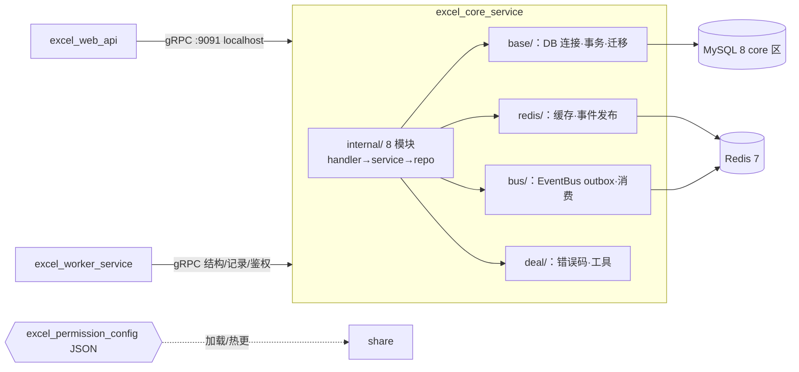
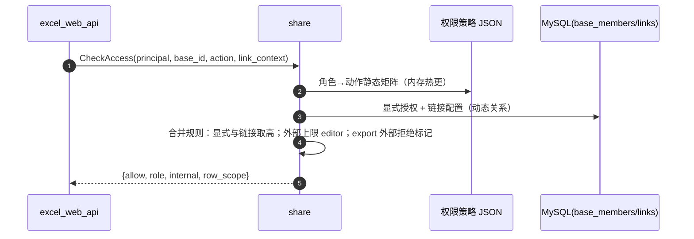
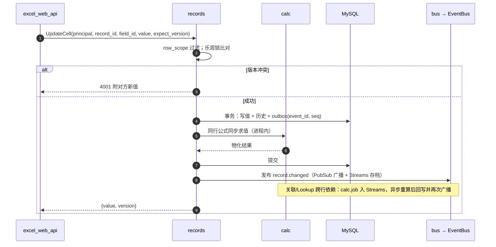
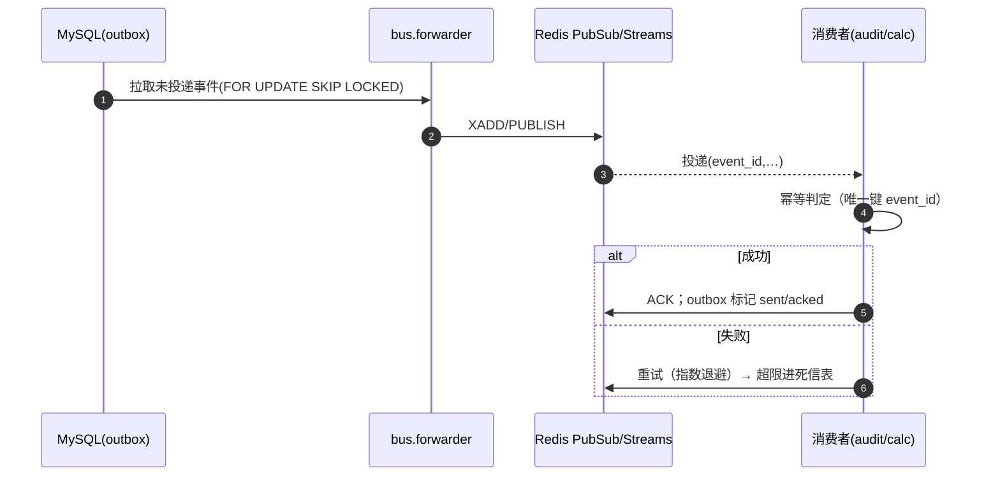
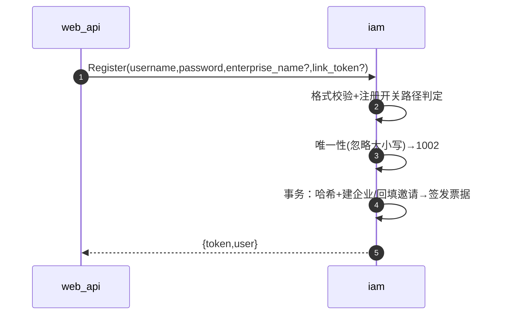
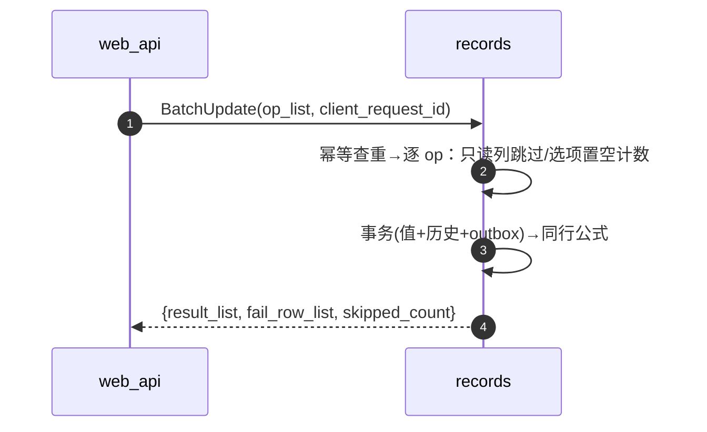
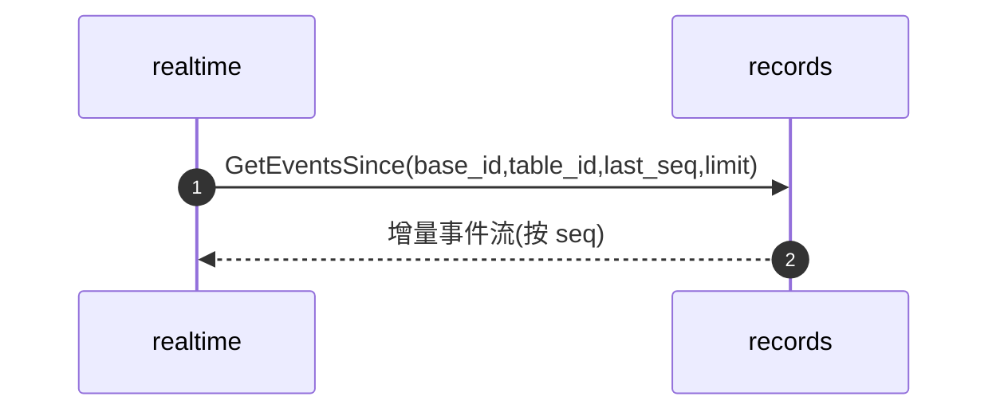
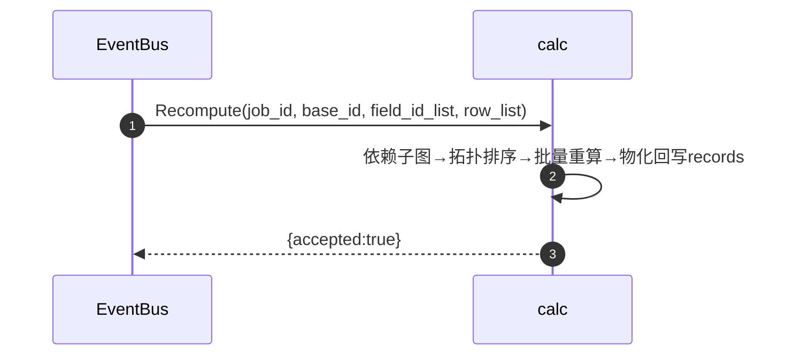
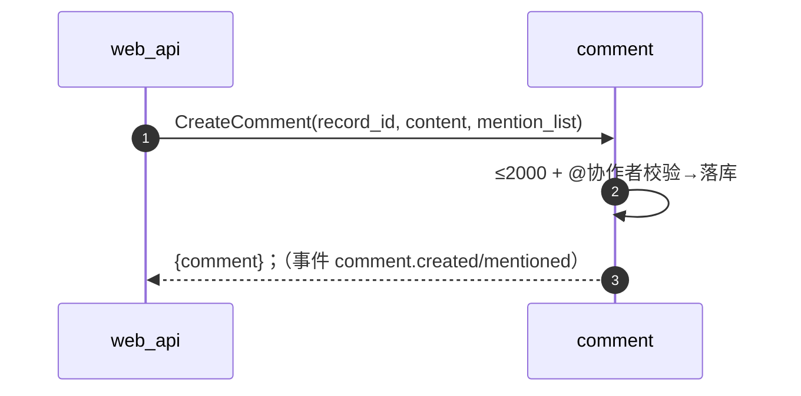
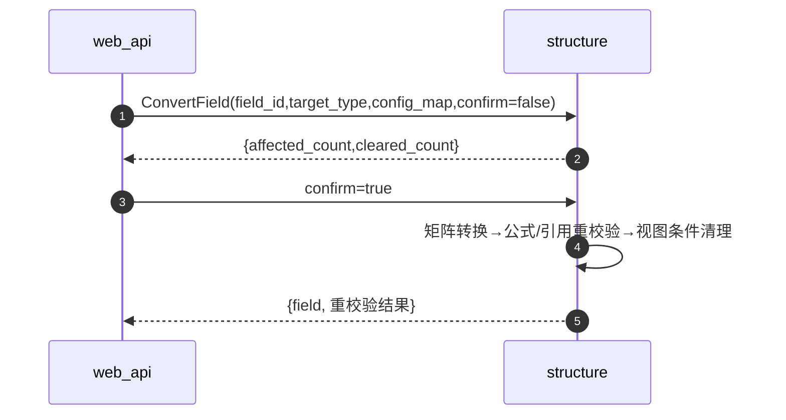

# excel_core_service 服务技术方案（初版）

| 项目 | 内容 |
|---|---|
| 文档版本 | v0.5（规范稿） |
| 关联文档 | 整体技术方案 v1.3、接口文档 v0.6、proto 契约（`proto/`）、产品需求文档 v1.3 |
| 定位 | 业务主域（OLTP 核心）：8 模块、gRPC :9091 仅 localhost、MySQL core 区、Redis、EventBus |
| 承载模块 | iam / share / audit / workspace / structure / records / calc / comment |

## 修订记录

| 版本 | 日期 | 修订内容 | 作者 |
|---|---|---|---|
| v0.1 | 2026-10-29 | 首次发布：职责边界、分层、模块明细、关键链路、数据事务、事件审计、配置运维与映射 | （待填） |
| v0.2 | 2026-10-29 | 细化：内嵌 8 服务完整 proto；93 个 RPC 逐一开小节描述内部逻辑；重要接口补时序图 | （待填） |
| v0.3 | 2026-10-29 | 增加接口规格总表：P0/P1/P2 分级、幂等与异常策略、下游依赖（RPC/Redis/DB/CFG）、逻辑要点 | （待填） |
| v0.4 | 2026-10-29 | 沉淀文件结构规则并重建仓库骨架（一文件一接口/common.go/xxx_config） | （待填） |
| v0.5 | 2026-10-30 | base 层模块分文件、表前缀 excel_<模块>_；新增代码编写规则 | （待填） |

## 1. 设计原则

1. **单一数据所有权**：8 个模块各持一组表；SQL 只写本模块表，禁止跨模块 JOIN；交集/并集在代码层通过模块接口聚合。
2. **鉴权唯一裁决点**：`share.CheckAccess` 统一输出 `{allow, role, internal, row_scope}`；其余模块不再判角色，只按 principal + row_scope 做行级可见性过滤。
3. **写事务 + outbox**：写库成功必有事件；事件头带 `event_id`，消费者幂等；可靠性由 MySQL outbox 承担，不依赖中间件持久化。
4. **计算结果后端权威**：公式/引用/Lookup 由 `calc` 物化落库；同行公式写事务内同步求值，跨行依赖走事件任务异步重算。
5. **零公网暴露**：仅监听 localhost；`principal` 来自网关注入的 `x-principal` 元数据（带内部来源校验），进程不做公网 TLS/端口。
6. **分层纪律**：`base/redis/bus/deal` 为业务无关封装；`internal/` 仅业务逻辑；permission JSON 与代码分离、支持热更。

## 2. 职责边界

### 2.1 做什么

- 账号与身份：注册三路径、登录锁定、会话票据分配、企业/成员/邀请、注销冷静期、注册开关、admin 通道（`iam`）。
- 统一鉴权：`CheckAccess`（API 层调用口）+ 内部 `ResolveRole`；权限策略 JSON 加载与热更；链接令牌与外部会话失效（`share`）。
- 动作级审计：180 天、不可删、CSV 导出（`audit`）。
- 资产与结构：首页聚合数据源、Base 生命周期、表/字段/视图/选项治理（`workspace`/`structure`）。
- 数据面唯一入口：记录写读、乐观锁、批量/粘贴、撤销、历史与回滚、视图查询引擎（`records`）。
- 计算：公式/引用/Lookup 求值物化、依赖图与环检测（`calc`）；两级评论与 @（`comment`）。

### 2.2 不做什么（红线）

| 不做 | 归属 |
|---|---|
| 不暴露公网、不承接 HTTP | `excel_web_api` |
| 不生成站内通知（仅发事件） | `worker.notify` 消费 `comment.*/invite.*` 等 |
| 不解析导入文件、不导出/生成缩略图 | `worker.importexport` / `worker.file` |
| 不做定时清理与冷静期执行 | `worker.scheduler` |
| 不缓存用户最终权限裁决结果（供网关） | 网关 Redis；本服务仅 `ResolveRole` 回源 |

## 3. 总体架构与分层



分层职责：

| 层 | 职责 | 约束 |
|---|---|---|
| `base/` | 连接池、事务模板、`sqlx` 执行、golang-migrate 迁移 | 只提供通用 DB 能力，不含业务 SQL 语义 |
| `redis/` | 权限短缓存、事件发布封装 | 仅可丢弃数据 |
| `bus/` | outbox 转发器、消费注册、ack/重试/幂等 | 默认 Redis PubSub+Streams，Kafka 经接口切换 |
| `deal/` | 错误码、分页、加解密、通用校验工具 | 无业务依赖 |
| `internal/{module}` | 每模块三层：`handler`（gRPC 适配）→ `service`（业务规则）→ `repo`（仅本模块表） | 跨模块只走 module interface，禁止直查他模块表 |

## 4. 八个模块职责一览

| 模块 | 职责 | 持有数据（表组） | proto 服务（RPC 数） |
|---|---|---|---|
| iam | 注册/登录/会话、企业/成员/邀请、注销、注册开关、admin 通道 | users, credentials, sessions, enterprises, members, invitations, login_failures | IamService（31） |
| share | 统一鉴权 CheckAccess/ResolveRole；协作者与链接授权；策略 JSON 热更；会话失效 | base_members, link_configs, link_tokens, link_sessions | ShareService（12） |
| audit | 动作级审计（180 天、不可删）；查询与 CSV 导出；事件消费 | audit_events | AuditService（3） |
| workspace | 首页聚合数据、Base 生命周期、星标、接管 | bases, home_meta, stars | WorkspaceService（8） |
| structure | 表/字段/视图/选项；类型转换与影响面；容量校验 | tables, fields, field_options, views | StructureService（20） |
| records | 记录读写、乐观锁、行级过滤、粘贴/撤销、历史与回滚、视图查询、对账事件 | records, record_histories, pending_undo, edit_seq | RecordsService（10） |
| calc | 26 函数求值、依赖图与环检测、同步/异步重算物化 | calc_jobs（内存依赖图） | CalcService（3） |
| comment | 两级评论、@ 提及、解决状态、级联删除 | comments | CommentService（6） |

合计 RPC：93。

## 5. 关键链路

### 5.1 统一鉴权 CheckAccess



### 5.2 记录写入、公式与事件（最热链路）



### 5.3 outbox → EventBus（可靠性保证）



## 6. 数据与事务设计

### 6.1 表前缀与所有权

| 模块 | 表前缀 | 模块 | 表前缀 |
|---|---|---|---|
| iam | `excel_iam_` | structure | `excel_structure_` |
| share | `excel_share_` | records | `excel_records_` |
| audit | `excel_audit_` | calc | `excel_calc_` |
| workspace | `excel_workspace_` | comment | `excel_comment_` |

- 所有数据表带 `enterprise_id`（外部协作者关联表除外），查询一律租户隔离；业务 ID 用 ULID 字符串主键，history/outbox/seq 等内部追加表用 bigint 自增。
- 跨模块不 JOIN、不写对方表；如 `records` 需要字段/视图定义，通过 `structure` 模块接口获取并内存缓存。

### 6.2 事务边界

- 写路径：单事务覆盖「业务写 + 历史追加 + outbox」，同库同 schema 保证原子。
- 同行公式同步求值落在同一事务内；跨行（关联/Lookup 依赖）重算异步，数百毫秒内物化回写，期间读侧可见「重算中」标记（物化值最后更新）。
- 删除语义：记录软删 7 秒可撤销；历史 append-only；audit 记录不可删（无 DELETE 权限）。

### 6.3 乐观锁与幂等

- `records.Record.version` 递增；`UpdateCell/BatchUpdate` 带 `expect_version`，不匹配返回 4001 并附对方新值（FR-06-3 三选交互动）。
- 批量写组内串行化；`client_request_id` 幂等窗口 24h（重放返回上次结果，不重复历史/事件）。

### 6.4 行级可见性

- `row_scope=ROW_SCOPE_OWN`（可填写）：查询/更新/删除强制过滤 `created_by = principal.user_id`。
- 关联候选与 Lookup 渲染：参与可见性判断的目标记录不可见时，候选不出现/引用置空展示（FR-03-5/6）。
- 查询条件注入统一在 `records` 数据入口，模块上层不得绕过。

## 7. 鉴权与权限策略

- 静态策略：`excel_permission_config/permissions.json`（角色→动作矩阵），启动加载、运行期热更（文件监视 + 原子替换 + 灰度生效）。
- 动态授权：协作者显式授权（成员/外部，上限 editor）、链接范围与角色（任何人仅 viewer/filler）存于 `share` 表；合并规则照 PRD 4.5。
- 审计联动：admin 通道（`AdminResetPassword/AdminTransferOwner`、注册开关切换、企业解散受理）直连 localhost RPC，校验 admin 白名单并入审计。
- 1 分钟熔断实现：`close/reset` 打失效标记 + 发布 `link.closed`（网关订阅清缓存） + scheduler TTL 兜底。

## 8. 公式与计算引擎（calc）

- 函数库：26 个纯函数注册表（表驱动、可单测），类型检查与错误原因（`#ERROR` + reason）。
- 依赖图：公式（同行引用）→ Lookup（跨表引用）→ 关联字段，图含跨表边；保存时全图环检测，含「公式→Lookup→目标表公式」间接环。
- 求值路径：同行=写事务内同步；跨行=`calc.job` 经 Streams 异步，按依赖序批量重算、物化回写、再广播 `record.changed`。
- 联动：字段类型转换后全依赖公式重新校验，失败标记 `#ERROR` 并通知字段管理者。

## 9. 事件与审计

生产者（模块 → 事件）：

| 模块 | 事件 |
|---|---|
| records | record.changed / record.deleted / calc.job |
| comment | comment.created / comment.mentioned |
| iam | invite.created / invite.canceled / member.disabled / member.enabled / enterprise.owner_transferred / enterprise.dissolved |
| share | link.closed / share.changed |

- outbox 要素：`event_id, type, version, base_id, seq, payload, status(sent/acked/dead), occurred_at`。
- 审计（audit）：`Append` 幂等消费；动作级（不计单元格内容）；180 天保留（scheduler 清理）；仅企业 owner/manager 可查、可导 CSV、不可删。

## 10. 配置与运维

- `configs/core_service_config.yaml` 骨架：`grpc_addr=127.0.0.1:9091`、mysql DSN、redis、`permission_config_path`。
- 迁移：`base/` 集成 golang-migrate；启动顺序：MySQL → 迁移 → 权限 JSON → gRPC listen。
- 健康检查：标准 `grpc.health.v1.Health`；`/readyz` 语义由网关探。
- 优雅退出：停止接收 → 排空 outbox 投递（限时 10s）→ 断开 Redis → 退出。
- 指标：预留 Prometheus（请求量/延迟/冲突 4001 计数/calc 重算队列深度/outbox 积压）。
- 只监听 127.0.0.1；不配置任何公网端口与 TLS。

## 11. 与接口文档、proto 的映射（v0.6）

| proto | RPC | 接口文档 | 说明 |
|---|---|---|---|
| iam/v1 | 31 | §8.3.1 | 含 admin 通道、企业注销生命周期 |
| share/v1 | 12 | §8.3.2 | CheckAccess 为统一鉴权入口 |
| audit/v1 | 3 | §8.3.3 | Append 为事件消费入口 |
| workspace/v1 | 8 | §8.3.4 | 首页聚合数据源 |
| structure/v1 | 20 | §8.3.5 | FieldType/ViewConfig 等枚举定义处 |
| records/v1 | 10 | §8.3.6 | 数据面唯一入口；GetEventsSince 流 |
| calc/v1 | 3 | §8.3.7 | 求值与重算 |
| comment/v1 | 6 | §8.3.8 | 两级评论 |

## 12. 风险与待定

| 风险/待定 | 影响 | 缓解 |
|---|---|---|
| JSON 行存 5 万行查询退化 | 视图查询/排序性能 | T1 PoC；不达标转专用列存储 |
| 行级过滤索引设计 | 可填写大表扫描 | 二级索引 (creator)；实测后定 |
| 跨行重算延迟 | 关联/Lookup 短暂陈旧 | 300-500ms 异步 + 「重算中」标记；上限告警 |
| 权限 JSON 热更原子性 | 配置半生效 | 原子替换+校验后再切换 |
| outbox 转发器单点 | core 故障时事件积压 | 重启续投+幂等；积压告警 |
| 内网信任边界 | 绕过网关直连可越权 | localhost 监听；若对外暴露恢复 RPC 侧校验（T8） |
| audit 表增长 | 180 天保留后仍增长 | scheduler 定期清理（保留期内不可删语义不变） |

## 附录：关键设计决策（恢复）

| 编号 | 决策 | 结论 |
|---|---|---|
| AD-CORE-01 | 数据所有权 | 模块各持表，禁跨模块 SQL，代码层聚合 |
| AD-CORE-02 | 鉴权唯一入口 | share.CheckAccess 输出四元组；业务模块只做行级过滤 |
| AD-CORE-03 | 可靠性 | 写事务+outbox，event_id 幂等；Redis 可丢弃 |
| AD-CORE-04 | 计算归属 | calc 后端物化：同行同步、跨行异步 |
| AD-CORE-05 | 审计不可删 | Append-only + 角色可见性 + 180 天 |
| AD-CORE-06 | 网络边界 | 仅 localhost；principal 来自网关注入，不暴露公网 |

## 13. 接口级细化设计（恢复版 · proto + 时序图）

> 逐接口逻辑、调用顺序、依赖与健壮性见「§14 接口规格总表」的逻辑要点列（该表承担逐接口小节职能）。完整消息定义依次内嵌如下（与 `proto/` 一致）。

### 13.0 common

```proto
// excel.common.v1：跨模块公共类型（与《接口文档 v0.6》§8.0 对应）
syntax = "proto3";

package excel.common.v1;

option go_package = "excel/api/common/v1;commonv1";

import "google/protobuf/struct.proto";

// 链接上下文（统一命名 LinkContext；弃用 LinkCtx/link_ctx）
message LinkContext {
  string base_id = 1;
  string link_token = 2;
  string role = 3; // viewer|filler|editor|manager
}

// 请求身份上下文（excel_web_api 注入 x-principal 元数据，唯一签发口：iam.ExchangeSession）
message Principal {
  string user_id = 1;
  string enterprise_id = 2; // 空串 = 无企业归属账号
  bool internal = 3;
  LinkContext link_context = 4;
}

// EventBus 事件统一头部
message EventHeader {
  string event_id = 1;
  string type = 2;
  int32 version = 3;
  string base_id = 4;
  int64 seq = 5;
  int64 occurred_at = 6; // 毫秒时间戳
  string producer = 7;
}

// 通用错误细节（x-request-id 对账用）
message ErrorDetail {
  int32 code = 1;
  string message = 2;
  google.protobuf.Struct detail_map = 3;
}

// 单元格/通用值。字段值编码见接口文档 §8.0.6；kv 用 map<string, Value> cells_map
message Value {
  oneof kind {
    string string_value = 1;
    int64 int_value = 2;
    double double_value = 3;
    bool bool_value = 4;
    int64 date_value_ms = 5; // 日期：毫秒时间戳
    ValueList list_value = 6; // 数组统一以 list 承载
  }
}

message ValueList {
  repeated Value value_list = 1;
}
```

### 13.1 iam

```proto
// excel.iam.v1：账号、企业与成员管理（对应接口文档 §4.1、§8.3.1）
syntax = "proto3";

package excel.iam.v1;

option go_package = "excel/api/iam/v1;iamv1";

import "google/protobuf/empty.proto";
import "common/v1/common.proto";

service IamService {
  rpc Register(RegisterRequest) returns (RegisterResponse);
  rpc Login(LoginRequest) returns (LoginResponse);
  rpc Logout(LogoutRequest) returns (google.protobuf.Empty);
  rpc ExchangeSession(ExchangeSessionRequest) returns (ExchangeSessionResponse);
  rpc GetMe(google.protobuf.Empty) returns (GetMeResponse);
  rpc UpdateProfile(UpdateProfileRequest) returns (UpdateProfileResponse);
  rpc ChangePassword(ChangePasswordRequest) returns (google.protobuf.Empty);
  rpc RequestDeactivate(google.protobuf.Empty) returns (RequestDeactivateResponse);
  rpc CancelDeactivate(google.protobuf.Empty) returns (google.protobuf.Empty);
  rpc ExecuteDeactivation(ExecuteDeactivationRequest) returns (google.protobuf.Empty); // scheduler 内部
  rpc GetEnterprise(google.protobuf.Empty) returns (GetEnterpriseResponse);
  rpc InviteMember(InviteMemberRequest) returns (InviteMemberResponse);
  rpc CancelInvite(CancelInviteRequest) returns (google.protobuf.Empty);
  rpc ListInvites(ListInvitesRequest) returns (ListInvitesResponse);
  rpc ListMyInvitations(google.protobuf.Empty) returns (ListMyInvitationsResponse);
  rpc AcceptInvite(AcceptInviteRequest) returns (google.protobuf.Empty);
  rpc RejectInvite(RejectInviteRequest) returns (google.protobuf.Empty);
  rpc ListMembers(ListMembersRequest) returns (ListMembersResponse);
  rpc UpdateMemberRole(UpdateMemberRoleRequest) returns (UpdateMemberRoleResponse);
  rpc DisableMember(DisableMemberRequest) returns (google.protobuf.Empty);
  rpc EnableMember(EnableMemberRequest) returns (google.protobuf.Empty);
  rpc TransferOwner(TransferOwnerRequest) returns (google.protobuf.Empty);
  rpc SetRegisterSwitch(SetRegisterSwitchRequest) returns (google.protobuf.Empty); // admin 脚本（RPC）
  rpc GetRegisterSwitch(google.protobuf.Empty) returns (GetRegisterSwitchResponse); // admin 脚本（RPC）
  rpc InitiateEnterpriseDissolution(InitiateEnterpriseDissolutionRequest) returns (InitiateEnterpriseDissolutionResponse); // admin 脚本（RPC），入审计
  rpc CancelEnterpriseDissolution(google.protobuf.Empty) returns (google.protobuf.Empty); // 所有者冷静期撤回
  rpc ExecuteEnterpriseDissolution(ExecuteEnterpriseDissolutionRequest) returns (google.protobuf.Empty); // scheduler 内部
  rpc GetEnterpriseDissolutionStatus(google.protobuf.Empty) returns (GetEnterpriseDissolutionStatusResponse);
  rpc AdminResetPassword(AdminResetPasswordRequest) returns (google.protobuf.Empty); // admin 脚本（RPC），入审计
  rpc AdminTransferOwner(AdminTransferOwnerRequest) returns (google.protobuf.Empty); // admin 脚本（RPC），入审计
  rpc SearchUsers(SearchUsersRequest) returns (SearchUsersResponse);
}

enum MemberRole {
  MEMBER_ROLE_UNSPECIFIED = 0;
  MEMBER_ROLE_OWNER = 1;
  MEMBER_ROLE_MANAGER = 2; // 企业管理员（命名基线：admin 专指运营者）
  MEMBER_ROLE_MEMBER = 3;
}

enum MemberStatus {
  MEMBER_STATUS_UNSPECIFIED = 0;
  MEMBER_STATUS_ACTIVE = 1;
  MEMBER_STATUS_DISABLED = 2;
}

enum InvitationStatus {
  INVITATION_STATUS_UNSPECIFIED = 0;
  INVITATION_STATUS_PENDING = 1;
  INVITATION_STATUS_ACCEPTED = 2;
  INVITATION_STATUS_REJECTED = 3;
  INVITATION_STATUS_CANCELED = 4;
}

enum DissolutionStatus {
  DISSOLUTION_STATUS_UNSPECIFIED = 0;
  DISSOLUTION_STATUS_NONE = 1;
  DISSOLUTION_STATUS_PENDING = 2;
  DISSOLUTION_STATUS_COOLING = 3;
  DISSOLUTION_STATUS_REVOKED = 4;
  DISSOLUTION_STATUS_DONE = 5;
}

message User {
  string id = 1;
  string username = 2;
  string display_name = 3;
  string avatar_uri = 4;
  string enterprise_id = 5;
  int64 created_at = 6;
}

message Enterprise {
  string id = 1;
  string name = 2;
  string owner_id = 3;
  int32 member_count = 4;
  int64 created_at = 5;
}

message Member {
  string user_id = 1;
  string username = 2;
  string display_name = 3;
  MemberRole role = 4;
  MemberStatus status = 5;
  int64 joined_at = 6;
}

message Invitation {
  string id = 1;
  string enterprise_id = 2;
  string enterprise_name = 3;
  string username = 4;
  InvitationStatus status = 5;
  int64 created_at = 6;
}

message RegisterRequest {
  string username = 1; // 4-20 字母开头
  string password = 2; // 8-32 含字母数字
  string enterprise_name = 3; // 仅注册路径③
  string link_token = 4; // 仅注册路径②（持链接注册）
}
message RegisterResponse { string token = 1; User user = 2; }

message LoginRequest { string username = 1; string password = 2; }
message LoginResponse { string token = 1; User user = 2; }

message LogoutRequest { string token = 1; }

message ExchangeSessionRequest { string token = 1; }
message ExchangeSessionResponse { excel.common.v1.Principal principal = 1; }

message GetMeResponse { User user = 1; Enterprise enterprise = 2; string my_role = 3; }

message UpdateProfileRequest { string display_name = 1; string avatar_uri = 2; }
message UpdateProfileResponse { User user = 1; }

message ChangePasswordRequest { string old_password = 1; string new_password = 2; }

message RequestDeactivateResponse { int64 deadline_ms = 1; }

message ExecuteDeactivationRequest { string user_id = 1; }

message GetEnterpriseResponse { Enterprise enterprise = 1; }

message InviteMemberRequest { repeated string username_list = 1; }
message InviteMemberResponse { repeated Invitation invitation_list = 1; }

message CancelInviteRequest { string invite_id = 1; }
message ListInvitesRequest { string cursor = 1; int32 limit = 2; }
message ListInvitesResponse { repeated Invitation invitation_list = 1; bool has_more = 2; string next_cursor = 3; }

message ListMyInvitationsResponse { repeated Invitation invitation_list = 1; }

message AcceptInviteRequest { string invite_id = 1; }
message RejectInviteRequest { string invite_id = 1; }

message ListMembersRequest { string cursor = 1; int32 limit = 2; string q = 3; }
message ListMembersResponse { repeated Member member_list = 1; bool has_more = 2; string next_cursor = 3; }

message UpdateMemberRoleRequest { string user_id = 1; MemberRole role = 2; }
message UpdateMemberRoleResponse { Member member = 1; }

message DisableMemberRequest { string user_id = 1; }
message EnableMemberRequest { string user_id = 1; }

message TransferOwnerRequest { string successor_id = 1; bool confirm = 2; }

message SetRegisterSwitchRequest { bool enabled = 1; }
message GetRegisterSwitchResponse { bool enabled = 1; }

message InitiateEnterpriseDissolutionRequest { string enterprise_id = 1; string note = 2; }
message InitiateEnterpriseDissolutionResponse { int64 deadline_ms = 1; }

message ExecuteEnterpriseDissolutionRequest { string enterprise_id = 1; }

message GetEnterpriseDissolutionStatusResponse { DissolutionStatus status = 1; int64 deadline_ms = 2; }

message AdminResetPasswordRequest { string username = 1; string new_password = 2; }
message AdminTransferOwnerRequest { string enterprise_id = 1; string new_owner_id = 2; }

message SearchUsersRequest { string q = 1; int32 limit = 2; }
message SearchUsersResponse { repeated User user_list = 1; }
```

### 13.2 share

```proto
// excel.share.v1：协作者、链接分享与统一鉴权（对应接口文档 §4.2、§8.3.2）
syntax = "proto3";

package excel.share.v1;

option go_package = "excel/api/share/v1;sharev1";

import "google/protobuf/empty.proto";
import "common/v1/common.proto";

service ShareService {
  // 统一鉴权：API 层唯一调用口
  rpc CheckAccess(CheckAccessRequest) returns (CheckAccessResponse);
  // 内部角色裁决
  rpc ResolveRole(ResolveRoleRequest) returns (ResolveRoleResponse);
  rpc AddCollaborator(AddCollaboratorRequest) returns (AddCollaboratorResponse);
  rpc RemoveCollaborator(RemoveCollaboratorRequest) returns (google.protobuf.Empty);
  rpc UpdateCollaboratorRole(UpdateCollaboratorRoleRequest) returns (UpdateCollaboratorRoleResponse);
  rpc ListCollaborators(ListCollaboratorsRequest) returns (ListCollaboratorsResponse);
  rpc GetLink(GetLinkRequest) returns (GetLinkResponse);
  rpc UpdateLink(UpdateLinkRequest) returns (UpdateLinkResponse);
  rpc ResetLink(ResetLinkRequest) returns (ResetLinkResponse);
  rpc CloseLink(CloseLinkRequest) returns (google.protobuf.Empty);
  rpc ListOpenLinksByEnterprise(ListOpenLinksByEnterpriseRequest) returns (ListOpenLinksByEnterpriseResponse);
  rpc ForceCloseByManager(ForceCloseByManagerRequest) returns (google.protobuf.Empty); // 企业管理器（manager）强关
}

// Base 角色（企业管理员用 MemberRole.MANAGER 区分）
enum Role {
  ROLE_UNSPECIFIED = 0;
  ROLE_VIEWER = 1;
  ROLE_FILLER = 2;
  ROLE_EDITOR = 3; // 外部协作者上限
  ROLE_MANAGER = 4; // 可管理
}

enum Action {
  ACTION_UNSPECIFIED = 0;
  ACTION_VIEW = 1;
  ACTION_CREATE_RECORD = 2;
  ACTION_EDIT_ALL = 3;
  ACTION_EDIT_OWN = 4;
  ACTION_DELETE_RECORD = 5;
  ACTION_MANAGE_VIEW = 6;
  ACTION_MANAGE_STRUCTURE = 7;
  ACTION_EXPORT = 8;
  ACTION_MANAGE_SHARE = 9;
  ACTION_COPY_BASE = 10;
  ACTION_IMPORT = 11;
  ACTION_COMMENT = 12;
}

enum LinkScope {
  LINK_SCOPE_UNSPECIFIED = 0;
  LINK_SCOPE_NONE = 1;
  LINK_SCOPE_ENTERPRISE = 2;
  LINK_SCOPE_ANYONE = 3;
}

enum RowScope {
  ROW_SCOPE_UNSPECIFIED = 0;
  ROW_SCOPE_ALL = 1;
  ROW_SCOPE_OWN = 2; // 可填写：仅本人创建
}

message Collaborator {
  string user_id = 1;
  string username = 2;
  string display_name = 3;
  Role role = 4;
  bool internal = 5;
  string source = 6; // invite|link
  int64 granted_at = 7;
}

message LinkConfig {
  bool enabled = 1;
  LinkScope scope = 2;
  Role role = 3;
  string url = 4;
  int64 updated_at = 5;
}

message OpenLink {
  string base_id = 1;
  string base_name = 2;
  string manager = 3; // 可管理者用户名
  Role role = 4;
  int64 opened_at = 5;
}

message CheckAccessRequest {
  excel.common.v1.Principal principal = 1;
  string base_id = 2;
  Action action = 3;
  excel.common.v1.LinkContext link_context = 4;
}
message CheckAccessResponse {
  bool allow = 1;
  Role role = 2;
  bool internal = 3;
  RowScope row_scope = 4;
}

message ResolveRoleRequest {
  excel.common.v1.Principal principal = 1;
  string base_id = 2;
  excel.common.v1.LinkContext link_context = 3;
}
message ResolveRoleResponse { Role role = 1; bool internal = 2; RowScope row_scope = 3; }

message AddCollaboratorRequest { string base_id = 1; string username = 2; Role role = 3; }
message AddCollaboratorResponse { Collaborator collaborator = 1; }

message RemoveCollaboratorRequest { string base_id = 1; string user_id = 2; }

message UpdateCollaboratorRoleRequest { string base_id = 1; string user_id = 2; Role role = 3; }
message UpdateCollaboratorRoleResponse { Collaborator collaborator = 1; }

message ListCollaboratorsRequest { string base_id = 1; string q = 2; }
message ListCollaboratorsResponse { repeated Collaborator collaborator_list = 1; }

message GetLinkRequest { string base_id = 1; }
message GetLinkResponse { LinkConfig link_config = 1; }

message UpdateLinkRequest { string base_id = 1; LinkScope scope = 2; Role role = 3; }
message UpdateLinkResponse { LinkConfig link_config = 1; }

message ResetLinkRequest { string base_id = 1; }
message ResetLinkResponse { LinkConfig link_config = 1; }

message CloseLinkRequest { string base_id = 1; }

message ListOpenLinksByEnterpriseRequest { string cursor = 1; int32 limit = 2; }
message ListOpenLinksByEnterpriseResponse { repeated OpenLink link_list = 1; bool has_more = 2; string next_cursor = 3; }

message ForceCloseByManagerRequest { string link_id = 1; }
```

### 13.3 audit

```proto
// excel.audit.v1：企业操作审计（对应接口文档 §4.3、§8.3.3；动作级、不可删）
syntax = "proto3";

package excel.audit.v1;

option go_package = "excel/api/audit/v1;auditv1";

import "google/protobuf/empty.proto";
import "google/protobuf/struct.proto";

service AuditService {
  rpc Append(AppendRequest) returns (google.protobuf.Empty); // EventBus 消费入口，按 event_id 幂等
  rpc Query(QueryRequest) returns (QueryResponse);
  rpc ExportCSV(ExportCSVRequest) returns (stream ExportCSVResponse);
}

enum AuditAction {
  AUDIT_ACTION_UNSPECIFIED = 0;
  AUDIT_ACTION_DATA_EXPORT = 1;
  AUDIT_ACTION_DATA_IMPORT = 2;
  AUDIT_ACTION_BASE_DELETED = 3;
  AUDIT_ACTION_TABLE_DELETED = 4;
  AUDIT_ACTION_RECORD_DELETED = 5;
  AUDIT_ACTION_LINK_FORCE_CLOSED = 6;
  AUDIT_ACTION_MEMBER_DISABLED = 7;
  AUDIT_ACTION_MEMBER_ENABLED = 8;
  AUDIT_ACTION_OWNER_TRANSFERRED = 9;
  AUDIT_ACTION_ADMIN_RESET_PASSWORD = 10;
  AUDIT_ACTION_BASE_OWNERSHIP_TRANSFERRED = 11;
  AUDIT_ACTION_ENTERPRISE_DISSOLUTION_ACCEPTED = 12;
  AUDIT_ACTION_REGISTER_SWITCH_CHANGED = 13;
}

message AuditEvent {
  string id = 1;
  AuditAction action = 2;
  string operator = 3; // 操作发起人（命名基线：operator）
  string target = 4;
  string base_id = 5;
  string table_id = 6;
  google.protobuf.Struct detail_map = 7;
  int64 created_at = 8;
}

message AppendRequest {
  string event_id = 1;
  AuditAction action = 2;
  string operator = 3;
  string target = 4;
  string base_id = 5;
  string table_id = 6;
  google.protobuf.Struct detail_map = 7;
}

message QueryRequest {
  string cursor = 1;
  int32 limit = 2;
  string operator = 3;
  int64 from_ms = 4;
  int64 to_ms = 5;
}
message QueryResponse { repeated AuditEvent audit_list = 1; bool has_more = 2; string next_cursor = 3; }

message ExportCSVRequest {
  string operator = 1;
  int64 from_ms = 2;
  int64 to_ms = 3;
}
message ExportCSVResponse { bytes chunk = 1; }
```

### 13.4 workspace

```proto
// excel.workspace.v1：首页与 Base 资产（对应接口文档 §4.4、§8.3.4）
syntax = "proto3";

package excel.workspace.v1;

option go_package = "excel/api/workspace/v1;workspacev1";

import "google/protobuf/empty.proto";

service WorkspaceService {
  rpc GetHome(google.protobuf.Empty) returns (GetHomeResponse);
  rpc SearchBases(SearchBasesRequest) returns (SearchBasesResponse);
  rpc CreateBase(CreateBaseRequest) returns (CreateBaseResponse);
  rpc RenameBase(RenameBaseRequest) returns (RenameBaseResponse);
  rpc DuplicateBase(DuplicateBaseRequest) returns (DuplicateBaseResponse);
  rpc DeleteBase(DeleteBaseRequest) returns (google.protobuf.Empty);
  rpc ToggleStar(ToggleStarRequest) returns (ToggleStarResponse);
  rpc TransferBase(TransferBaseRequest) returns (google.protobuf.Empty);
}

message Base {
  string id = 1;
  string name = 2;
  int32 table_count = 3;
  string my_role = 4;
  bool starred = 5;
  int64 last_modified_at = 6;
  string last_modifier = 7;
}

message Home {
  repeated Base recent_list = 1;
  repeated Base created_list = 2;
  repeated Base shared_list = 3;
  repeated Base star_list = 4;
  // 邀请待办由 iam.ListMyInvitations 提供，此处仅保留计数
  int32 pending_invitation_count = 5;
}
message GetHomeResponse { Home home = 1; }

message SearchBasesRequest { string q = 1; }
message SearchBasesResponse { repeated Base base_list = 1; }

message CreateBaseRequest { string name = 1; }
message CreateBaseResponse { Base base = 1; }

message RenameBaseRequest { string base_id = 1; string name = 2; }
message RenameBaseResponse { Base base = 1; }

message DuplicateBaseRequest { string base_id = 1; }
message DuplicateBaseResponse { Base base = 1; }

message DeleteBaseRequest { string base_id = 1; bool confirm = 2; }

message ToggleStarRequest { string base_id = 1; bool starred = 2; }
message ToggleStarResponse { Base base = 1; }

message TransferBaseRequest { string base_id = 1; string new_owner_id = 2; }
```

### 13.5 structure

```proto
PR_STR
```

### 13.6 records

```proto
PR_REC
```

### 13.7 calc

```proto
PR_CAL
```

### 13.8 comment

```proto
PR_CMT
```

### 13.9 重要接口时序图集

**REGISTER / LOGIN**



**BATCHUPDATE / GETEVENTSSINCE / RECOMPUTE / CREATECOMMENT / CONVERTFIELD**











## 14. 接口规格总表（分级 / 健壮性 / 依赖）

### 14.1 分级标准（三服务通用）

- **P0 业务主要接口**：主链路或重要底层依赖；出问题影响绝大多数场景或流量。
- **P1 业务旁支接口**：使用频率一般的业务或管理面动作，不影响表格主链路。
- **P2 次要接口**：低频、不对外暴露或异步任务/内部接口。

### 14.2 健壮性约定（符号）

- 幂等：RW=只读天然幂等；NAT=自然键幂等；EID=event_id；CRI=client_request_id；TOK=会话级。
- 异常策略：F=明确错误码；E=空/默认兜底；P=局部降级；R=重试+死信；KEEP=保留用户输入。
- 依赖简写（`DB:表` 省略 `excel_<模块>_` 前缀）：`RPC:模块.方法`；`DB:表`；`RED:key用途`；`CFG:permissions.json`；`BUS:事件名`。

### 14.3 iam（31）

| 接口 | 级 | 幂等/异常 | 调用依赖 | 逻辑要点 |
|---|---|---|---|---|
| IAM-01 Register | P0 | NAT(用户名)/F | DB:users,enterprises CFG:注册开关 | 三路径判归属→唯一→哈希落库→签发票据 |
| IAM-02 Login | P0 | RW/F+限流 | DB:users,sessions RED:失败计数 | 用户名+IP 计数锁→比对→签发 |
| IAM-03 Logout | P1 | NAT/F | DB:sessions | 票据失效；多端独立不互踢 |
| IAM-04 ExchangeSession | P0 | RW/F | DB:sessions,members | 票据→Principal 唯一签发口 |
| IAM-05 InviteMember | P1 | NAT/F | DB:invitations BUS:invite.created | 逐用户名校验→占邀/幂等→事件 |
| IAM-06 CancelInvite | P1 | NAT/F | DB:invitations BUS:invite.canceled | 仅 pending 可撤 |
| IAM-07 ListInvites | P2 | RW/E | DB:invitations | 分页直查 |
| IAM-08 ListMyInvitations | P1 | RW/E | DB:invitations | 按用户名关联（含占邀） |
| IAM-09 AcceptInvite | P1 | NAT/F | DB:users,members,invitations | 单企业约束→转入成员 |
| IAM-10 RejectInvite | P1 | NAT/F | DB:invitations | 置 rejected |
| IAM-11 ListMembers | P1 | RW/E | DB:members | 分页+角色状态 |
| IAM-12 UpdateMemberRole | P1 | NAT/F+守卫 | DB:members | 禁自降/最后 owner |
| IAM-13 DisableMember | P1 | NAT/F | DB:members BUS:member.disabled | 资产归 owner |
| IAM-14 EnableMember | P1 | NAT/F | DB:members BUS:member.enabled | 恢复同企业 |
| IAM-15 TransferOwner | P1 | NAT/F | DB:members BUS:owner_transferred | 继任者校验+确认 |
| IAM-16 SetRegisterSwitch | P2 | NAT/F | DB:app_config BUS:audit.append | admin 白名单→审计 |
| IAM-17 GetRegisterSwitch | P2 | RW/F | DB:app_config | 只读 |
| IAM-18 InitiateEnterpriseDissolution | P2 | NAT/F | DB:enterprises BUS:audit.append | 核验成员→COOLING 30 天 |
| IAM-19 CancelEnterpriseDissolution | P2 | NAT/F | DB:enterprises | 仅 COOLING 期 owner |
| IAM-20 ExecuteEnterpriseDissolution | P2 | EID/R | DB:enterprises BUS:enterprise.dissolved | 删本模块数据→发布 E-17 |
| IAM-21 GetEnterpriseDissolutionStatus | P2 | RW/E | DB:enterprises | 只读 |
| IAM-22 GetMe | P1 | RW/F | DB:users,enterprises,members | 聚合身份概要 |
| IAM-23 GetEnterprise | P1 | RW/F | DB:enterprises | 只读 |
| IAM-24 UpdateProfile | P1 | NAT/F | DB:users | 显示名校验→更新 |
| IAM-25 ChangePassword | P1 | NAT/F | DB:credentials | 旧密→哈希（不踢他端） |
| IAM-26 RequestDeactivate | P2 | NAT/F | DB:users BUS:task | 建 7 天任务 |
| IAM-27 CancelDeactivate | P2 | NAT/F | DB:users BUS:task | 撤任务 |
| IAM-28 ExecuteDeactivation | P2 | EID/R | DB:users,members,sessions BUS:audit | 资产交接+凭据删除 |
| IAM-29 AdminResetPassword | P2 | NAT/F | DB:credentials,sessions BUS:audit | 白名单→重置→踢会话 |
| IAM-30 AdminTransferOwner | P2 | NAT/F | DB:members BUS:owner_transferred | 白名单→转移→审计 |
| IAM-31 SearchUsers | P1 | RW/E | DB:users | 精确用户名→显示名包含 |

### 14.4 share（12）

| 接口 | 级 | 幂等/异常 | 调用依赖 | 逻辑要点 |
|---|---|---|---|---|
| SHR-01 CheckAccess | P0 | RW/F | DB:base_members,links CFG:permissions.json | 静态矩阵+动态授权合并→四元组；external 禁 export |
| SHR-02 ResolveRole | P0 | RW/F | 同上 | 同源裁决；供模块行级过滤 |
| SHR-03 AddCollaborator | P1 | NAT/F | RPC:iam.SearchUsers DB:base_members BUS:share.changed | 账号存在→外部上限 editor→唯一角色 |
| SHR-04 RemoveCollaborator | P1 | NAT/F+守卫 | DB:base_members BUS:share.changed | 禁移除自己；≥1 manager |
| SHR-05 UpdateCollaboratorRole | P1 | NAT/F | DB:base_members BUS:share.changed | 守卫同上 |
| SHR-06 ListCollaborators | P1 | RW/E | DB:base_members | 内存过滤 q |
| SHR-07 GetLink | P1 | RW/E | DB:link_configs | 只读 |
| SHR-08 UpdateLink | P1 | NAT/F | DB:link_configs BUS:link.closed | 范围/角色约束；收窄即失效 |
| SHR-09 ResetLink | P1 | NAT/F | DB:link_tokens BUS:link.closed | 换 token 旧链作废 |
| SHR-10 CloseLink | P1 | NAT/F | DB:link_configs BUS:link.closed | 失效标记；重开沿用 URL |
| SHR-11 ListOpenLinksByEnterprise | P2 | RW/E | DB:link_configs RPC:workspace | 企业维度聚合分页 |
| SHR-12 ForceCloseByManager | P1 | NAT/F | RPC:iam DB:link_configs BUS:link.closed+audit | manager 校验→关链→通知+审计 |

### 14.5 audit（3）

| 接口 | 级 | 幂等/异常 | 调用依赖 | 逻辑要点 |
|---|---|---|---|---|
| AUD-01 Append | P0 | EID/R | DB:audit_events | event_id 唯一键；180 天；禁 UPDATE/DELETE |
| AUD-02 Query | P2 | RW/E | DB:audit_events | owner/manager 可视；过滤分页 |
| AUD-03 ExportCSV | P2 | RW/F | DB:audit_events | 流式导出；动作入审计 |

### 14.6 workspace（8）

| 接口 | 级 | 幂等/异常 | 调用依赖 | 逻辑要点 |
|---|---|---|---|---|
| WSP-01 GetHome | P0 | RW/E | DB:bases,home_meta,stars RPC:share | 四列表聚合；访问异步写 |
| WSP-02 SearchBases | P1 | RW/E | DB:bases | 名称前缀 |
| WSP-03 CreateBase | P0 | NAT/F | DB:bases RPC:structure | 建 Base+默认 1 表 3 字段 |
| WSP-04 RenameBase | P1 | NAT/F | DB:bases | 重名 1002 |
| WSP-05 DuplicateBase | P1 | CRI/F | DB:bases RPC:structure+records | 复制结构数据视图；不含评论/历史 |
| WSP-06 DeleteBase | P1 | NAT/F | DB:bases RPC:structure+records+comment BUS:audit | 级联删除 |
| WSP-07 ToggleStar | P1 | NAT/F | DB:stars | 幂等切换 |
| WSP-08 TransferBase | P2 | NAT/F | DB:bases BUS:audit | 接管转移 |

### 14.7 structure（20）

| 接口 | 级 | 幂等/异常 | 调用依赖 | 逻辑要点 |
|---|---|---|---|---|
| STR-01 ListTables | P0 | RW/E | DB:tables | 只读 |
| STR-02 CreateTable | P1 | NAT/F | DB:tables | ≤50/重名 |
| STR-03 RenameTable | P1 | NAT/F | DB:tables | — |
| STR-04 DuplicateTable | P2 | CRI/F | DB:tables RPC:records | 结构+数据+视图 |
| STR-05 DeleteTable | P1 | NAT/F | DB:tables RPC:records+comment BUS:audit | 最后一张禁删；级联 |
| STR-06 ListFields | P0 | RW/E | DB:fields | 只读 |
| STR-07 CreateField | P1 | NAT/F | DB:fields RPC:calc | ≤100；config 表驱动 |
| STR-08 RenameField | P1 | NAT/F | DB:fields | 表级顺序 |
| STR-09 UpdateFieldConfig | P1 | NAT/F | DB:fields RPC:calc | 配置→公式重校验；D14 |
| STR-10 ConvertField | P1 | NAT/F | DB:fields RPC:calc | 预览→矩阵→重校验+视图清理 |
| STR-11 DeleteField | P1 | NAT/F | DB:fields,views RPC:calc BUS:audit | impact 三计数+级联 |
| STR-12 UpdateOptions | P1 | NAT/F | DB:field_options | 判重；可填写禁新建 |
| STR-13 DuplicateField | P2 | CRI/F | DB:fields | 仅配置 |
| STR-14 ListViews | P0 | RW/E | DB:views | 只读 |
| STR-15 CreateView | P1 | NAT/F | DB:views | — |
| STR-16 RenameView | P1 | NAT/F | DB:views | — |
| STR-17 DuplicateView | P2 | CRI/F | DB:views | — |
| STR-18 DeleteView | P2 | NAT/F | DB:views | ≥1 守卫 |
| STR-19 GetViewConfig | P0 | RW/E | DB:views | records 渲染依赖 |
| STR-20 UpdateViewConfig | P1 | NAT/F | DB:views | ≤5/≤3/≤1 校验 |

### 14.8 records（10）

| 接口 | 级 | 幂等/异常 | 调用依赖 | 逻辑要点 |
|---|---|---|---|---|
| REC-01 QueryView | P0 | RW/E | DB:records RPC:structure | 视图语义→SQL→租户+行级→游标 |
| REC-02 GetRecord | P0 | RW/F | DB:records | 行级过滤 |
| REC-03 CreateRecord | P0 | CRI/F | DB:records,histories,outbox BUS:record.changed | 校验→编码→v1→事件 |
| REC-04 UpdateCell | P0 | NAT/F(4001) | DB:records… RPC:calc BUS:record.changed | 乐观锁→事务+同行公式 |
| REC-05 BatchUpdate | P0 | CRI/P | DB:records… BUS:record.changed | 串行；跳过/置空计数 |
| REC-06 DeleteRecords | P0 | CRI/F | DB:records,pending_undo BUS:record.deleted+audit | 软删+7s 任务 |
| REC-07 GetHistory | P1 | RW/E | DB:histories | 90 天可见性 |
| REC-08 UndoDelete | P1 | NAT/F(4002) | DB:records,pending_undo | 窗口内恢复 |
| REC-09 Rollback | P1 | CRI/F | DB:records,histories | 公式/引用禁回滚 |
| REC-10 GetEventsSince | P0 | RW/E | DB:outbox/seq | 有序增量流；对账底座 |

### 14.9 calc（3）

| 接口 | 级 | 幂等/异常 | 调用依赖 | 逻辑要点 |
|---|---|---|---|---|
| CAL-01 Evaluate | P0 | RW/F | 内存函数表 | 解析→类型→单行求值→#ERROR |
| CAL-02 Recompute | P0 | EID/R | BUS:calc.job DB:calc_jobs RPC:records | 拓扑重算→写回→再发布 |
| CAL-03 GetRecalcStatus | P2 | RW/E | DB:calc_jobs | 只读 |

### 14.10 comment（6）

| 接口 | 级 | 幂等/异常 | 调用依赖 | 逻辑要点 |
|---|---|---|---|---|
| CMT-01 ListComments | P1 | RW/E | DB:comments | 两级聚合+未解决计数 |
| CMT-02 CreateComment | P1 | CRI/F | DB:comments RPC:share BUS:comment.created/mentioned | ≤2000；@ 解析→事件 |
| CMT-03 ReplyComment | P1 | CRI/F | DB:comments BUS:comment.created | 两级约束 |
| CMT-04 ResolveComment | P2 | NAT/F | DB:comments | 状态机 |
| CMT-05 ReopenComment | P2 | NAT/F | DB:comments | 状态机 |
| CMT-06 DeleteComment | P2 | NAT/F | DB:comments | 级联子回复 |

## 文件结构规则（全仓库统一）

1. **模块文件名化**：除通用逻辑外，不同模块的代码分隔在不同文件，文件名以模块名命名（如 `rpc/iam.go`、`rpc/records.go`）。
2. **可复用逻辑归口**：各包内可复用逻辑集中在 `common.go`。
3. **配置命名**：配置文件统一 `<服务>_config` 格式（如 `configs/web_api_config.yaml`、`configs/core_service_config.yaml`、`configs/worker_service_config.yaml`）。
4. **internal 一文件一接口**：`internal/` 以模块名命名文件夹（`internal/iam/`），文件夹内以接口名命名文件、一个文件一个接口（如 `internal/iam/register.go`）；`common.go` 为模块内复用逻辑例外，`doc.go` 仅作包说明。
5. **base 层按模块分文件 + 表前缀**：`base/` 内按模块分文件（`base/iam.go`）；数据库表统一 `excel_<模块名>_` 前缀。A 模块代码只操作 A 模块表；跨模块数据整合/写入尽量在代码逻辑层拆分或聚合，确需跨模块 SQL 时才允许（须注释原因）。
## 代码编写规则（全仓库统一）

1. **函数命名与职责**：函数名必须体现其主要作用；一个函数保持单一功能性。
2. **函数长度**：单函数尽量 ≤500 行；预计超限必须先寻找拆分方案（按步骤/子任务/收窄接口）。确经评估不便拆分方可超限。
3. **符合性**：以上两条在 Code Review 中作为必检项。

## 附录：excel_core_service 仓库文件结构（按文件结构规则生成，全量）

```text
excel_core_service/
├─ base/
│   ├─ audit.go
│   ├─ calc.go
│   ├─ comment.go
│   ├─ common.go
│   ├─ db.go
│   ├─ doc.go
│   ├─ iam.go
│   ├─ migrate.go
│   ├─ records.go
│   ├─ share.go
│   ├─ structure.go
│   └─ workspace.go
├─ bus/
│   ├─ common.go
│   ├─ consumer.go
│   ├─ doc.go
│   └─ outbox.go
├─ cmd/
│   └─ main.go
├─ configs/
│   └─ core_service_config.yaml
├─ deal/
│   ├─ common.go
│   ├─ doc.go
│   └─ errcode.go
├─ internal/
│   ├─ audit/
│   │   ├─ append.go
│   │   ├─ common.go
│   │   ├─ doc.go
│   │   ├─ export_csv.go
│   │   └─ query.go
│   ├─ calc/
│   │   ├─ common.go
│   │   ├─ doc.go
│   │   ├─ evaluate.go
│   │   ├─ get_recalc_status.go
│   │   └─ recompute.go
│   ├─ comment/
│   │   ├─ common.go
│   │   ├─ create_comment.go
│   │   ├─ delete_comment.go
│   │   ├─ doc.go
│   │   ├─ list_comments.go
│   │   ├─ reopen_comment.go
│   │   ├─ reply_comment.go
│   │   └─ resolve_comment.go
│   ├─ iam/
│   │   ├─ accept_invite.go
│   │   ├─ admin_reset_password.go
│   │   ├─ admin_transfer_owner.go
│   │   ├─ cancel_deactivate.go
│   │   ├─ cancel_enterprise_dissolution.go
│   │   ├─ cancel_invite.go
│   │   ├─ change_password.go
│   │   ├─ common.go
│   │   ├─ disable_member.go
│   │   ├─ doc.go
│   │   ├─ enable_member.go
│   │   ├─ exchange_session.go
│   │   ├─ execute_deactivation.go
│   │   ├─ execute_enterprise_dissolution.go
│   │   ├─ get_enterprise_dissolution_status.go
│   │   ├─ get_enterprise.go
│   │   ├─ get_me.go
│   │   ├─ get_register_switch.go
│   │   ├─ initiate_enterprise_dissolution.go
│   │   ├─ invite_member.go
│   │   ├─ list_invites.go
│   │   ├─ list_members.go
│   │   ├─ list_my_invitations.go
│   │   ├─ login.go
│   │   ├─ logout.go
│   │   ├─ register.go
│   │   ├─ reject_invite.go
│   │   ├─ request_deactivate.go
│   │   ├─ search_users.go
│   │   ├─ set_register_switch.go
│   │   ├─ transfer_owner.go
│   │   ├─ update_member_role.go
│   │   └─ update_profile.go
│   ├─ records/
│   │   ├─ batch_update.go
│   │   ├─ common.go
│   │   ├─ create_record.go
│   │   ├─ delete_records.go
│   │   ├─ doc.go
│   │   ├─ get_events_since.go
│   │   ├─ get_history.go
│   │   ├─ get_record.go
│   │   ├─ query_view.go
│   │   ├─ rollback.go
│   │   ├─ undo_delete.go
│   │   └─ update_cell.go
│   ├─ share/
│   │   ├─ add_collaborator.go
│   │   ├─ check_access.go
│   │   ├─ close_link.go
│   │   ├─ common.go
│   │   ├─ doc.go
│   │   ├─ force_close_by_manager.go
│   │   ├─ get_link.go
│   │   ├─ list_collaborators.go
│   │   ├─ list_open_links_by_enterprise.go
│   │   ├─ remove_collaborator.go
│   │   ├─ reset_link.go
│   │   ├─ resolve_role.go
│   │   ├─ update_collaborator_role.go
│   │   └─ update_link.go
│   ├─ structure/
│   │   ├─ common.go
│   │   ├─ convert_field.go
│   │   ├─ create_field.go
│   │   ├─ create_table.go
│   │   ├─ create_view.go
│   │   ├─ delete_field.go
│   │   ├─ delete_table.go
│   │   ├─ delete_view.go
│   │   ├─ doc.go
│   │   ├─ duplicate_field.go
│   │   ├─ duplicate_table.go
│   │   ├─ duplicate_view.go
│   │   ├─ get_view_config.go
│   │   ├─ list_fields.go
│   │   ├─ list_tables.go
│   │   ├─ list_views.go
│   │   ├─ rename_field.go
│   │   ├─ rename_table.go
│   │   ├─ rename_view.go
│   │   ├─ update_field_config.go
│   │   ├─ update_options.go
│   │   └─ update_view_config.go
│   └─ workspace/
│       ├─ common.go
│       ├─ create_base.go
│       ├─ delete_base.go
│       ├─ doc.go
│       ├─ duplicate_base.go
│       ├─ get_home.go
│       ├─ rename_base.go
│       ├─ search_bases.go
│       ├─ toggle_star.go
│       └─ transfer_base.go
├─ redis/
│   ├─ cache.go
│   ├─ common.go
│   ├─ doc.go
│   └─ publish.go
├─ go.mod
└─ README.md
```

共享（仓库根）：proto/（webapi.v1 + common + 12 服务包）、excel_permission_config/（独立配置仓库）。
