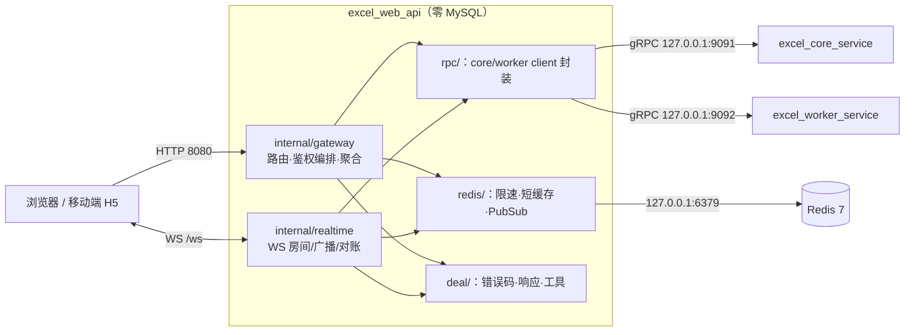
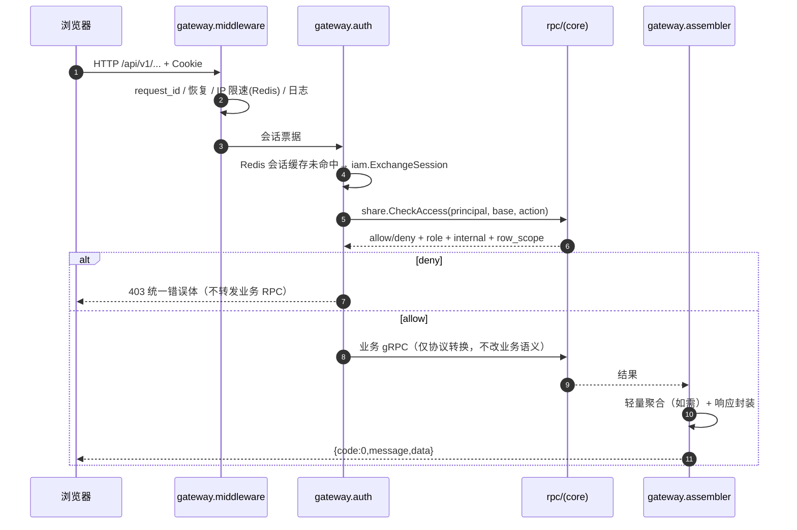
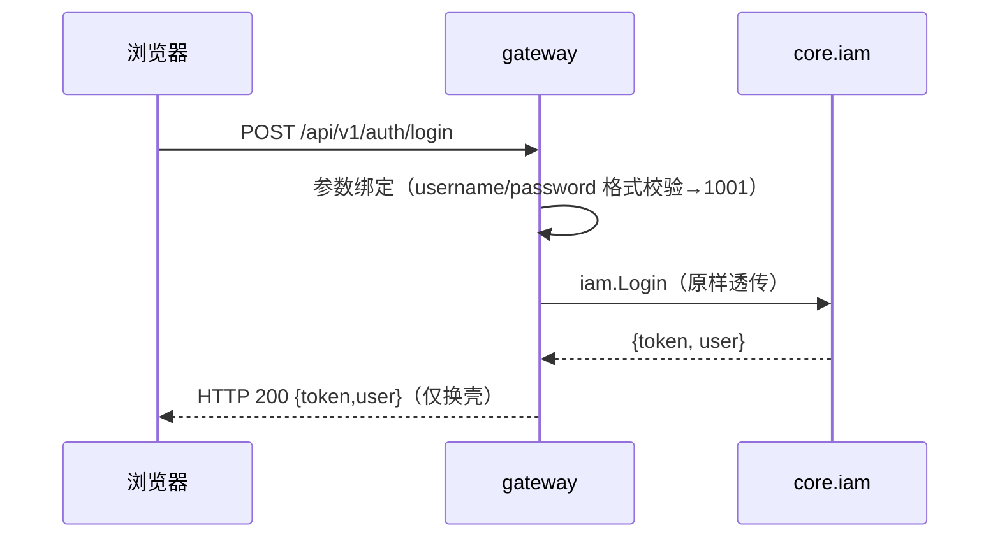
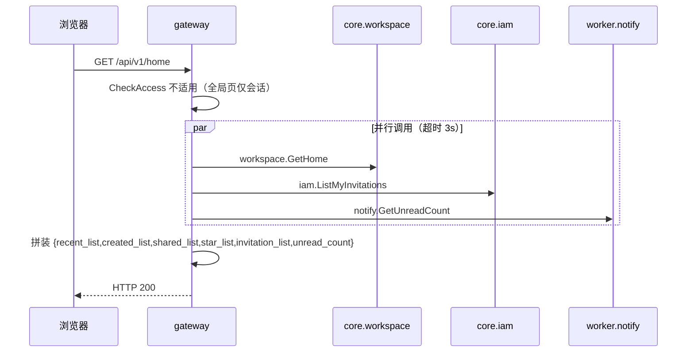
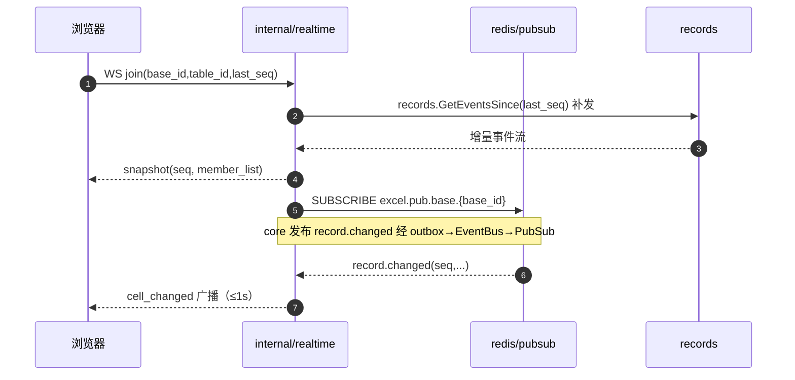
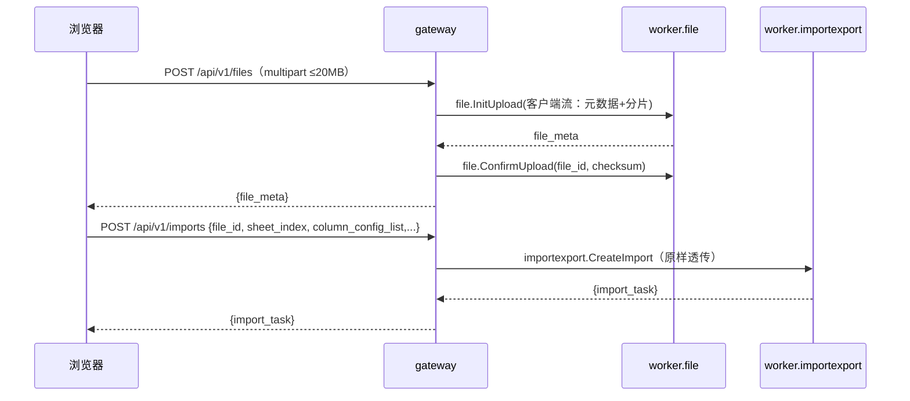

# excel_web_api 服务技术方案（初版）

| 项目 | 内容 |
|---|---|
| 文档版本 | v0.6（规范稿） |
| 关联文档 | 整体技术方案 v1.3、接口文档 v0.6、产品需求文档 v1.3、proto 契约 |
| 定位 | 三进程中的唯一公网面（HTTP/WS），**轻量网关**：业务逻辑主要放在 core/worker，本服务仅负责调用 service、整合数据与少量简单逻辑 |
| 部署 | 单机自托管，公网端口 8080；**零 MySQL 连接**；Redis 仅限速/短缓存/PubSub（可丢弃数据） |

## 修订记录

| 版本 | 日期 | 修订内容 | 作者 |
|---|---|---|---|
| v0.1 | 2026-10-29 | 首次发布：轻量化网关设计、职责边界、分层、聚合清单与关键链路 | （待填） |
| v0.2 | 2026-10-29 | 补充本服务 WebSocket 契约 proto（excel.webapi.v1）与 proto 依赖清单 | （待填） |
| v0.3 | 2026-10-29 | 评审修订：补齐遗漏 G1-G7、优化 O1-O5；Q 系列按建议定案（fail-open/局部降级/心跳与容量/protojson/落盘 webapi.proto） | （待填） |
| v0.4 | 2026-10-29 | 增加接口规格总表：93 个 HTTP + 16 个 WS 的分级、幂等/异常策略、下游依赖 | （待填） |
| v0.5 | 2026-10-29 | 沉淀文件结构规则并重建仓库骨架（一文件一接口/common.go/xxx_config） | （待填） |
| v0.6 | 2026-10-30 | base 层模块分文件、表前缀 excel_<模块>_；新增代码编写规则（函数命名/单一职责/500 行） | （待填） |

## 1. 设计原则

1. **业务下沉**：状态机、事务、规则、审计、通知、计算全部在 core/worker 实现；`excel_web_api` 不落业务数据、不做角色以外的业务判定。
2. **网关只做四件事**：①会话识别（token → Principal）；②统一鉴权（`share.CheckAccess`）；③协议转换（REST/WS ↔ gRPC）；④数据聚合（把 2~3 个 RPC 结果拼装为 1 个 HTTP 响应）。
3. **简单逻辑白名单**：仅限参数绑定与轻量校验（格式/长度 → 1001）、IP 限速、短缓存（TTL<60s）、幂等键透传、文件流桥接、`/s/{link_token}` 重定向。超出白名单即下沉到 RPC。
4. **聚合最小化**：默认前端并行调用既有接口；仅当响应间有依赖、或强一致要求时，才由网关聚合（聚合点清单见第 6 节，当前仅 2 个组合点）。
5. **无状态（WS 内存态除外）**：随时可重启；重启后 WS 依赖 seq 对账恢复，其余接口无会话粘性。
6. **命名与分层**：沿用《整体技术方案 v1.3》§10.1 命名基线；分层 `rpc/redis/deal/internal`。

## 2. 职责边界

### 2.1 做什么

- REST 路由与 `REST → gRPC` 映射（HTTP `/api/v1`，冻结版本）。
- 会话解析与统一鉴权：`iam.ExchangeSession` → `share.CheckAccess`（缓存 TTL<60s），越权即 403，不转发业务 RPC。
- 轻量聚合：组合少数 RPC（详见第 6 节），绝不在网关重写业务规则。
- 静态资源托管（前端构建产物，自托管）。
- WebSocket 协作：房间、在线状态、颜色、光标/选区、广播、断线 `last_seq` 对账补发。
- 文件流桥接：HTTP 流 ↔ `file.InitUpload`（客户端流）/`DownloadStream`（服务端流）；导入导出流同理。
- `/s/{link_token}` 链接入口：解析 `LinkContext`、引导登录/注册、跳转 Base。
- IP 限速（Redis 滑窗）、`/healthz`、`/readyz`、统一错误响应。

### 2.2 不做什么（红线）

| 不做 | 原因/归属 |
|---|---|
| 不连接 MySQL、不落任何业务数据 | 规则 1；数据所有权在 core/worker |
| 不重复角色校验 | 已由 `CheckAccess` 裁决；业务 RPC 做行级过滤即可 |
| 不做公式计算、导入解析、缩略图、通知/审计生成 | `calc`/`importexport`/`file`/`notify`/`audit` 职责 |
| 不做定时任务、后台循环（WS 心跳除外） | `scheduler` 职责 |
| 不在网关实现业务组合状态机 | 如邀请流程、注销冷静期仅转发 `iam` |

## 3. 总体架构与分层



分层职责与依赖规则：

| 层 | 职责 | 依赖规则 |
|---|---|---|
| `internal/gateway` | 路由表、统一鉴权编排、聚合组装、静态资源、中间件 | 仅依赖 rpc/redis/deal；不 import 其他 internal 业务包（realtime 除外，经接口隔离） |
| `internal/realtime` | WS 接入、房间、presence、广播、补发对账、心跳 | 依赖 redis/（PubSub）、rpc/（`records.GetEventsSince` 补发） |
| `rpc/` | 对 core/worker 的 gRPC client 封装：`rpc/core/{iam,share,audit,workspace,structure,records,calc,comment}.go`、`rpc/worker/{file,importexport,notify}.go`；统一注入 principal、超时（建议 3s，流式例外）、重试策略（仅幂等 GET） | 仅 proto 生成代码 + deal |
| `redis/` | `rate`（滑窗限速）、`cache`（会话/鉴权短缓存）、`pubsub`（realtime 订阅、事件） | 仅 redis client + deal |
| `deal/` | 统一错误码映射、响应封装、请求 ID、日志字段、参数校验工具 | 无业务依赖 |

## 4. 关键链路

### 4.1 请求处理管线（统一模板）



处理约定：每个 HTTP 接口在 `gateway` 内是一段「鉴权 → 参数绑定 → RPC → 组装」的薄代码；**单接口累计不超过一次业务判断**，复杂判断一律下沉。实现上采用表驱动路由 + 统一处理模板，直通/聚合/编排三类注册同一模板；聚合并发用 errgroup（O1）。

### 4.2 直通模式（多数接口，零逻辑）



典型直通：H-02/H-06/H-09/H-16/H-30/H-51/H-58/H-64/H-73/H-85 等约 85% 接口，网关不加工语义。

### 4.3 聚合模式（仅 2 个组合点）



部分失败语义（Q3 已决）：聚合成员任一失败不整体 500；`invitation_list/unread_count` 置空并在响应附 `partial=true`，网关记录错误日志。

## 5. 鉴权与缓存（轻量实现要点）

- 会话缓存：`redis/cache`，键 `excel:session:{token}`，TTL 55s（<60s 熔断窗口）；未命中回源 `iam.ExchangeSession`。
- 鉴权缓存：键 `excel:ac:{user_id}:{base_id}:{action}`，TTL 55s；value = {allow, role, internal, row_scope}。
- 主动失效：订阅 `share.changed`、`link.closed` 事件（redis/pubsub），按 base_id 批量删鉴权缓存，满足「收窄/关闭链接 1 分钟内全体失效」。
- 行级过滤不下放网关：`row_scope=OWN` 场景由 `records` 服务按 principal 过滤，网关不做。
- 防击穿（O2）：并发相同缓存 key 用 `singleflight` 合并回源，避免缓存未命中风暴。
- 预热（O4）：首个 Base 视图请求时，预热该 `(user,base)` 下常用 actions（view/edit_all/comment/export）的鉴权缓存。
- 降级（G3/Q2 已决）：Redis 不可用时 fail-open——限速放行并告警；会话缓存 miss 回源 `iam.ExchangeSession`；PubSub 断开则 realtime 转 `records.GetEventsSince` 定时对账兜底。

## 6. 数据聚合清单（v0.1 冻结）

| 组合点 | HTTP | 调用链 | 说明 |
|---|---|---|---|
| 首页聚合 | H-21 `GET /home` | `workspace.GetHome` + `iam.ListMyInvitations` + `notify.GetUnreadCount`（并行） | 三个来源无依赖，一次往返 |
| 分享弹窗初始化 | H-63 + H-67（前端并行，不建组合接口） | `share.ListCollaborators` + `share.GetLink` | 依赖同源 share，可并行；演示期不建组合接口（Q1 已决） |

规则：除上表外，其余接口一律直通；未来新增聚合点须评审「是否带来强一致/减少次数收益」，避免网关膨胀。

## 7. WebSocket 协作链（realtime）



- 纯内存房间：在线成员/颜色/光标/「编辑中」标记不落库；进程重启即丢，客户端重连 `last_seq` 对账。
- 心跳与容量（Q4 已决）：客户端 10s 心跳；服务端 30s 超时清理离线成员；指数退避重连 1s/2s/4s（上限 30s）；单进程 WS 连接上限 500、超限排队；压测 T2 后回写终值。
- 合帧（O3）：同一房间事件按 50ms 窗口批量合帧下发，降低小包与扇出。
- 优雅退出与吊销（G6）：订阅 `link.closed` 按 base 广播 `session_revoked`；服务优雅重启前先推送该消息并发送 WS close code 1001。

### 7.1 WebSocket 消息契约（excel.webapi.v1）

说明：本服务**不部署 gRPC server**；该包的用途是给 WS 帧一个可生成、可校验的契约。消息编号与《接口文档 v0.6》W-01~W-16 一一对应。已决（Q5/Q6）：transport 固定 protojson；契约文件同步落盘 `proto/webapi/v1/webapi.proto`。

```proto
// excel.webapi.v1：excel_web_api 自身契约（WebSocket 帧，protojson over WS）
syntax = "proto3";

package excel.webapi.v1;

option go_package = "excel/api/webapi/v1;webapiv1";

import "common/v1/common.proto";

// 客户端 → 服务端
message JoinRequest { string base_id = 1; string table_id = 2; int64 last_seq = 3; }      // W-01
message LeaveRequest {}                                                                   // W-02
message HeartbeatRequest {}                                                               // W-03
message CursorRequest { string record_id = 1; string field_id = 2; string range = 3; }    // W-04
message SelectionRequest { string range = 1; }                                            // W-05
message EditingRequest { string record_id = 1; string field_id = 2; bool on = 3; }        // W-06
message ReplayRequest { int64 last_seq = 1; }                                             // W-07

// 服务端 → 客户端
message MemberPresence { string user_id = 1; string color = 2; bool online = 3; bool internal = 4; }
message Snapshot { int64 seq = 1; repeated MemberPresence member_list = 2; }              // W-08
message CellChanged {                                                                     // W-09
  int64 seq = 1;
  string record_id = 2;
  string field_id = 3;
  excel.common.v1.Value value = 4;
  int64 version = 5;
  string operator = 6;
}
message RecordDeleted { int64 seq = 1; string record_id = 2; }                            // W-10
message StructureChanged { int64 seq = 1; string change_type = 2; string table_id = 3; string field_id = 4; } // W-11
message PresenceChanged { string user_id = 1; string color = 2; bool online = 3; bool internal = 4; } // W-12
message CursorEcho { string user_id = 1; string record_id = 2; string field_id = 3; string range = 4; }    // W-13
message RecalcStatus { string record_id = 1; string field_id = 2; string status = 3; }    // W-14
message SessionRevoked { string reason = 1; }                                             // W-15
message Ack { string msg_id = 1; }                                                        // W-16

// 统一帧：每条 WS 消息一个 Frame（如需落盘契约文件，建议 proto/webapi/v1/webapi.proto）
message Frame {
  string msg_id = 1;
  oneof payload {
    JoinRequest join = 2;
    LeaveRequest leave = 3;
    HeartbeatRequest heartbeat = 4;
    CursorRequest cursor = 5;
    SelectionRequest selection = 6;
    EditingRequest editing = 7;
    ReplayRequest replay_request = 8;
    Snapshot snapshot = 9;
    CellChanged cell_changed = 10;
    RecordDeleted record_deleted = 11;
    StructureChanged structure_changed = 12;
    PresenceChanged presence = 13;
    CursorEcho cursor_echo = 14;
    RecalcStatus recalc_status = 15;
    SessionRevoked session_revoked = 16;
    Ack ack = 17;
  }
}
```
## 8. 文件与导入导出流桥接



网关只做流的中转与 RPC 桥接；解析、报告、通知、审计全在 worker。

## 9. 错误处理与统一响应

- 统一体：`{"code":0,"message":"ok","data":...}`；错误码与 HTTP 映射沿用接口文档 §8.0.1（1001→400、2001→401、3001/3002→403、4001/4002→409、5001/5002→413、5003→429、9001→5xx）。
- gRPC 错误 → 统一体：读取 status code 与 details 中的 `code/message`；网关不补业务错误文案。
- 日志与脱敏（G7）：request_id 贯穿；不落密码、会话票据、`Authorization`、`link_token`、请求正文、附件内容；明文 HTTP 风险已确认接受。
- 错误映射集中化（O5）：`deal/errcode` 表驱动完成 gRPC status → 统一错误体/HTTP 状态，全服务单点维护。
- CORS 与安全头（G4）：默认同源、不开放 CORS；响应带 `X-Request-Id`；含票据/数据的响应加 `Cache-Control: no-store`。

## 10. 限速与防滥用（redis/rate）

- 按 IP 滑窗计数，作用于：注册、登录、记录提交、评论与 @（PRD 7.5）。
- 参数建议（挂配置、按实测调）：注册 10 次/分/IP；登录 20 次/分/IP；写操作 120 次/分/IP；默认超限返回 5003 + 提示。
- 登录失败锁定（用户名+IP，15 分钟）属 `iam` 逻辑，网关不重复实现。
- admin 操作不经网关（脚本直连 localhost RPC），不占用限速逻辑。
- 非文件请求体上限 1MB（G2），超限 1001；multipart 大小仍由 worker 在流内校验。

## 11. 关键设计决策

| 编号 | 决策 | 结论 | 理由 |
|---|---|---|---|
| AD-WEB-01 | 业务下沉 | 网关零业务数据、零业务状态机 | 单点可重启、安全边界收敛 |
| AD-WEB-02 | 统一鉴权位置 | 网关调 `share.CheckAccess`，缓存 TTL<60s | 越权请求不触达业务 RPC |
| AD-WEB-03 | 聚合最小化 | 默认前端并行；仅 2 个组合点 | 防 BFF 膨胀 |
| AD-WEB-04 | 无状态 | 除 WS 内存房间外无不落盘状态 | 水平扩展前提（当前单机） |
| AD-WEB-05 | 协议转换为主 | 85% 接口为直通换壳 | 简单、可单测、低维护成本 |

## 12. 配置与运维

- `configs/web_api_config.yaml` 骨架已建；新增项：限速阈值、缓存 TTL、WS 心跳/超时、静态资源目录、请求超时（3s）/流超时（300s）。
- 端口：8080 唯一公网；内部目标 `127.0.0.1:9091/9092`、Redis `127.0.0.1:6379`。
- 健康检查：`/healthz`（存活）、`/readyz`（core/worker/Redis 就绪）。
- 可观测性（G5）：预留 Prometheus 指标——请求量/延迟/错误码分布/限速命中/鉴权缓存命中/WS 连接数；不接第三方上报 SDK。
- 限额与超时（G2/Q4）：JSON body ≤1MB；WS 连接上限 500；RPC 超时 3s、流超时 300s；以上入 `configs/web_api_config.yaml`。
- 优雅退出：停止接新请求 → 拆 WS 集群推送 → 排空在途请求（10s）→ 退出。
- 静态资源（G1）：构建产物带内容 hash 长缓存；`index.html` 与 SPA 路由做 history fallback 且 no-cache；禁第三方 CDN/统计/字体 SDK。

## 13. 与接口文档的映射（v0.6 93 个 HTTP 接口分类）

| 类别 | 数量占比（约） | 网关行为 |
|---|---|---|
| 直通（单一 RPC 换壳） | ~85%（约 79 个） | 鉴权→绑定→1 RPC→封装 |
| 聚合（组合 2+ RPC） | 2 个组合点（H-21；H-63+H-67 评估中） | 并行调用 + 字段拼装 |
| 编排（多步串行） | 导入 H-77→H-82；导出 H-85→H-86；上传三段式 | 仅顺序调用，每步直通 |
| 静态/入口 | `/s/{link_token}`、`/assets`、`/healthz` | 网关本地处理 |

rpc client 分组（`rpc/`）：

| 文件 | 封装模块 | 主要消费接口 |
|---|---|---|
| `rpc/core/iam.go` | iam | Login/Register/ExchangeSession/成员/邀请/admin 通道 |
| `rpc/core/share.go` | share | CheckAccess、协作者、链接 |
| `rpc/core/workspace.go` | workspace | Home、Base 资产 |
| `rpc/core/structure.go` | structure | 表/字段/视图 |
| `rpc/core/records.go` | records | 查询/写/历史/`GetEventsSince` |
| `rpc/core/comment.go` | comment | 评论 |
| `rpc/core/audit.go` | audit | 查询/导出（企业管理员） |
| `rpc/core/calc.go` | calc | 公式预览校验 |
| `rpc/worker/file.go` | file | InitUpload/Download/Thumb |
| `rpc/worker/importexport.go` | importexport | 预览/导入/导出 |
| `rpc/worker/notify.go` | notify | 通知/未读 |

### 13.1 本服务涉及的 proto 契约清单

| proto 包 | 用途 | 使用方式 |
|---|---|---|
| `excel.webapi.v1` | 本服务自身 WS 帧契约 | protojson 编解码（落盘 `proto/webapi/v1/webapi.proto`，见 §7.1） |
| `excel.common.v1` | Value/Principal/LinkContext/EventHeader | 客户端代码与帧编解码引用 |
| `excel.iam.v1`~`excel.notify.v1`（12 包） | core/worker 的 gRPC client stub | `rpc/` 层生成代码，仅作客户端导入 |

依赖规则：`rpc/` 只引用 proto 生成代码；`internal/` 不得直接 import 生成包之外的实现细节。
## 14. 风险与待办

| 项 | 说明/缓解 |
|---|---|
| 重合服务不可用 | `/readyz` 摘流量；错误 9001 兜底 |
| 鉴权缓存滞后 | TTL<60s + 事件主动失效；链接熔断窗口已验证 |
| WS 内存态重启 | 客户端 `last_seq` 对账；30s 清理离线 |
| 聚合点膨胀 | 新增聚合须评审（AD-WEB-03） |
| 明文 HTTP | 已确认接受；不打印敏感日志字段 |
| T2 待压测 | 50 人在线 WS 基线实测后校准心跳与广播参数 |

## 附录：网关允许的「简单逻辑」白名单（超出即下沉）

1. 参数绑定与格式/长度校验（返回 1001）
2. 会话/鉴权结果短缓存读取与写入
3. IP 滑窗限速判定
4. `client_request_id` 透传
5. HTTP↔gRPC 流桥接与 multipart 解析
6. `/s/{link_token}` 解析与重定向
7. WS 房间路由/心跳/seq 对账（realtime 内）
8. 统一响应体组装与日志字段填充

## 结语

网关职责四件事、简单逻辑白名单、聚合组合点清单（仅 2 个）为本方案三条基线；新增逻辑先对照白名单，不能归入白名单的一律下沉 core/worker。

## 15. 接口规格总表（分级 / 健壮性 / 依赖）

> 分级与符号同《excel_core_service-技术方案》§14.1/14.2。所有受保护接口统一前置：`RED:session` 会话解析 → `RPC:share.CheckAccess`（RED:ac 缓存），下表只列业务下游。

### 15.1 HTTP（H-01 ~ H-47）

| 接口 | 级 | 幂等/异常 | 业务下游 | 说明 |
|---|---|---|---|---|
| H-01 register | P0 | NAT/F | RPC:iam.Register | 三路径透传 |
| H-02 login | P0 | RW/F+限流 | RPC:iam.Login | 锁定在 iam |
| H-03 logout | P1 | NAT/F | RPC:iam.Logout | — |
| H-04 me | P1 | RW/F | RPC:iam.GetMe | — |
| H-05 profile | P2 | NAT/F | RPC:iam.UpdateProfile | — |
| H-06 password | P2 | NAT/F | RPC:iam.ChangePassword | 不打印密码 |
| H-07 deactivate | P2 | NAT/F | RPC:iam.RequestDeactivate | — |
| H-08 cancel deactivate | P2 | NAT/F | RPC:iam.CancelDeactivate | — |
| H-09 enterprise | P1 | RW/F | RPC:iam.GetEnterprise | — |
| H-10 invites | P1 | NAT/F | RPC:iam.InviteMember | — |
| H-11 cancel invite | P2 | NAT/F | RPC:iam.CancelInvite | — |
| H-12 list invites | P2 | RW/E | RPC:iam.ListInvites | — |
| H-13 my invitations | P1 | RW/E | RPC:iam.ListMyInvitations | — |
| H-14 accept | P1 | NAT/F | RPC:iam.AcceptInvite | — |
| H-15 reject | P1 | NAT/F | RPC:iam.RejectInvite | — |
| H-16 members | P1 | RW/E | RPC:iam.ListMembers | — |
| H-17 role | P2 | NAT/F | RPC:iam.UpdateMemberRole | — |
| H-18 disable | P1 | NAT/F | RPC:iam.DisableMember | — |
| H-19 enable | P2 | NAT/F | RPC:iam.EnableMember | — |
| H-20 owner transfer | P2 | NAT/F | RPC:iam.TransferOwner | — |
| H-21 home | P0 | RW/P | RPC:workspace.GetHome+iam.ListMyInvitations+notify.GetUnreadCount | 并行聚合 partial |
| H-22 search bases | P1 | RW/E | RPC:workspace.SearchBases | — |
| H-23 create base | P0 | NAT/F | RPC:workspace.CreateBase | 主入口 |
| H-24 rename base | P1 | NAT/F | RPC:workspace.RenameBase | — |
| H-25 dup base | P2 | CRI/F | RPC:workspace.DuplicateBase | 长任务 |
| H-26 delete base | P1 | NAT/F | RPC:workspace.DeleteBase | — |
| H-27 star | P2 | NAT/F | RPC:workspace.ToggleStar | — |
| H-28 transfer base | P2 | NAT/F | RPC:workspace.TransferBase | — |
| H-29 tables | P0 | RW/E | RPC:structure.ListTables | 渲染依赖 |
| H-30 create table | P1 | NAT/F | RPC:structure.CreateTable | — |
| H-31 rename table | P2 | NAT/F | RPC:structure.RenameTable | — |
| H-32 dup table | P2 | CRI/F | RPC:structure.DuplicateTable | — |
| H-33 delete table | P1 | NAT/F | RPC:structure.DeleteTable | — |
| H-34 fields | P0 | RW/E | RPC:structure.ListFields | 渲染依赖 |
| H-35 create field | P1 | NAT/F | RPC:structure.CreateField | — |
| H-36 rename field | P2 | NAT/F | RPC:structure.RenameField | — |
| H-37 field config | P1 | NAT/F | RPC:structure.UpdateFieldConfig | — |
| H-38 convert | P1 | NAT/F | RPC:structure.ConvertField | 预览→确认两响 |
| H-39 delete field | P1 | NAT/F | RPC:structure.DeleteField | impact 透传 |
| H-40 options | P1 | NAT/F | RPC:structure.UpdateOptions | — |
| H-41 views | P0 | RW/E | RPC:structure.ListViews | — |
| H-42 create view | P1 | NAT/F | RPC:structure.CreateView | — |
| H-43 rename view | P2 | NAT/F | RPC:structure.RenameView | — |
| H-44 dup view | P2 | CRI/F | RPC:structure.DuplicateView | — |
| H-45 delete view | P2 | NAT/F | RPC:structure.DeleteView | — |
| H-46 view config | P0 | RW/E | RPC:structure.GetViewConfig | 渲染依赖 |
| H-47 put view config | P1 | NAT/F | RPC:structure.UpdateViewConfig | — |

### 15.2 HTTP（H-48 ~ H-93）

| 接口 | 级 | 幂等/异常 | 业务下游 | 说明 |
|---|---|---|---|---|
| H-48 records query | P0 | RW/E | RPC:records.QueryView | 主链路 |
| H-49 record | P0 | RW/F | RPC:records.GetRecord | — |
| H-50 create record | P0 | CRI/F | RPC:records.CreateRecord | — |
| H-51 update cell | P0 | NAT/F(4001)KEEP | RPC:records.UpdateCell | 冲突体透传 |
| H-52 batch | P0 | CRI/P | RPC:records.BatchUpdate | skipped 透传 |
| H-53 delete records | P0 | CRI/F | RPC:records.DeleteRecords | — |
| H-54 undo | P1 | NAT/F(4002) | RPC:records.UndoDelete | — |
| H-55 history | P1 | RW/E | RPC:records.GetHistory | — |
| H-56 rollback | P1 | CRI/F | RPC:records.Rollback | — |
| H-57 comments | P1 | RW/E | RPC:comment.ListComments | — |
| H-58 create comment | P1 | CRI/F | RPC:comment.CreateComment | — |
| H-59 reply | P1 | CRI/F | RPC:comment.ReplyComment | — |
| H-60 resolve | P2 | NAT/F | RPC:comment.ResolveComment | — |
| H-61 reopen | P2 | NAT/F | RPC:comment.ReopenComment | — |
| H-62 delete comment | P2 | NAT/F | RPC:comment.DeleteComment | — |
| H-63 collaborators | P1 | RW/E | RPC:share.ListCollaborators | — |
| H-64 add collab | P1 | NAT/F | RPC:share.AddCollaborator | — |
| H-65 role | P1 | NAT/F | RPC:share.UpdateCollaboratorRole | — |
| H-66 remove | P1 | NAT/F | RPC:share.RemoveCollaborator | — |
| H-67 link | P1 | RW/E | RPC:share.GetLink | — |
| H-68 update link | P1 | NAT/F | RPC:share.UpdateLink | 收窄触发熔断 |
| H-69 reset | P1 | NAT/F | RPC:share.ResetLink | — |
| H-70 close | P1 | NAT/F | RPC:share.CloseLink | — |
| H-71 open links | P2 | RW/E | RPC:share.ListOpenLinksByEnterprise | — |
| H-72 force close | P1 | NAT/F | RPC:share.ForceCloseByManager | — |
| H-73 notifications | P1 | RW/E | RPC:notify.ListNotifications | — |
| H-74 unread | P0 | RW/E | RPC:notify.GetUnreadCount | Home 依赖 |
| H-75 mark read | P2 | NAT/F | RPC:notify.MarkRead | — |
| H-76 mark all | P2 | NAT/F | RPC:notify.MarkAllRead | — |
| H-77 upload | P1 | CRI/F(5002) | RPC:file.InitUpload+ConfirmUpload | 流桥接 |
| H-78 download | P1 | RW/F | RPC:file.DownloadStream | 流桥接 |
| H-79 thumb | P1 | RW/F | RPC:file.GetThumb | 流桥接 |
| H-80 rename file | P2 | NAT/F | RPC:file.RenameFile | — |
| H-81 delete file | P1 | NAT/F | RPC:file.DeleteFile | — |
| H-82 import | P1 | CRI/F | RPC:importexport.CreateImport | 先 H-77 |
| H-83 status | P1 | RW/E | RPC:importexport.GetImportStatus | — |
| H-84 report | P2 | RW/F | RPC:importexport.GetImportReport | — |
| H-85 export | P1 | CRI/F | RPC:importexport.CreateExport | — |
| H-86 download export | P1 | RW/F | RPC:importexport.ExportStream | — |
| H-87 audits | P2 | RW/E | RPC:audit.Query | — |
| H-88 audit csv | P2 | RW/F | RPC:audit.ExportCSV | — |
| H-89 cancel dissolution | P2 | NAT/F | RPC:iam.CancelEnterpriseDissolution | — |
| H-90 dissolution status | P2 | RW/E | RPC:iam.GetEnterpriseDissolutionStatus | — |
| H-91 users search | P1 | RW/E | RPC:iam.SearchUsers | — |
| H-92 dup field | P2 | CRI/F | RPC:structure.DuplicateField | — |
| H-93 import preview | P1 | RW/F | RPC:importexport.PreviewImport | 上传先行 |

### 15.3 WebSocket（W-01 ~ W-16）

| 消息 | 级 | 幂等/异常 | 依赖 | 说明 |
|---|---|---|---|---|
| W-01 join | P0 | NAT/F | RED:pubsub RPC:records.GetEventsSince | 对账补发 |
| W-02 leave | P1 | NAT | RED | — |
| W-03 heartbeat | P0(底层) / NAT | RED | 10s 心跳 | — |
| W-04 cursor | P1 | NAT | RED:pubsub | 最新覆盖 |
| W-05 selection | P1 | NAT | RED | — |
| W-06 editing | P0(底层) / NAT | RED | 编辑锁广播 | — |
| W-07 replay_request | P0(底层) / RW | RPC:records.GetEventsSince | 断线重连 | — |
| W-08 snapshot | P0 | RW | RED | — |
| W-09 cell_changed | P0 | RW | RED:pubsub | ≤1s | — |
| W-10 record_deleted | P0 | RW | RED | — |
| W-11 structure_changed | P0(底层) / RW | RED | — |
| W-12 presence | P1 | NAT | RED | — |
| W-13 cursor_echo | P1 | NAT | RED | — |
| W-14 recalc_status | P2 | NAT | RED | — |
| W-15 session_revoked | P0(底层) / RW | RED:link.closed | 熔断语义 | — |
| W-16 ack | P1 | NAT | — | — |

## 文件结构规则（全仓库统一）

1. **模块文件名化**：除通用逻辑外，不同模块的代码分隔在不同文件，文件名以模块名命名（如 `rpc/iam.go`、`rpc/records.go`）。
2. **可复用逻辑归口**：各包内可复用逻辑集中在 `common.go`。
3. **配置命名**：配置文件统一 `<服务>_config` 格式（如 `configs/web_api_config.yaml`、`configs/core_service_config.yaml`、`configs/worker_service_config.yaml`）。
4. **internal 一文件一接口**：`internal/` 以模块名命名文件夹（`internal/iam/`），文件夹内以接口名命名文件、一个文件一个接口（如 `internal/iam/register.go`）；`common.go` 为模块内复用逻辑例外，`doc.go` 仅作包说明。
5. **base 层按模块分文件 + 表前缀**：`base/` 内按模块分文件（`base/iam.go`）；数据库表统一 `excel_<模块名>_` 前缀。A 模块代码只操作 A 模块表；跨模块数据整合/写入尽量在代码逻辑层拆分或聚合，确需跨模块 SQL 时才允许（须注释原因）。
## 代码编写规则（全仓库统一）

1. **函数命名与职责**：函数名必须体现其主要作用；一个函数保持单一功能性。
2. **函数长度**：单函数尽量 ≤500 行；预计超限必须先寻找拆分方案（按步骤/子任务/收窄接口）。确经评估不便拆分方可超限。
3. **符合性**：以上两条在 Code Review 中作为必检项。

## 附录：excel_web_api 仓库文件结构（按文件结构规则生成，全量）

```text
excel_web_api/
├─ cmd/
│   └─ main.go
├─ configs/
│   └─ web_api_config.yaml
├─ deal/
│   ├─ common.go
│   ├─ doc.go
│   ├─ errcode.go
│   └─ response.go
├─ internal/
│   ├─ gateway/
│   │   ├─ accept_invite.go
│   │   ├─ add_collaborator.go
│   │   ├─ batch_update.go
│   │   ├─ cancel_deactivate.go
│   │   ├─ cancel_enterprise_dissolution.go
│   │   ├─ cancel_invite.go
│   │   ├─ change_password.go
│   │   ├─ close_link.go
│   │   ├─ common.go
│   │   ├─ convert_field.go
│   │   ├─ create_base.go
│   │   ├─ create_comment.go
│   │   ├─ create_export.go
│   │   ├─ create_field.go
│   │   ├─ create_import.go
│   │   ├─ create_record.go
│   │   ├─ create_table.go
│   │   ├─ create_view.go
│   │   ├─ delete_base.go
│   │   ├─ delete_comment.go
│   │   ├─ delete_field.go
│   │   ├─ delete_file.go
│   │   ├─ delete_records.go
│   │   ├─ delete_table.go
│   │   ├─ delete_view.go
│   │   ├─ disable_member.go
│   │   ├─ doc.go
│   │   ├─ download.go
│   │   ├─ duplicate_base.go
│   │   ├─ duplicate_field.go
│   │   ├─ duplicate_table.go
│   │   ├─ duplicate_view.go
│   │   ├─ enable_member.go
│   │   ├─ export_audits.go
│   │   ├─ export_stream.go
│   │   ├─ force_close_by_manager.go
│   │   ├─ get_enterprise_dissolution_status.go
│   │   ├─ get_enterprise.go
│   │   ├─ get_history.go
│   │   ├─ get_home.go
│   │   ├─ get_import_report.go
│   │   ├─ get_import_status.go
│   │   ├─ get_link.go
│   │   ├─ get_me.go
│   │   ├─ get_record.go
│   │   ├─ get_thumb.go
│   │   ├─ get_unread_count.go
│   │   ├─ get_view_config.go
│   │   ├─ invite_member.go
│   │   ├─ list_collaborators.go
│   │   ├─ list_comments.go
│   │   ├─ list_fields.go
│   │   ├─ list_invites.go
│   │   ├─ list_members.go
│   │   ├─ list_my_invitations.go
│   │   ├─ list_notifications.go
│   │   ├─ list_open_links_by_enterprise.go
│   │   ├─ list_tables.go
│   │   ├─ list_views.go
│   │   ├─ login.go
│   │   ├─ logout.go
│   │   ├─ mark_all_read.go
│   │   ├─ mark_read.go
│   │   ├─ preview_import.go
│   │   ├─ query_audits.go
│   │   ├─ query_view.go
│   │   ├─ register.go
│   │   ├─ reject_invite.go
│   │   ├─ remove_collaborator.go
│   │   ├─ rename_base.go
│   │   ├─ rename_field.go
│   │   ├─ rename_file.go
│   │   ├─ rename_table.go
│   │   ├─ rename_view.go
│   │   ├─ reopen_comment.go
│   │   ├─ reply_comment.go
│   │   ├─ request_deactivate.go
│   │   ├─ reset_link.go
│   │   ├─ resolve_comment.go
│   │   ├─ rollback.go
│   │   ├─ search_bases.go
│   │   ├─ search_users.go
│   │   ├─ toggle_star.go
│   │   ├─ transfer_base.go
│   │   ├─ transfer_owner.go
│   │   ├─ undo_delete.go
│   │   ├─ update_cell.go
│   │   ├─ update_collaborator_role.go
│   │   ├─ update_field_config.go
│   │   ├─ update_link.go
│   │   ├─ update_member_role.go
│   │   ├─ update_options.go
│   │   ├─ update_profile.go
│   │   ├─ update_view_config.go
│   │   └─ upload.go
│   └─ realtime/
│       ├─ ack.go
│       ├─ cell_changed.go
│       ├─ common.go
│       ├─ cursor_echo.go
│       ├─ cursor.go
│       ├─ doc.go
│       ├─ editing.go
│       ├─ heartbeat.go
│       ├─ join.go
│       ├─ leave.go
│       ├─ presence.go
│       ├─ recalc_status.go
│       ├─ record_deleted.go
│       ├─ replay_request.go
│       ├─ selection.go
│       ├─ session_revoked.go
│       ├─ snapshot.go
│       └─ structure_changed.go
├─ redis/
│   ├─ cache.go
│   ├─ common.go
│   ├─ doc.go
│   ├─ pubsub.go
│   └─ rate.go
├─ rpc/
│   ├─ audit.go
│   ├─ calc.go
│   ├─ comment.go
│   ├─ common.go
│   ├─ doc.go
│   ├─ file.go
│   ├─ iam.go
│   ├─ importexport.go
│   ├─ notify.go
│   ├─ records.go
│   ├─ share.go
│   ├─ structure.go
│   └─ workspace.go
├─ go.mod
└─ README.md
```

共享（仓库根）：proto/（webapi.v1 + common + 12 服务包）、excel_permission_config/（独立配置仓库）。
