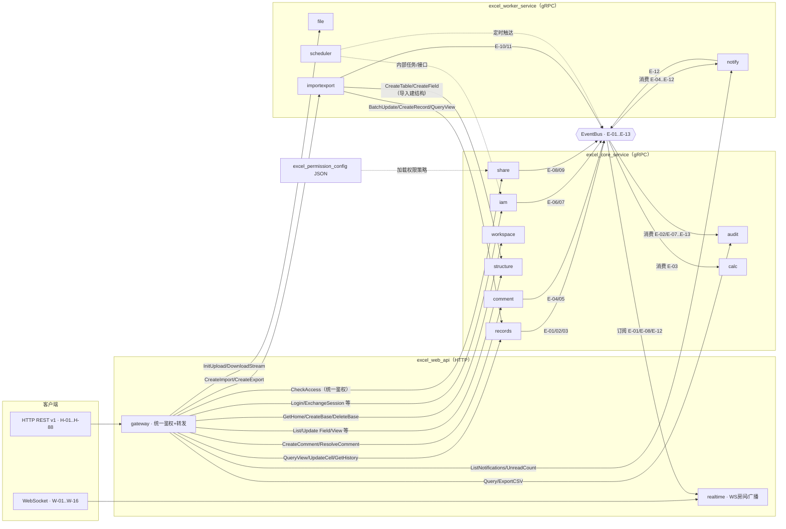
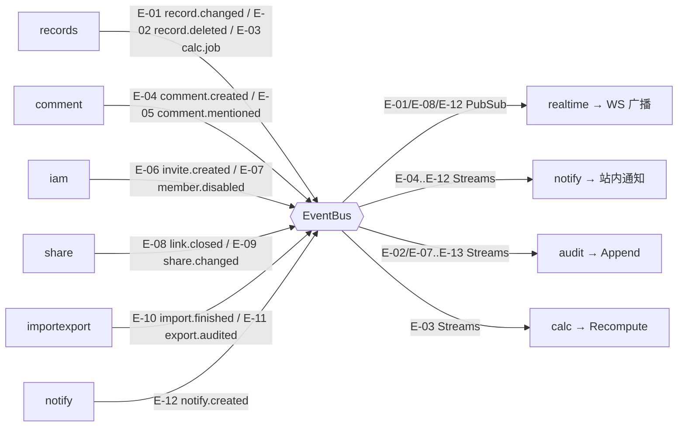
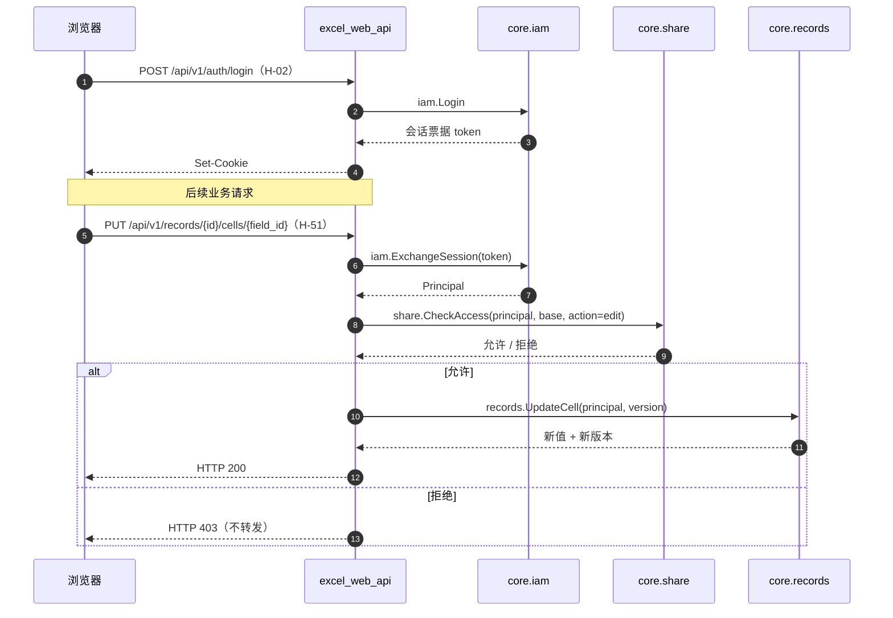
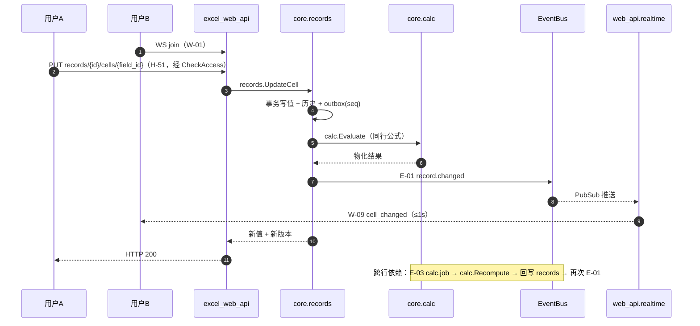
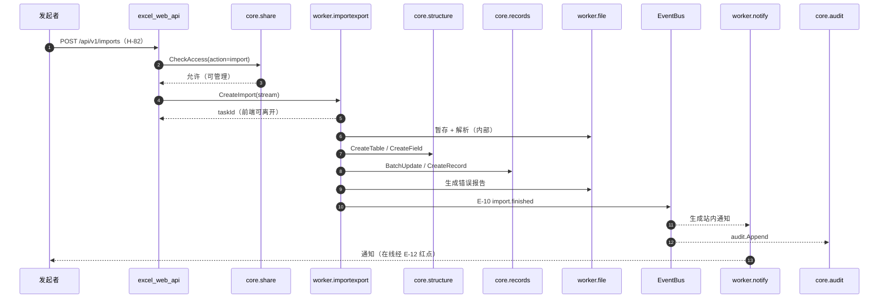
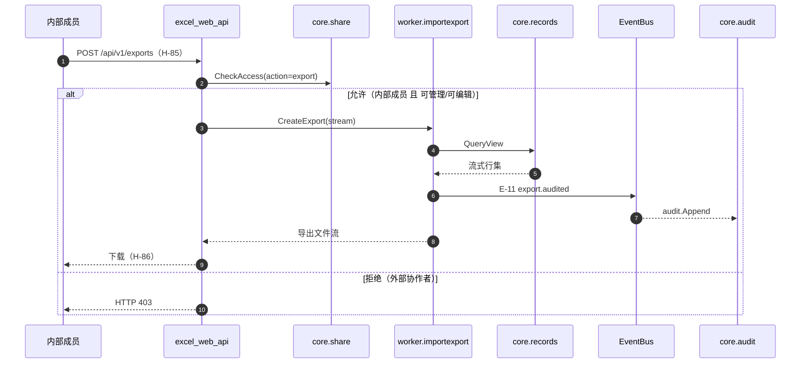

# 三服务接口文档（接口清单与调用关系）

| 项目 | 内容 |
|---|---|
| 文档版本 | v0.6 |
| 文档状态 | 评审稿 |
| 关联文档 | 整体技术方案 v1.3、产品需求文档 v1.3（评审稿） |
| 本版范围 | ①接口清单；②调用关系 UML；③全部接口入参出参；④字段级校验规则；⑤接口示例与契约测试清单 |
| 契约来源 | `proto/` 为唯一事实源；本清单与 proto 联动更新 |

## 修订记录

| 版本 | 日期 | 修订内容 | 作者 |
|---|---|---|---|
| v0.1 | 2026-10-28 | 首次发布：三服务接口清单 + 调用关系 UML | （待填） |
| v0.2 | 2026-10-28 | 补充全部接口入参出参（HTTP 93 / WS 16 / gRPC 110 / 事件 16） | （待填） |
| v0.3 | 2026-10-28 | 补充字段级校验规则与接口示例 | （待填） |
| v0.4 | 2026-10-28 | 补充契约测试清单 | （待填） |
| v0.5 | 2026-10-28 | 补充 P0：值编码字典、鉴权/链接上下文传输约定、文件流衔接、proto 命名与布局；命名统一（admin/operator、_list/_map） | （待填） |
| v0.6 | 2026-10-29 | 补定跨进程清理事件 E-17 enterprise.dissolved | （待填） |

## 1. 接口面总览

| 接口面 | 载体 | 承载服务 | 清单位置 |
|---|---|---|---|
| 对客 REST | HTTP/JSON `/api/v1` | excel_web_api | 第 2 节 |
| 对客实时 | WebSocket `/ws` | excel_web_api.realtime | 第 3 节 |
| 服务间 RPC | gRPC（仅 localhost） | excel_core_service / excel_worker_service | 第 4 节 |
| 服务间事件 | EventBus（Redis Streams + PubSub） | 三服务 | 第 5 节 |
| 权限策略 | JSON 静态配置（非运行时调用） | excel_permission_config → core.share | 第 6 节说明 |

约定：

- 权限校验统一在 `excel_web_api`：除认证/静态资源外的每个请求先调 `share.CheckAccess` 再转发业务 gRPC。
- 编号：`H-xx`=对客 HTTP；`W-xx`=WebSocket 消息；`G-{模块}-xx`=gRPC；`E-xx`=事件。
- 第 7 节 UML 中出现的接口名与第 2–5 节清单保持一致。

## 2. HTTP 接口清单（excel_web_api）

### 2.1 认证与账户

| 编号 | 方法与路径 | 说明 | 转发 gRPC 接口 |
|---|---|---|---|
| H-01 | POST /api/v1/auth/register | 用户名+密码注册（三条归属路径，受注册开关控制） | iam.Register |
| H-02 | POST /api/v1/auth/login | 登录，发放会话票据 | iam.Login |
| H-03 | POST /api/v1/auth/logout | 退出登录 | iam.Logout |
| H-04 | GET /api/v1/auth/me | 当前身份/企业/角色概要 | iam.GetMe |
| H-05 | PUT /api/v1/me/profile | 修改显示名/头像 | iam.UpdateProfile |
| H-06 | POST /api/v1/me/password | 凭旧密码修改密码 | iam.ChangePassword |
| H-07 | POST /api/v1/me/deactivate | 申请注销（7 天冷静期） | iam.RequestDeactivate |
| H-08 | POST /api/v1/me/deactivate/cancel | 撤回注销申请 | iam.CancelDeactivate |

### 2.2 企业与成员

| 编号 | 方法与路径 | 说明 | 转发 gRPC 接口 |
|---|---|---|---|
| H-09 | GET /api/v1/enterprise | 企业信息 | iam.GetEnterprise |
| H-10 | POST /api/v1/enterprise/invites | 按用户名邀请成员 | iam.InviteMember |
| H-11 | DELETE /api/v1/enterprise/invites/{id} | 撤回邀请 | iam.CancelInvite |
| H-12 | GET /api/v1/enterprise/invites | 企业侧待处理邀请列表 | iam.ListInvites |
| H-13 | GET /api/v1/invitations | 我收到的邀请（个人首页待办） | iam.ListMyInvitations |
| H-14 | POST /api/v1/invitations/{id}/accept | 接受邀请加入企业 | iam.AcceptInvite |
| H-15 | POST /api/v1/invitations/{id}/reject | 拒绝邀请 | iam.RejectInvite |
| H-16 | GET /api/v1/enterprise/members | 成员列表 | iam.ListMembers |
| H-17 | PUT /api/v1/enterprise/members/{id}/role | 调整成员角色（管理员/成员） | iam.UpdateMemberRole |
| H-18 | POST /api/v1/enterprise/members/{id}/disable | 停用成员 | iam.DisableMember |
| H-19 | POST /api/v1/enterprise/members/{id}/enable | 恢复启用成员 | iam.EnableMember |
| H-20 | POST /api/v1/enterprise/owner/transfer | 转移企业所有者（二次确认） | iam.TransferOwner |

> 口径说明：新建企业随注册路径③隐式创建（iam.Register 内建企业），不单独提供 HTTP「新建企业」接口（D18）；企业注销 P0 无自助入口（D22），普通用户不暴露注销接口，仅 admin 受理 + 所有者冷静期撤回，见 2.14。

### 2.3 首页与 Base

| 编号 | 方法与路径 | 说明 | 转发 gRPC 接口 |
|---|---|---|---|
| H-21 | GET /api/v1/home | 首页聚合（最近访问/我创建/与我共享/星标/邀请待办） | workspace.GetHome |
| H-22 | GET /api/v1/bases?q= | 按名称搜索 Base | workspace.SearchBases |
| H-23 | POST /api/v1/bases | 新建空白多维表格 | workspace.CreateBase |
| H-24 | PATCH /api/v1/bases/{id} | 重命名 Base | workspace.RenameBase |
| H-25 | POST /api/v1/bases/{id}/duplicate | 复制 Base | workspace.DuplicateBase |
| H-26 | DELETE /api/v1/bases/{id} | 删除 Base（强提示，P0 不可恢复） | workspace.DeleteBase |
| H-27 | POST /api/v1/bases/{id}/star | 星标置顶切换 | workspace.ToggleStar |
| H-28 | POST /api/v1/bases/{id}/transfer | 管理员接管/转移 Base 所有权 | workspace.TransferBase |

### 2.4 数据表

| 编号 | 方法与路径 | 说明 | 转发 gRPC 接口 |
|---|---|---|---|
| H-29 | GET /api/v1/bases/{id}/tables | 数据表列表 | structure.ListTables |
| H-30 | POST /api/v1/bases/{id}/tables | 新增数据表 | structure.CreateTable |
| H-31 | PATCH /api/v1/tables/{id} | 重命名数据表 | structure.RenameTable |
| H-32 | POST /api/v1/tables/{id}/duplicate | 复制数据表 | structure.DuplicateTable |
| H-33 | DELETE /api/v1/tables/{id} | 删除数据表 | structure.DeleteTable |

### 2.5 字段与选项

| 编号 | 方法与路径 | 说明 | 转发 gRPC 接口 |
|---|---|---|---|
| H-34 | GET /api/v1/tables/{id}/fields | 字段列表 | structure.ListFields |
| H-35 | POST /api/v1/tables/{id}/fields | 新增字段 | structure.CreateField |
| H-36 | PATCH /api/v1/fields/{id} | 重命名字段/改表级顺序 | structure.RenameField |
| H-37 | PUT /api/v1/fields/{id}/config | 更新字段配置（类型参数/选项开关等） | structure.UpdateFieldConfig |
| H-38 | POST /api/v1/fields/{id}/convert | 更改字段类型（影响预览+确认） | structure.ConvertField |
| H-39 | DELETE /api/v1/fields/{id} | 删除字段（影响面提示） | structure.DeleteField |
| H-40 | PUT /api/v1/fields/{id}/options | 维护单选/多选选项（增删改排序） | structure.UpdateOptions |

### 2.6 视图

| 编号 | 方法与路径 | 说明 | 转发 gRPC 接口 |
|---|---|---|---|
| H-41 | GET /api/v1/tables/{id}/views | 视图列表 | structure.ListViews |
| H-42 | POST /api/v1/tables/{id}/views | 新建视图 | structure.CreateView |
| H-43 | PATCH /api/v1/views/{id} | 重命名视图 | structure.RenameView |
| H-44 | POST /api/v1/views/{id}/duplicate | 复制视图 | structure.DuplicateView |
| H-45 | DELETE /api/v1/views/{id} | 删除视图 | structure.DeleteView |
| H-46 | GET /api/v1/views/{id}/config | 获取视图配置 | structure.GetViewConfig |
| H-47 | PUT /api/v1/views/{id}/config | 更新视图配置（筛选/排序/分组/显隐/冻结） | structure.UpdateViewConfig |

### 2.7 记录与历史

| 编号 | 方法与路径 | 说明 | 转发 gRPC 接口 |
|---|---|---|---|
| H-48 | GET /api/v1/bases/{id}/records?table=&view=&cursor= | 视图查询（筛选/排序/分组/分页） | records.QueryView |
| H-49 | GET /api/v1/records/{id} | 获取单条记录 | records.GetRecord |
| H-50 | POST /api/v1/bases/{id}/records | 新增记录 | records.CreateRecord |
| H-51 | PUT /api/v1/records/{id}/cells/{field_id} | 更新单元格（带乐观锁版本） | records.UpdateCell |
| H-52 | POST /api/v1/records/batch | 批量更新（含粘贴） | records.BatchUpdate |
| H-53 | DELETE /api/v1/records | 删除记录（单条/批量） | records.DeleteRecords |
| H-54 | POST /api/v1/records/{id}/undo | 7 秒内撤销删除 | records.UndoDelete |
| H-55 | GET /api/v1/records/{id}/history | 记录操作历史（90 天） | records.GetHistory |
| H-56 | POST /api/v1/records/{id}/history/{node_id}/rollback | 回滚历史字段值 | records.Rollback |

### 2.8 评论

| 编号 | 方法与路径 | 说明 | 转发 gRPC 接口 |
|---|---|---|---|
| H-57 | GET /api/v1/records/{id}/comments | 记录评论列表（两级） | comment.ListComments |
| H-58 | POST /api/v1/records/{id}/comments | 发表评论 | comment.CreateComment |
| H-59 | POST /api/v1/comments/{id}/replies | 回复评论 | comment.ReplyComment |
| H-60 | POST /api/v1/comments/{id}/resolve | 标记已解决 | comment.ResolveComment |
| H-61 | POST /api/v1/comments/{id}/reopen | 重新打开 | comment.ReopenComment |
| H-62 | DELETE /api/v1/comments/{id} | 删除自己评论/可管理删除 | comment.DeleteComment |

### 2.9 分享与外部链接

| 编号 | 方法与路径 | 说明 | 转发 gRPC 接口 |
|---|---|---|---|
| H-63 | GET /api/v1/bases/{id}/shares/members | 协作者列表 | share.ListCollaborators |
| H-64 | POST /api/v1/bases/{id}/shares/members | 添加协作者（外部上限可编辑） | share.AddCollaborator |
| H-65 | PUT /api/v1/shares/members/{id}/role | 调整协作者角色 | share.UpdateCollaboratorRole |
| H-66 | DELETE /api/v1/shares/members/{id} | 移除协作者 | share.RemoveCollaborator |
| H-67 | GET /api/v1/bases/{id}/link | 获取链接分享配置 | share.GetLink |
| H-68 | PUT /api/v1/bases/{id}/link | 修改分享范围/链接角色 | share.UpdateLink |
| H-69 | POST /api/v1/bases/{id}/link/reset | 重置链接（旧链立即作废） | share.ResetLink |
| H-70 | POST /api/v1/bases/{id}/link/close | 关闭链接分享 | share.CloseLink |
| H-71 | GET /api/v1/enterprise/open-links | 企业内全部「任何人」外链清单 | share.ListOpenLinksByEnterprise |
| H-72 | POST /api/v1/enterprise/open-links/{id}/close | 管理员强制关闭外链 | share.ForceCloseByManager |

### 2.10 通知

| 编号 | 方法与路径 | 说明 | 转发 gRPC 接口 |
|---|---|---|---|
| H-73 | GET /api/v1/notifications | 通知列表（时间倒序聚合） | notify.ListNotifications |
| H-74 | GET /api/v1/notifications/unread-count | 未读计数 | notify.GetUnreadCount |
| H-75 | POST /api/v1/notifications/{id}/read | 单条已读 | notify.MarkRead |
| H-76 | POST /api/v1/notifications/read-all | 全部已读 | notify.MarkAllRead |

### 2.11 文件

| 编号 | 方法与路径 | 说明 | 转发 gRPC 接口 |
|---|---|---|---|
| H-77 | POST /api/v1/files | 上传附件（multipart，黑名单/容量校验） | file.InitUpload |
| H-78 | GET /api/v1/files/{id}/download | 下载附件 | file.DownloadStream |
| H-79 | GET /api/v1/files/{id}/thumb | 图片缩略图 | file.GetThumb |
| H-80 | PATCH /api/v1/files/{id} | 重命名显示名 | file.RenameFile |
| H-81 | DELETE /api/v1/files/{id} | 删除附件 | file.DeleteFile |

### 2.12 导入导出

| 编号 | 方法与路径 | 说明 | 转发 gRPC 接口 |
|---|---|---|---|
| H-82 | POST /api/v1/imports | 发起导入（xlsx/xls/csv ≤20MB） | importexport.CreateImport |
| H-83 | GET /api/v1/imports/{id} | 查询导入状态 | importexport.GetImportStatus |
| H-84 | GET /api/v1/imports/{id}/report | 下载行级错误报告 | importexport.GetImportReport |
| H-85 | POST /api/v1/exports | 发起当前视图导出 | importexport.CreateExport |
| H-86 | GET /api/v1/exports/{id}/download | 下载导出文件 | importexport.ExportStream |

### 2.13 审计

| 编号 | 方法与路径 | 说明 | 转发 gRPC 接口 |
|---|---|---|---|
| H-87 | GET /api/v1/enterprise/audits | 查询企业操作审计（180 天） | audit.Query |
| H-88 | GET /api/v1/enterprise/audits/export.csv | 导出审计 CSV | audit.ExportCSV |

### 2.14 企业生命周期（补充）

| 编号 | 方法与路径 | 说明 | 转发 gRPC 接口 |
|---|---|---|---|
| H-89 | POST /api/v1/enterprise/dissolution/cancel | 所有者在 30 天冷静期内撤回企业注销 | iam.CancelEnterpriseDissolution |
| H-90 | GET /api/v1/enterprise/dissolution | 查询企业注销状态（冷静期/受理中） | iam.GetEnterpriseDissolutionStatus |

说明：企业注销的受理仅提供 RPC（`iam.InitiateEnterpriseDissolution`），由 admin 脚本调用、动作入审计，不暴露 HTTP；所有者冷静期撤回走 H-89；到期删除由 scheduler 调 `iam.ExecuteEnterpriseDissolution` 完成。
### 2.15 补充接口（A 类审核加入）

| 编号 | 方法与路径 | 说明 | 转发 gRPC 接口 |
|---|---|---|---|
| H-91 | GET /api/v1/users/search?q= | 按用户名/显示名搜索注册账号（邀请与协作者添加用） | iam.SearchUsers |
| H-92 | POST /api/v1/fields/{id}/duplicate | 复制字段（复制配置不复制数据） | structure.DuplicateField |
| H-93 | POST /api/v1/imports/preview | 导入解析预览（类型识别/首行字段名/逐列配置） | importexport.PreviewImport |

说明：本组为评审后补充；H-93 预览与 H-82 确认执行构成两段式导入流程。
## 3. WebSocket 消息清单（excel_web_api.realtime）

### 3.1 客户端 → 服务端

| 编号 | 消息 | 说明 |
|---|---|---|
| W-01 | join | 接入 Base 房间（携带 base_id、table_id、last_seq） |
| W-02 | leave | 离开房间 |
| W-03 | heartbeat | 心跳保活 |
| W-04 | cursor | 上报光标/选中位置 |
| W-05 | selection | 上报选中区域 |
| W-06 | editing | 单元格「编辑中」开始/结束 |
| W-07 | replay_request | 断线重连后请求补发（携带 last_seq） |

### 3.2 服务端 → 客户端

| 编号 | 消息 | 说明 |
|---|---|---|
| W-08 | snapshot | 房间快照（当前 seq、在线协作者列表） |
| W-09 | cell_changed | 单元格变更（seq、cell、value、version） |
| W-10 | record_deleted | 记录被删除（seq、record_id） |
| W-11 | structure_changed | 结构变更（字段/表/视图变化） |
| W-12 | presence | 在线状态/颜色/上下线 |
| W-13 | cursor_echo | 他人光标/选区 |
| W-14 | recalc_status | 单元格重算状态（重算中/完成） |
| W-15 | session_revoked | 会话被吊销（链接关闭等，1 分钟内） |
| W-16 | ack | 消息确认（用于对账） |

## 4. gRPC 接口清单（core / worker）

> 权限说明：除统一鉴权接口外，业务 gRPC 不重复角色校验；网关已鉴权后传入 Principal，业务接口仅做行级可见性过滤与归属校验。
> admin 接口（注册开关、应急重置密码、代转移所有者、企业注销受理等）一律不暴露 HTTP；由 admin 脚本经 grpcurl/运维脚本直连 localhost RPC 调用，校验 admin 白名单并入操作审计。

### 4.1 iam（excel_core_service）

| 方法 | 说明 | 主调用方 |
|---|---|---|
| Register | 用户注册（三条归属路径 + 注册开关） | web_api |
| Login | 登录校验，返回会话票据 | web_api |
| Logout | 退出登录并使会话失效 | web_api |
| ExchangeSession | 会话票据换取 Principal | web_api |
| GetMe | 当前身份/企业/角色概要 | web_api |
| UpdateProfile | 修改显示名/头像 | web_api |
| ChangePassword | 凭旧密码改密 | web_api |
| RequestDeactivate | 申请注销（进入 7 天冷静期） | web_api |
| CancelDeactivate | 撤回注销 | web_api |
| ExecuteDeactivation | 到期执行注销（删除凭据/个人资料/资产交接） | scheduler（内部） |
| GetEnterprise | 查询企业信息 | web_api |
| InviteMember | 按用户名邀请成员 | web_api |
| CancelInvite | 撤回邀请 | web_api |
| ListInvites | 企业侧邀请列表 | web_api |
| ListMyInvitations | 个人收到的邀请 | web_api |
| AcceptInvite | 接受邀请 | web_api |
| RejectInvite | 拒绝邀请 | web_api |
| ListMembers | 成员列表 | web_api |
| UpdateMemberRole | 调整成员角色 | web_api |
| DisableMember | 停用成员 | web_api |
| EnableMember | 恢复启用成员 | web_api |
| TransferOwner | 转移企业所有者 | web_api |
| SetRegisterSwitch | 注册开关管理 | admin 脚本（RPC） |
| GetRegisterSwitch | 查询注册开关状态 | admin 脚本（RPC） |
| InitiateEnterpriseDissolution | admin 受理企业注销（30 天冷静期，入审计） | admin 脚本（RPC） |
| CancelEnterpriseDissolution | 所有者冷静期撤回注销 | web_api |
| ExecuteEnterpriseDissolution | 到期执行企业注销（删除全量数据） | scheduler（内部） |
| GetEnterpriseDissolutionStatus | 查询企业注销状态 | web_api |
| AdminResetPassword | admin 应急重置任意账号密码（入审计） | admin 脚本（RPC） |
| AdminTransferOwner | admin 代转移企业所有者（入审计） | admin 脚本（RPC） |
| SearchUsers | 按用户名/显示名搜索注册账号（含企业归属/内外判定） | web_api |

### 4.2 share（excel_core_service）

| 方法 | 说明 | 主调用方 |
|---|---|---|
| CheckAccess | 统一鉴权：身份+Base+动作 → 允许/拒绝 | web_api（唯一对外调用方） |
| ResolveRole | 内部角色裁决（角色+内部标志+行级范围） | 内部 share |
| AddCollaborator | 添加协作者（外部上限可编辑） | web_api |
| RemoveCollaborator | 移除协作者 | web_api |
| UpdateCollaboratorRole | 调整协作者角色 | web_api |
| ListCollaborators | 协作者列表 | web_api |
| GetLink | 获取链接分享配置 | web_api |
| UpdateLink | 修改分享范围/链接角色 | web_api |
| ResetLink | 重置链接 | web_api |
| CloseLink | 关闭链接分享 | web_api |
| ListOpenLinksByEnterprise | 企业内「任何人」外链清单 | web_api |
| ForceCloseByManager | 管理员强制关闭外链 | web_api |

### 4.3 audit（excel_core_service）

| 方法 | 说明 | 主调用方 |
|---|---|---|
| Append | 追加审计事件（动作级，不可删） | EventBus 消费者（内部） |
| Query | 查询审计（180 天，仅所有者/管理员） | web_api |
| ExportCSV | 导出审计 CSV | web_api |

### 4.4 workspace（excel_core_service）

| 方法 | 说明 | 主调用方 |
|---|---|---|
| GetHome | 首页聚合（最近访问/我创建/与我共享/星标/邀请待办） | web_api |
| SearchBases | 按名称搜索 Base | web_api |
| CreateBase | 新建空白 Base | web_api |
| RenameBase | 重命名 Base | web_api |
| DuplicateBase | 复制 Base | web_api |
| DeleteBase | 删除 Base | web_api |
| ToggleStar | 星标切换 | web_api |
| TransferBase | 管理员接管/转移 Base 所有权 | web_api |

### 4.5 structure（excel_core_service）

| 方法 | 说明 | 主调用方 |
|---|---|---|
| ListTables | 数据表列表 | web_api |
| CreateTable | 新增数据表 | web_api / importexport |
| RenameTable | 重命名数据表 | web_api |
| DuplicateTable | 复制数据表 | web_api |
| DeleteTable | 删除数据表 | web_api |
| ListFields | 字段列表 | web_api / records / importexport |
| CreateField | 新增字段 | web_api / importexport |
| RenameField | 重命名字段/调整顺序 | web_api |
| UpdateFieldConfig | 更新字段配置（类型参数/选项开关） | web_api |
| ConvertField | 更改字段类型（含影响预览） | web_api |
| DeleteField | 删除字段 | web_api |
| UpdateOptions | 维护单选/多选选项 | web_api |
| DuplicateField | 复制字段（复制配置不复制数据） | web_api |
| ListViews | 视图列表 | web_api |
| CreateView | 新建视图 | web_api |
| RenameView | 重命名视图 | web_api |
| DuplicateView | 复制视图 | web_api |
| DeleteView | 删除视图 | web_api |
| GetViewConfig | 获取视图配置 | web_api / records |
| UpdateViewConfig | 更新视图配置 | web_api |

### 4.6 records（excel_core_service）

| 方法 | 说明 | 主调用方 |
|---|---|---|
| QueryView | 视图查询（筛选/排序/分组/分页） | web_api / importexport |
| GetRecord | 获取单条记录 | web_api |
| CreateRecord | 新增记录 | web_api / importexport |
| UpdateCell | 更新单元格（乐观锁版本） | web_api |
| BatchUpdate | 批量更新（含粘贴） | web_api / importexport |
| DeleteRecords | 删除记录（单/批量） | web_api |
| UndoDelete | 7 秒撤销删除 | web_api |
| GetHistory | 记录操作历史 | web_api |
| Rollback | 回滚字段历史值 | web_api |
| GetEventsSince | 按 seq 对账补发事件 | realtime |

### 4.7 calc（excel_core_service）

| 方法 | 说明 | 主调用方 |
|---|---|---|
| Evaluate | 公式求值/校验（26 函数） | records（内部）/ web_api 预览 |
| Recompute | 跨行依赖重算任务 | EventBus 消费者 / records |
| GetRecalcStatus | 查询重算状态 | web_api |

### 4.8 comment（excel_core_service）

| 方法 | 说明 | 主调用方 |
|---|---|---|
| ListComments | 记录评论列表 | web_api |
| CreateComment | 发表评论 | web_api |
| ReplyComment | 回复评论 | web_api |
| ResolveComment | 标记已解决 | web_api |
| ReopenComment | 重新打开 | web_api |
| DeleteComment | 删除评论 | web_api |

### 4.9 file（excel_worker_service）

| 方法 | 说明 | 主调用方 |
|---|---|---|
| InitUpload | 初始化上传（黑名单/容量校验） | web_api |
| ConfirmUpload | 上传完成确认/去重 | web_api |
| DownloadStream | 下载附件（流式） | web_api |
| GetThumb | 获取缩略图 | web_api |
| RenameFile | 重命名显示名 | web_api |
| DeleteFile | 删除附件 | web_api |
| GetQuota | 查询附件池容量 | web_api（内部） |

### 4.10 importexport（excel_worker_service）

| 方法 | 说明 | 主调用方 |
|---|---|---|
| PreviewImport | 解析文件并返回预览（类型识别/首行字段名/逐列配置） | web_api |
| CreateImport | 发起导入任务（异步） | web_api |
| GetImportStatus | 查询导入状态 | web_api |
| GetImportReport | 下载错误报告 | web_api |
| CreateExport | 发起导出任务（内部成员断言在 API 层） | web_api |
| ExportStream | 导出文件流下载 | web_api |

### 4.11 notify（excel_worker_service）

| 方法 | 说明 | 主调用方 |
|---|---|---|
| ListNotifications | 通知列表 | web_api |
| GetUnreadCount | 未读计数 | web_api |
| MarkRead | 单条已读 | web_api |
| MarkAllRead | 全部已读 | web_api |

### 4.12 scheduler（excel_worker_service）

无对外 gRPC 接口。内部任务面负责：注销 7 天 / 企业 30 天冷静期执行、历史/通知/审计过期清理、链接会话 TTL 兜底、任务重试与死信；通过调用 `iam.ExecuteDeactivation` 等内部接口或投递事件完成。

## 5. 事件接口清单（EventBus）

| 编号 | 事件 | 生产者（模块.接口） | 消费者 | 通道 |
|---|---|---|---|---|
| E-01 | record.changed | records.UpdateCell / BatchUpdate / CreateRecord | realtime（W-09/W-11 广播）、calc | PubSub + Streams |
| E-02 | record.deleted | records.DeleteRecords | realtime（W-10）、audit.Append | Streams |
| E-03 | calc.job | records / calc（依赖变化后派发） | calc.Recompute | Streams |
| E-04 | comment.created | comment.CreateComment / ReplyComment | notify | Streams |
| E-05 | comment.mentioned | comment.CreateComment / ReplyComment（@） | notify | Streams |
| E-06 | invite.created | iam.InviteMember | notify | Streams |
| E-07 | member.disabled | iam.DisableMember | notify、audit.Append | Streams |
| E-08 | link.closed | share.CloseLink / ResetLink / ForceCloseByManager | realtime（W-15）、notify、audit.Append | PubSub + Streams |
| E-09 | share.changed | share.UpdateLink / AddCollaborator / UpdateCollaboratorRole / RemoveCollaborator | notify、audit.Append | Streams |
| E-10 | import.finished | importexport.CreateImport（执行完成） | notify、audit.Append | Streams |
| E-11 | export.audited | importexport.ExportStream / CreateExport | audit.Append | Streams |
| E-12 | notify.created | notify（站内通知生成） | realtime（在线红点） | PubSub |
| E-14 | invite.canceled | iam.CancelInvite | notify | Streams |
| E-15 | member.enabled | iam.EnableMember | notify、audit.Append | Streams |
| E-16 | enterprise.owner_transferred | iam.TransferOwner / AdminTransferOwner | notify、audit.Append | Streams |
| E-17 | enterprise.dissolved | iam.ExecuteEnterpriseDissolution | file / importexport / notify（附件、导出件、通知清理） | Streams |
| E-13 | audit.append | 各模块（统一审计入口） | audit.Append | Streams |

说明：事件头统一含 `event_id/type/version/base_id/seq/occurred_at/producer`；消费者按 `event_id` 幂等；PubSub 为瞬时广播，Streams 为可靠消费（consumer group + ack）。

## 6. 权限策略配置（非运行时接口）

- 角色 → 权限动作的静态映射存放于独立配置仓库 `excel_permission_config/permissions.json`，由 `core.share` 启动加载并热更新。
- 该配置是 `share.CheckAccess`（G-SHR-01 口径的统一鉴权接口）的判定依据之一；用户与 Base 的动态授权关系存 MySQL（FR-09 运行时写库）。
- 本文件不构成进程间调用接口，故不在第 7 节 UML 中列为节点，仅以虚线标注其加载关系。

## 7. 接口调用关系（UML）

### 7.1 总览：三服务模块与接口调用



### 7.2 事件流：生产者 → 总线 → 消费者



注：A 类补充事件 E-14（invite.canceled→notify）、E-15（member.enabled→notify+audit）、E-16（enterprise.owner_transferred→notify+audit）与同型事件流向一致，未在上图重复绘制；E-17（enterprise.dissolved→对标 worker.file/importexport/notify 清理）亦未绘制。

### 7.3 时序：统一鉴权 + 业务写全链



### 7.4 时序：编辑 → 事件 → 实时广播与公式重算



### 7.5 时序：导入 .xlsx



### 7.6 时序：导出当前视图



## 8. 接口入参出参规格

> 类型符号：`str` 字符串、`int` 整数、`bool` 布尔、`arr` 数组、`obj` 对象、`ts` 时间戳（毫秒）、`enum` 枚举、`bin` 二进制流。括号内为长度/区间约束（如 `str(8-32)`）；`?` 表示可选。
> 本表只列业务参数；会话票据由 `Cookie/Authorization` 统一携带，经网关解析为 Principal 后注入服务间 gRPC 元数据（见 8.0.3 Principal）。

### 8.0 公共约定与数据结构

#### 8.0.1 HTTP 统一信封与错误码

- 统一响应：`{ "code": 0/错误码, "message": "...", "data": obj|arr|null }`
- 主要错误码：`1001` 参数缺失或非法（HTTP 400）；`1002` 用户名已存在/对象重名（400）；`2001` 未登录（401）；`2002` 登录失败或已锁定（401）；`3001` 角色无此操作权限（403）；`3002` 外部协作者禁导出（403）；`4001` 并发版本冲突（409）；`4002` 记录/字段已被删除（409）；`5001` 容量软上限（413）；`5002` 文件超限/黑名单（413）；`5003` 触发限速（429）；`9001` 服务暂不可用（5xx）；`9002` 保存冲突请重试（5xx）。

#### 8.0.2 分页、排序与幂等

- 游标分页：请求 `cursor str?`、`limit int?(默认 20，上限 100)`；响应列表字段名随接口而定（如 `records`、
otifications`），统一附 `has_more`、
ext_cursor`。
- 幂等：批量写/导入导出支持 `client_request_id str` 防重。
- 排序参数统一为 `sort arr[{field_id, dir(asc|desc)}]`（视图查询内使用视图配置）。

#### 8.0.3 公共对象

- `Principal`：`user_id, enterprise_id?, internal(bool), link_context?（LinkContext：base_id, link_token, role）`
- `User`：`id, username, display_name, avatar_uri?, enterprise_id?, created_at(ts)`
- `Enterprise`：`id, name, owner_id, member_count, created_at`
- `Member`：`user_id, username, display_name, role(owner|manager|member), status(active|disabled), joined_at`
- `Invitation`：`id, enterprise_id, enterprise_name, username, status(pending|accepted|rejected|canceled), created_at`
- `Base`：`id, name, table_count, my_role, starred(bool), last_modified_at, last_modifier`
- `Table`：`id, base_id, name, field_count, view_count, created_at`
- `Field`：`id, table_id, name, type, config_map(obj), is_primary(bool), position(int)`
- `FieldOption`：`id, name, color`
- `View`：`id, table_id, name, type(table), created_at`
- `ViewConfig`：`hidden_field_list arr, frozen_field_list arr, filter_list arr[{field_id,op,value}]x≤5, sort_list arr[{field_id,dir}]x≤3, group_by_list arr[{field_id,granularity}], row_height(compact|medium|tall)`
- `Record`：`id, table_id, cells_map obj{field_id:value}, created_by, created_at, version`
- `HistoryNode`：`id, record_id, field_id, before, after, operator, created_at`
- `Comment`：`id, record_id, parent_id?, content str≤2000, mention_list arr[user_id], status(open|resolved), author, created_at, unsolved_count?`
- `Notification`：`id, type, base_id?, record_id?, comment_id?, payload_map(obj), read(bool), created_at`
- `FileMeta`：`id, name, display_name, ext, mime, size, uploader, created_at`
- `ImportTask`：`id, status(pending|preview|importing|done|failed), base_id?, total_rows, ok_rows, fail_rows, report_file_id?, created_at`
- `ExportTask`：`id, status(pending|done|failed), format, file_name, row_list, created_at`
- `AuditEvent`：`id, action, operator, target, base_id?, table_id?, detail_map(obj), created_at`
- `Collaborator`：`user_id, username, display_name, role, internal(bool), source(invite|link), granted_at`
- `LinkConfig`：`enabled(bool), scope(none|enterprise|anyone), role(viewer|filler|editor), url, updated_at`（`editor` 仅限 scope=enterprise）
- `Preview`：`column_list arr[{index, detected_type, sample_value_list arr, ignore(bool), name}], first_row_header_hint(bool), total_rows`
- 动作枚举（`share.CheckAccess.action`）：`view, create_record, edit_all, edit_own, delete_record, manage_view, manage_structure, export, manage_share, copy_base, import, comment`

#### 8.0.4 字段类型与配置参数（`Field.config` 展开）

`Field.type` 枚举（同时用于导入 `column_config.type`）：`text | number | select | multiselect | date | person | attachment | url | formula | relation | lookup`。

| type | config 参数 | 校验/显示规则 |
|---|---|---|
| text | 无 | ≤10,000 字符；列表省略、展开全文 |
| number | `format enum(int|decimal|percent|currency)、decimals int(0-4)、currency enum(¥|$|€|£)、thousands bool` | 非法字符不可录入；超精度四舍五入 |
| select | `option_list arr[FieldOption]、allow_create bool(默认 false)` | 选项去首尾空格、忽略大小写判重；可填写不可新建 |
| multiselect | 同 select | 0–N 个值，标签展示 |
| date | `include_time bool、format enum(YYYY/MM/DD|YYYY-MM-DD|YYYY年M月D日)` | 最小值 1900-01-01 |
| person | `allow_multiple bool` | 候选=Base 协作者（含外部）；停用/注销不出现 |
| attachment | 无 | 单记录≤10、单文件≤20MB、池≤5GB、黑名单 |
| url | 无 | 仅 http/https；自动补全 https:// |
| formula | `expression str` | 只读；`{字段名}` 同行引用；26 函数；环检测（含关联/引用形成的环） |
| relation | `target_table_id、allow_multiple bool` | 候选受目标记录可见性约束 |
| lookup | `relation_field_id、target_field_id` | 只读；随源值刷新 |

#### 8.0.5 视图筛选/排序/分组参数（`ViewConfig` 展开）

| 参数 | 取值/约束 |
|---|---|
| filter_list[] | `{field_id, op, value}`；条件 ≤5，AND |
| op（按字段类型） | 文本 `contains/not_contains/is_empty/not_empty`；数字 `eq/ne/gt/lt/between/is_empty`；单选 `in/not_in/is_empty`；多选 `contains_any/contains_all/is_empty`；日期 `eq/before/after/between/today/is_empty`；人员 `contains/is_empty`；附件 `has/none`；关联 `has/none`；公式按结果类型 |
| sort_list[] | `{field_id, dir(asc|desc)}` ≤3；空值排最后 |
| group_by_list[] | `{field_id, granularity(month|week|day)}` 单字段 |
#### 8.0.6 Cell 值编码字典（`value` 与字段类型对应）

| 字段类型 | `value` 编码 | 示例 |
|---|---|---|
| text | string（≤10,000） | `"任务说明"` |
| number | JSON number（按字段 config_map 精度） | `1234.5` |
| select | option_id（str） | `"opt_1"` |
| multiselect | option_id_list（按选择顺序） | `["opt_1","opt_3"]` |
| date | 毫秒时间戳 int（展示格式由字段 config_map 决定） | `1730000000000` |
| person | user_id 或 user_id_list（按 allow_multiple） | `"usr_1"` / `["usr_1"]` |
| attachment | file_id_list（≤10） | `["fil_1"]` |
| url | `{url, display_text}` | `{"url":"https://a.com","display_text":"官网"}` |
| formula | 按返回结果类型编码（text/number/date 等） | `42` 或 `"文本"` |
| relation | record_id 或 record_id_list（按 allow_multiple） | `"rec_9"` |
| lookup | 按被引用字段类型的值；多条并列 `target_value_list[]` | `[126, 99]` |
| 空值 | null（所有类型统一） | `null` |

#### 8.0.7 鉴权元数据与链接上下文约定

- HTTP：不透明会话票据经 `Cookie: sid=<token>` 或 `Authorization: Bearer <token>` 携带。
- 链接入口：`GET /s/{link_token}`（重定向至 Base 或登录/注册页）；网关解析 link_token 组成 `LinkContext{base_id, link_token, role}`，随会话缓存（TTL<60s）。
- gRPC 元数据：`x-principal` = base64(Principal proto)；`x-request-id` 用于链路对账；仅网关注入，core 侧校验内部来源签名。
- `iam.ExchangeSession` 为 Principal 唯一签发口；服务间传递不携带明文密码。

#### 8.0.8 文件与导入临时文件约定

- `usage` 枚举：`attachment`（附件）、`import_temp`（导入临时文件）、`avatar`（预留，对应 B3 待定）。
- 统一两段式上传：客户端 multipart → 网关桥接 `file.InitUpload` 客户端流（黑名单/20MB/池容量校验） → `file.ConfirmUpload(file_id, checksum)` 完整性确认。
- 导入流程：H-77（usage=import_temp）先取 file_id → H-93/H-82 引用 file_id；任务结束后临时文件由 worker 清理。
### 8.1 HTTP 入参出参（H-01 ~ H-93）

#### 8.1.1 认证与账户

| 编号 | 入参 | 出参（data） | 错误/备注 |
|---|---|---|---|
| H-01 | `username str(4-20)、password str(8-32，须含字母+数字)、enterprise_name str(2-30)?`（仅路径③）、link_token str?`（路径②持链接注册） | `token str、user` | 1002；5003 |
| H-02 | `username、password` | `token、user` | 2002 失败/锁定（用户名+IP 计次）；5003 |
| H-03 | 无 | `{}` | — |
| H-04 | 无 | `user、enterprise?、my_role?` | 2001 |
| H-05 | `display_name str(1-20)、avatar_uri str?`（头像渠道待 B3 确认） | `user` | 1001/3001 |
| H-06 | `old_password、new_password str(8-32)` | `{}` | 2002 旧密码错误 |
| H-07 | 无 | `{deadline(ts)}` 冷静期截止 | 3001 |
| H-08 | 无 | `{}` | — |

#### 8.1.2 企业与成员

| 编号 | 入参 | 出参（data） | 错误/备注 |
|---|---|---|---|
| H-09 | 无 | `enterprise` | 3001 |
| H-10 | `username_list arr[str]` | `invitation_list arr` | 1002 已属其他企业；3001 |
| H-11 | `path:id` | `{}` | — |
| H-12 | `cursor、limit` | `invitation_list、has_more` | — |
| H-13 | `cursor、limit` | `invitation_list、has_more` | 无企业账号可见 |
| H-14 | `path:id` | `{}` | 2001/3001 |
| H-15 | `path:id` | `{}` | — |
| H-16 | `cursor、limit、q?` | `member_list、has_more` | 3001 |
| H-17 | `user_id、role enum(manager|member)` | `member` | 3001；禁止自降/降最后所有者 |
| H-18 | `user_id` | `{}` | 3001 |
| H-19 | `user_id` | `{}` | 3001 |
| H-20 | `successor_id、confirm(bool)`（二次确认前置） | `{}` | 3001 |

#### 8.1.3 首页与 Base

| 编号 | 入参 | 出参（data） | 错误/备注 |
|---|---|---|---|
| H-21 | 无 | `{recent_list arr[Base], created_list arr, shared_list arr, star_list arr, invitation_list arr}` | — |
| H-22 | `q str(1-50)` | `base_list arr` | — |
| H-23 | `name str(1-50)?`（默认「未命名多维表格」） | `base` | 5001 |
| H-24 | `name` | `base` | 3001 |
| H-25 | 无 | `base`（新 Base，评论与历史不复制） | 5001 |
| H-26 | `confirm(bool)` | `{}` | 3001 |
| H-27 | `starred(bool)` | `base` | — |
| H-28 | `new_owner_id` | `{}` | 3001 |

#### 8.1.4 数据表与字段

| 编号 | 入参 | 出参（data） | 错误/备注 |
|---|---|---|---|
| H-29 | 无 | `table_list arr` | — |
| H-30 | `name str(1-30)` | `table` | 1002 重名；5001 |
| H-31 | `name` | `table` | 3001 |
| H-32 | 无 | `table` | 5001 |
| H-33 | `confirm(bool)` | `{}` | 最后一张表禁删 |
| H-34 | 无 | `field_list arr` | — |
| H-35 | `name、type enum(text|number|select|multiselect|date|person|attachment|url|formula|relation|lookup)、config_map(obj)` | `field` | 1002；5001（≤100 字段） |
| H-36 | `name` | `field` | 主字段可改名 |
| H-37 | `config_map(obj)`（含 `allow_create_option` 开关等） | `field` | 3001 |
| H-38 | `target_type、config_map?、confirm(bool)` | 先返预览 `{affected_count, cleared_count}`；确认后 `field` | 3001；公式/关联/引用互转禁止 |
| H-39 | `confirm(bool)` | `{impact:{record_count, dependent_formulas, dependent_lookups}}` | 3001 |
| H-40 | `option_list arr[{id?,name,color}], allow_create(bool)` | `field` | 可填写不可新建选项 |

#### 8.1.5 视图 / 记录 / 评论

| 编号 | 入参 | 出参（data） | 错误/备注 |
|---|---|---|---|
| H-41 | 无 | `view_list arr` | — |
| H-42 | `name str(1-30)、type=table` | `view` | 5001 |
| H-43 | `name` | `view` | 3001 |
| H-44 | 无 | `view` | — |
| H-45 | 无 | `{}` | 3001；至少保留 1 个视图 |
| H-46 | 无 | `view_config` | — |
| H-47 | `view_config` | `view_config` | 可编辑及以上 |
| H-48 | `table_id、view_id?、cursor、limit` | `{record_list arr, has_more, next_cursor}`（按视图筛选/排序/分组/显隐） | 3002 无关项；行级可见性过滤 |
| H-49 | `path:id` | `record`（cells_map 按行级可见性） | 3001/4002 |
| H-50 | `cells_map obj{field_id:value}、client_request_id?` | `record` | 5001（5 万行上限） |
| H-51 | `path:id（记录）、path:field_id、value、expect_version int` | `{value, version}` | 4001（附对方新值）；4002 |
| H-52 | `op_list arr[{record_id?,field_id,value,expect_version}]、client_request_id` | `{result_list arr, fail_row_list arr, skipped_count int}` | 部分失败不阻断；只读列跳过/选项不匹配计 skipped_count |
| H-53 | `record_id_list arr、client_request_id?` | `{deleted_count}` | 3001 |
| H-54 | `path:id`（7 秒窗口内） | `record` | 超窗 4002 |
| H-55 | `cursor、limit` | `history_list arr、has_more` | 可见性按角色 |
| H-56 | `node_id` | `record`（回滚=新历史节点） | 公式/引用不可回滚 |
| H-57 | `cursor、limit` | `{comment_list arr, unsolved_count}` | — |
| H-58 | `content str≤2000、mention_list arr[user_id]` | `comment` | 5003 |
| H-59 | `content、mention_list` | `comment` | — |
| H-60 | 无 | `comment` | 作者/可管理 |
| H-61 | 无 | `comment` | — |
| H-62 | 无 | `{}` | — |

#### 8.1.6 分享与外部链接

| 编号 | 入参 | 出参（data） | 错误/备注 |
|---|---|---|---|
| H-63 | `q?`（B1 待定，v0.2 暂按可选） | `collaborator_list arr` | — |
| H-64 | `username、role enum(viewer|filler|editor)`（外部上限 editor） | `collaborator` | 1002 用户名不存在；3002 具体 |
| H-65 | `role` | `collaborator` | 不可移除/降级自己；至少 1 名可管理 |
| H-66 | 无 | `{}` | — |
| H-67 | 无 | `link_config` | — |
| H-68 | `scope enum(none|enterprise|anyone)、role` | `link_config` | 任何人仅 viewer/filler；收窄即 1 分钟熔断 |
| H-69 | 无 | `link_config`（新 url，旧链作废） | 3001 |
| H-70 | 无 | `{}` | 3001 |
| H-71 | `cursor、limit` | `link_list arr[{base_id, base_name, manager, role, opened_at}]、has_more` | 仅所有者/管理员 |
| H-72 | `path:id` | `{}`（通知 Base 可管理者） | 3001 |

#### 8.1.7 通知 / 文件 / 导入导出 / 审计 / 企业生命周期 / 补充

| 编号 | 入参 | 出参（data） | 错误/备注 |
|---|---|---|---|
| H-73 | `cursor、limit` | `notification_list arr、has_more` | 90 天保留 |
| H-74 | 无 | `{count}` | — |
| H-75 | `path:id` | `{}` | — |
| H-76 | 无 | `{}` | — |
| H-77 | `file bin(≤20MB)、usage enum(attachment|import_temp|avatar)、client_request_id?`（multipart，网关桥接为 InitUpload 流） | `file_meta` | 5002 黑名单/超限；池满拦截 |
| H-78 | `path:id` | `bin`（流式 + 文件名头） | 3001 |
| H-79 | `path:id` | `bin`（缩略图） | — |
| H-80 | `display_name` | `file_meta` | — |
| H-81 | 无 | `{}` | — |
| H-82 | `file_id（先经 H-77 usage=import_temp 上传）、sheet_index int、first_row_header(bool)、column_config_list arr[{index,name,type,ignore}]、client_request_id?` | `import_task`（新 Base 「导入中」） | ≤20MB/≤5 万行；400/5002 |
| H-83 | `path:id` | `import_task` | — |
| H-84 | `path:id` | `bin`（错误报告） | 仅发起者 |
| H-85 | `base_id、table_id、view_id、format enum(xlsx|csv)、client_request_id?` | `export_task` | 3002 外部禁导出在 API 层拦截 |
| H-86 | `path:id` | `bin`（`Base_表_视图_YYYYMMDD` 命名） | — |
| H-87 | `operator?、from?、to?、cursor、limit` | `audit_list arr、has_more` | 仅所有者/管理员；180 天 |
| H-88 | 同 H-87 | `bin`（CSV） | — |
| H-89 | 无 | `{}` | 仅冷静期内 |
| H-90 | 无 | `{status enum(none|pending|cooling|revoked|done), deadline?}` | 所有者/admin 可查 |
| H-91 | `q str(2-20)` | `user_list arr[{user_id, username, display_name, enterprise_id?, internal}]` | 邀请/协作者添加用 |
| H-92 | 无 | `field`（仅复制配置，不复制数据） | 3001 |
| H-93 | `file_id（usage=import_temp）、sheet_index int` | `preview` | 同 H-82 上传校验 |

### 8.2 WebSocket 消息结构（W-01 ~ W-16）

| 消息 | 载荷字段 | 方向/回应 |
|---|---|---|
| W-01 join | `base_id, table_id, last_seq int?` | C→S；回应 W-08 |
| W-02 leave | 无 | C→S |
| W-03 heartbeat | 无 | C→S；回应 W-16 |
| W-04 cursor | `record_id?, field_id?, range?` | C→S |
| W-05 selection | `range`（单元格/区域） | C→S |
| W-06 editing | `record_id, field_id, on(bool)` | C→S |
| W-07 replay_request | `last_seq` | C→S；回应 W-09~W-11 增量 |
| W-08 snapshot | `seq, member_list arr[{user_id, color, online, internal}]` | S→C |
| W-09 cell_changed | `seq, record_id, field_id, value, version, operator` | S→C |
| W-10 record_deleted | `seq, record_id` | S→C |
| W-11 structure_changed | `seq, change_type, table_id, field_id?` | S→C |
| W-12 presence | `user_id, color, online(bool), internal(bool)` | S→C |
| W-13 cursor_echo | `user_id, record_id?, field_id?, range?` | S→C |
| W-14 recalc_status | `record_id, field_id, status enum(calc|error)` | S→C |
| W-15 session_revoked | `reason enum(link_closed|perm_changed|logout)` | S→C |
| W-16 ack | `msg_id` | S→C |

### 8.3 gRPC 入参出参（core / worker）

> 说明：全部服务间调用携带 `principal`（元数据注入）与 `client_request_id?`；「主调用方」见第 4 节。

#### 8.3.1 iam

| 方法 | 入参（req） | 出参（resp） |
|---|---|---|
| Register | username, password, enterprise_name?, link_token? | token, user |
| Login | username, password | token, user |
| Logout | token | {} |
| ExchangeSession | token | principal |
| GetMe | principal | user, enterprise?, my_role? |
| UpdateProfile | display_name, avatar_uri? | user |
| ChangePassword | old_password, new_password | {} |
| RequestDeactivate | principal | deadline |
| CancelDeactivate | principal | {} |
| ExecuteDeactivation | user_id | {}（scheduler 内部） |
| GetEnterprise | principal | enterprise |
| InviteMember | username_list[] | invitation_list[] |
| CancelInvite | invite_id | {} |
| ListInvites | cursor, limit | invitation_list[], has_more |
| ListMyInvitations | cursor, limit | invitation_list[], has_more |
| AcceptInvite | invite_id | {} |
| RejectInvite | invite_id | {} |
| ListMembers | cursor, limit, q? | member_list[], has_more |
| UpdateMemberRole | user_id, role | member |
| DisableMember | user_id | {} |
| EnableMember | user_id | {} |
| TransferOwner | successor_id, confirm | {} |
| SetRegisterSwitch | enabled(bool) | {}（admin 脚本） |
| GetRegisterSwitch | 无 | enabled |
| InitiateEnterpriseDissolution | enterprise_id, note? | deadline（admin 脚本，入审计） |
| CancelEnterpriseDissolution | principal | {} |
| ExecuteEnterpriseDissolution | enterprise_id | {}（scheduler） |
| GetEnterpriseDissolutionStatus | principal | status, deadline? |
| AdminResetPassword | username, new_password | {}（admin 脚本，入审计） |
| AdminTransferOwner | enterprise_id, new_owner_id | {}（admin 脚本，入审计） |
| SearchUsers | q, limit | user_list[] |

#### 8.3.2 share

| 方法 | 入参（req） | 出参（resp） |
|---|---|---|
| CheckAccess | principal, base_id, action, link_context? | allow, role, internal, row_scope |
| ResolveRole | principal, base_id, link_context? | role, internal（内部） |
| AddCollaborator | base_id, username, role | collaborator |
| RemoveCollaborator | base_id, user_id | {} |
| UpdateCollaboratorRole | base_id, user_id, role | collaborator |
| ListCollaborators | base_id, q? | collaborator_list[] |
| GetLink | base_id | link_config |
| UpdateLink | base_id, scope, role | link_config |
| ResetLink | base_id | link_config |
| CloseLink | base_id | {} |
| ListOpenLinksByEnterprise | cursor, limit | link_list[], has_more |
| ForceCloseByManager | link_id | {} |

#### 8.3.3 audit

| 方法 | 入参（req） | 出参（resp） |
|---|---|---|
| Append | event（幂等） | {} |
| Query | operator?, from?, to?, cursor, limit | audit_list[], has_more |
| ExportCSV | operator?, from?, to? | stream |

#### 8.3.4 workspace

| 方法 | 入参（req） | 出参（resp） |
|---|---|---|
| GetHome | principal | recent_list[], created_list[], shared_list[], star_list[], invitation_list[] |
| SearchBases | q | base_list[] |
| CreateBase | name? | base |
| RenameBase | base_id, name | base |
| DuplicateBase | base_id | base |
| DeleteBase | base_id, confirm | {} |
| ToggleStar | base_id, starred | base |
| TransferBase | base_id, new_owner_id | {} |

#### 8.3.5 structure

| 方法 | 入参（req） | 出参（resp） |
|---|---|---|
| ListTables | base_id | table_list[] |
| CreateTable | base_id, name | table |
| RenameTable | table_id, name | table |
| DuplicateTable | table_id | table |
| DeleteTable | table_id, confirm | {} |
| ListFields | table_id | field_list[] |
| CreateField | table_id, name, type, config_map | field |
| RenameField | field_id, name | field |
| UpdateFieldConfig | field_id, config_map | field |
| ConvertField | field_id, target_type, config_map?, confirm | preview / field |
| DeleteField | field_id, confirm | impact:{record_count, dependent_formulas, dependent_lookups} |
| UpdateOptions | field_id, option_list[], allow_create | field |
| DuplicateField | field_id | field |
| ListViews | table_id | view_list[] |
| CreateView | table_id, name, type | view |
| RenameView | view_id, name | view |
| DuplicateView | view_id | view |
| DeleteView | view_id | {} |
| GetViewConfig | view_id | view_config |
| UpdateViewConfig | view_id, view_config | view_config |

#### 8.3.6 records

| 方法 | 入参（req） | 出参（resp） |
|---|---|---|
| QueryView | base_id, table_id, view_id?, cursor, limit | record_list[], has_more |
| GetRecord | record_id | record |
| CreateRecord | table_id, cells_map, client_request_id? | record |
| UpdateCell | record_id, field_id, value, expect_version | value, version |
| BatchUpdate | op_list[], client_request_id | result_list[], fail_row_list, skipped_count |
| DeleteRecords | record_id_list[], client_request_id? | deleted_count |
| UndoDelete | record_id | record |
| GetHistory | record_id, cursor, limit | history_list[], has_more |
| Rollback | node_id | record |
| GetEventsSince | base_id, table_id, last_seq, limit | event_list[] |

#### 8.3.7 calc

| 方法 | 入参（req） | 出参（resp） |
|---|---|---|
| Evaluate | expression_list[], schema_map, row_context_map | result_list[{value / #ERROR, reason}] |
| Recompute | job_id, base_id, field_id_list[], row_list[] | accepted(bool) |
| GetRecalcStatus | record_id, field_id | status |

#### 8.3.8 comment

| 方法 | 入参（req） | 出参（resp） |
|---|---|---|
| ListComments | record_id, cursor, limit | comment_list[], unsolved_count |
| CreateComment | record_id, content, mention_list | comment |
| ReplyComment | comment_id, content, mention_list | comment |
| ResolveComment | comment_id | comment |
| ReopenComment | comment_id | comment |
| DeleteComment | comment_id | {} |

#### 8.3.9 file

| 方法 | 入参（req） | 出参（resp） |
|---|---|---|
| InitUpload | 元数据 name/ext/mime/size/usage + 客户端流(二进制) | file_meta |
| ConfirmUpload | file_id, checksum | file_meta（完整性核验） |
| DownloadStream | file_id | stream |
| GetThumb | file_id | stream |
| RenameFile | file_id, display_name | file_meta |
| DeleteFile | file_id | {} |
| GetQuota | 无 | used, limit, available |

#### 8.3.10 importexport

| 方法 | 入参（req） | 出参（resp） |
|---|---|---|
| PreviewImport | file_id, sheet_index | preview |
| CreateImport | file_id, sheet_index, first_row_header, column_config_list, client_request_id? | import_task |
| GetImportStatus | task_id | import_task |
| GetImportReport | task_id | stream |
| CreateExport | base_id, table_id, view_id, format, client_request_id? | export_task |
| ExportStream | task_id | stream |

#### 8.3.11 notify

| 方法 | 入参（req） | 出参（resp） |
|---|---|---|
| ListNotifications | cursor, limit | notification_list[], has_more |
| GetUnreadCount | 无 | count |
| MarkRead | notification_id | {} |
| MarkAllRead | 无 | {} |

### 8.4 事件负载（E-01 ~ E-17）

公共头：`event_id, type, version, base_id?, seq?, occurred_at, producer`；消费者按 `event_id` 幂等。

| 事件 | 特有负载字段 | 说明 |
|---|---|---|
| E-01 record.changed | record_id, field_id?, value?, version, operator, change_type | 单元格/记录/结构联动变更 |
| E-02 record.deleted | record_id_list[] | 记录删除（含审计） |
| E-03 calc.job | job_id, table_id, field_id_list[], trigger{record_id, field_id} | 跨行重算任务 |
| E-04 comment.created_list | record_id, comment_id, author | 新评论 |
| E-05 comment.mentioned | record_id, comment_id, mentioned_user_id_list[] | @ 提及 |
| E-06 invite.created_list | enterprise_id, username, invite_id | 邀请发出 |
| E-07 member.disabled | enterprise_id, user_id, operator | 成员停用 |
| E-08 link.closed | base_id, link_id, operator, reason | 链接关闭/重置/强关 |
| E-09 share.changed | base_id, change_type, user_id, role? | 协作者增删改 |
| E-10 import.finished | task_id, base_id, ok_rows, fail_rows, report_file_id? | 导入完成/失败 |
| E-11 export.audited | operator, base_id, table_id, view_id, format, row_list | 导出审计 |
| E-12 notify.created_list | notification_id, user_id, type, base_id? | 站内通知（在线红点） |
| E-13 audit.append | action, operator, target, detail_map(obj) | 通用审计入口 |
| E-14 invite.canceled | enterprise_id, username, invite_id | 邀请撤回 |
| E-15 member.enabled | enterprise_id, user_id, operator | 成员启用 |
| E-16 enterprise.owner_transferred | enterprise_id, from_user_id, to_user_id | 所有者转移（含 admin 代转移） |
| E-17 enterprise.dissolved | enterprise_id, dissolved_at, note? | 企业注销到期；worker 清理附件/导出件/通知 |


### 8.5 字段级校验规则

> 校验失败统一走 `1001`（参数/格式错误）、`5001`（容量软上限）、`5002`（文件超限/黑名单）；语义错误码见 8.0.1。

#### 8.5.1 命名与凭据

| 对象 | 校验规则 |
|---|---|
| 用户名 | 4–20 位；字母开头；仅字母/数字/下划线；全局唯一（忽略大小写）；注册后不可修改 |
| 密码 | 8–32 位；须同时含字母与数字；修改密码凭旧密码 |
| 企业名称 | 2–30 字符 |
| 显示名 | 1–20 字符 |
| Base 名称 | 1–50 字符；默认「未命名多维表格」 |
| 表/字段/视图/选项名 | 1–30 字符；同表内字段、同表内视图、同字段内选项不可重名（字段名去首尾空格判重） |
| 文本保存 | 去除首尾意外空格后落库 |

#### 8.5.2 容量软上限（超限回 5001/5002）

| 对象 | 上限 |
|---|---|
| 单 Base 数据表 | ≤ 50 张 |
| 单表字段 | ≤ 100 个 |
| 单表记录 | ≤ 50,000 行（约 40,000 行时提前提示） |
| 评论长度 | ≤ 2,000 字符 |
| 视图配置 | 筛选 ≤5、排序 ≤3、分组 1 个字段 |
| 导入 | 单文件 ≤20MB、≤50,000 行 |
| 附件 | 单文件 ≤20MB、单记录 ≤10 个、全站共享池 ≤5GB |
| 保留期 | 历史 90 天 / 通知 90 天 / 审计 180 天（scheduler 清理） |

#### 8.5.3 字段输入校验（返回 1001）

| 类型 | 校验规则 |
|---|---|
| text | ≤10,000 字符；支持换行 |
| number | 非法字符不可录入；拒绝 NaN/Infinity；超精度四舍五入；空值与 0 区分 |
| select | 每行一个值；选项去首尾空格、忽略大小写判重；「可填写」任何情况下不可新建选项 |
| multiselect | 0–N 个值；标签展示；其余同 select |
| date | 非法日历日（如 2/30）拒绝；最小值 1900-01-01 |
| person | 候选=该 Base 协作者（含外部）；停用成员灰显不出现、注销账号不可选 |
| attachment | 扩展名 + MIME 双校验黑名单；压缩包允许上传但不解压查杀 |
| url | 仅 http/https 开头；非协议自动补全 `https://` |
| formula | 保存时校验：字段不存在/类型不匹配/除零/循环引用（含关联-引用形成的环）均不允许保存 |
| relation | 目标须本 Base 内数据表；候选与已选标签受目标记录可见性约束 |
| lookup | 只读；不参与手输；依赖的关联字段删除时一并提示删除 |

#### 8.5.4 公式计算语义

- 26 个函数；以 `{字段名}` 引用同一行字段；参数类型按函数语义匹配。
- 空值语义：`SUM` 忽略空值；算术运算遇空值得 `#ERROR`。
- 计算失败：该格显示 `#ERROR`，hover 展示原因（如「除数为空」）。
- 公式/引用/关联三类字段互转禁止，只能删除后新建；公式不可作为关联显示字段。
- 被引用字段类型变更后，公式重新校验，不匹配标记 `#ERROR` 并通知字段管理者。

#### 8.5.5 字段类型转换（源 → 目标）

| 转换 | 规则 |
|---|---|
| 任意 → text | 按显示格式转文本（日期按格式、选项取名、人员取姓名、附件取文件名串联） |
| text → number | 去千分位/货币符号解析；失败或空 → 空值；百分比文本按数值/100 |
| number → text | 按显示格式输出 |
| text → date | 三格式解析；失败 → 空值 |
| date → text | 按格式输出 |
| date → number | 不允许（D01 已确认） |
| select ↔ multiselect | 单选→多选为单元素；多选→单选取第一个、其余丢弃（预览告知丢弃量） |
| select/multiselect → text | 选项名拼接（多选逗号分隔） |
| text → select/multiselect | 精确匹配选项名；不匹配 → 空值（不自动建选项） |
| person → text | 允许；反向不允许 |
| attachment → text | 文件名拼接；反向不允许 |
| relation/formula/lookup | 不可转其他类型，只能删除后新建 |

#### 8.5.6 删除影响面与恢复

| 对象 | 操作者 | 确认方式 | 恢复（P0） |
|---|---|---|---|
| 记录 | 可编辑及以上 | 单条/批量确认 | 7 秒内撤销（UndoDelete） |
| 字段 | 可管理 | 展示影响面（record_count/dependent_formulas/dependent_lookups）二次确认 | 不可恢复（历史 90 天内可手工找回） |
| 数据表 | 可管理 | 二次确认；最后一张表禁删 | 不可恢复 |
| 视图 | 可编辑及以上 | 单击确认 | 不可恢复 |
| 评论 | 作者/可管理 | 无撤销 | 不可恢复 |
| Base | 可管理/企业管理员 | 强提示二次确认 | 不可恢复（P1 回收站） |

### 8.6 接口示例

> 示例为 JSON5 风格示意（允许注释/省略无关字段），字段正确定义以第 8 章参数表与 proto 为准。

#### 8.6.1 通用信封

```json
// 成功
{ "code": 0, "message": "ok", "data": {} }
// 失败
{ "code": 3001, "message": "无此操作权限", "data": null }
```

#### 8.6.2 登录 / 注册

```json
// H-02 POST /api/v1/auth/login
请求: { "username": "alice", "password": "Pass1234" }
响应 data: { "token": "sess_01J...", "user": { "id": "usr_1", "username": "alice", "display_name": "Alice", "enterprise_id": "ent_1" } }

// H-01 注册路径③（建企业）
请求: { "username": "bob", "password": "Pass1234", "enterprise_name": "启航科技" }
// H-01 注册路径②（持链接注册，无企业）
请求: { "username": "carol", "password": "Pass1234", "link_token": "lnk_01J..." }
```

#### 8.6.3 记录查询 / 更新 / 冲突

```json
// H-48 GET /api/v1/bases/{base_id}/records?table_id=tbl_1&view_id=vw_1&limit=50
响应 data: {
  "record_list": [
    { "id": "rec_1", "table_id": "tbl_1", "cells_map": { "fld_name": "演示", "fld_num": 42 }, "created_by": "usr_1", "version": 7 }
  ],
  "has_more": true, "next_cursor": "cur_01J..."
}

// H-51 PUT /api/v1/records/{id}/cells/{field_id}
请求: { "value": 126, "expect_version": 7 }
成功 data: { "value": 126, "version": 8 }
冲突 409: { "code": 4001, "message": "该单元格已被另一协作者修改", "data": { "their_value": 99, "their_version": 8 } }
```

#### 8.6.4 批量写入（含粘贴）

```json
// H-52 POST /api/v1/records/batch
请求: {
  "op_list": [
    { "record_id": "rec_1", "field_id": "fld_num", "value": 1, "expect_version": 8 },
    { "record_id": null, "field_id": "fld_name", "value": "新行", "expect_version": null }
  ],
  "client_request_id": "req_01J..."
}
响应 data: {
  "result_list": [ { "record_id": "rec_1", "ok": true, "version": 9 }, { "record_id": "rec_2", "ok": true, "version": 1 } ],
  "fail_row_list": [], "skipped_count": 1
}
```

#### 8.6.5 新建字段

```json
// H-35 数字（货币）字段
请求: { "name": "金额", "type": "number", "config_map": { "format": "currency", "decimals": 2, "currency": "¥", "thousands": true } }
// H-35 单选字段
请求: { "name": "状态", "type": "select", "config_map": { "option_list": [ { "name": "待办", "color": "blue" }, { "name": "进行中", "color": "green" } ], "allow_create": false } }
```

#### 8.6.6 视图配置 / 分享

```json
// H-47 PUT /api/v1/views/{id}/config
请求: {
  "hidden_field_list": ["fld_x"], "frozen_field_list": ["fld_name"],
  "filter_list": [ { "field_id": "fld_status", "op": "in", "value": ["待办"] } ],
  "sort_list": [ { "field_id": "fld_num", "dir": "desc" } ],
  "group_by_list": [ { "field_id": "fld_status", "granularity": null } ],
  "row_height": "medium"
}

// H-64 添加协作者 → iam.SearchUsers 命中后
请求: { "username": "dave", "role": "editor" }
响应 data: { "user_id": "usr_9", "username": "dave", "role": "editor", "internal": false, "source": "invite" }

// H-68 更新链接分享（任何人·可查看）
请求: { "scope": "anyone", "role": "viewer" }
响应 data: { "enabled": true, "scope": "anyone", "role": "viewer", "url": "http://公网IP:8080/s/lnk_..." }
```

#### 8.6.7 导入 / 导出

```json
// H-93 POST /api/v1/imports/preview（multipart：file、sheet_index）
响应 data: { "column_list": [ { "index": 0, "detected_type": "text", "sample_value_list": ["任务A","任务B"], "ignore": false, "name": "任务名" } ], "first_row_header_hint": true, "total_rows": 1200 }

// H-82 POST /api/v1/imports（multipart + JSON）
请求: { "sheet_index": 0, "first_row_header": true, "column_config_list": [ { "index": 0, "name": "任务名", "type": "text", "ignore": false } ] }
响应 data: { "id": "imp_1", "status": "pending", "total_rows": 1200, "ok_rows": 0, "fail_rows": 0 }

// H-85 POST /api/v1/exports
请求: { "base_id": "b1", "table_id": "t1", "view_id": "v1", "format": "xlsx" }
响应 data: { "id": "exp_1", "status": "pending", "format": "xlsx", "file_name": "CRM_线索_全部_20261028.xlsx" }
```

#### 8.6.8 WebSocket

```json
// C→S W-01 join
{ "t": "join", "base_id": "b1", "table_id": "t1", "last_seq": 1200 }
// S→C W-08 snapshot
{ "t": "snapshot", "seq": 1203, "member_list": [ { "user_id": "usr_1", "color": "blue", "online": true, "internal": true } ] }
// S→C W-09 cell_changed
{ "t": "cell_changed", "seq": 1204, "record_id": "rec_1", "field_id": "fld_num", "value": 126, "version": 8, "operator": "usr_1" }
```

#### 8.6.9 事件负载

```json
{
  "event_id": "evt_01J...", "type": "record.changed", "version": 1,
  "base_id": "b1", "seq": 1204, "occurred_at": 1730000000000, "producer": "records",
  "payload_map": { "record_id": "rec_1", "field_id": "fld_num", "value": 126, "version": 8, "operator": "usr_1" }
}
```

#### 8.6.10 gRPC 消息示意（proto）

```proto
message CheckAccessRequest {
  string base_id = 1;
  string action = 2;   // view|create_record|edit_all|edit_own|delete_record|manage_view|manage_structure|export|manage_share|copy_base|import|comment
}
message CheckAccessResponse { bool allow = 1; string role = 2; bool internal = 3; RowScope row_scope = 4; }
```
## 9. 契约测试清单

### 9.1 目的、口径与环境

- 目的：验证实现与《接口文档 v0.6》在「路径/方法、入参校验、出参结构、错误码、副作用（审计/事件）、鉴权链路」上完全一致。
- 通过标准：每条检查项至少一条断言通过；接口变更（proto/文档）后须回归受影响条目。
- 环境：单机 demo（docker-compose：3 进程 + MySQL + Redis）；工具用 curl/grpcurl + JSON 断言与 redis-cli 观察事件，不引入商业测试工具。
- 数据基线：两家企业、一个无企业归属外部账号、一条「任何人」链接、一张含 26 函数的表。
- 范围说明：性能指标（T1/T2 压测）与界面交互不属契约测试，另列验收测试。

### 9.2 全接口通用检查项（每个接口默认执行）

| 编号 | 检查项 | 期望 |
|---|---|---|
| C-01 | 未登录调用受保护接口 | 2001，不返回任何数据 |
| C-02 | 缺参数/参数类型错误 | 1001，message 指明字段 |
| C-03 | 命名/凭据格式非法（§8.5.1） | 1001 |
| C-04 | 角色矩阵外动作 | 3001，不落库、不留审计误记 |
| C-05 | 分页正确 | cursor/limit/has_more/next_cursor 可完整翻页、无重无漏 |
| C-06 | 写接口幂等 | 带 client_request_id 重放结果一致、记录/事件/通知不重复 |
| C-07 | 响应结构 | 与 §8 参数表字段、类型、枚举完全一致 |
| C-08 | 容量软上限（§8.5.2） | 命中即 5001（文件类 5002），提示文案明确 |
| C-09 | 限速（注册/登录/记录提交/评论@） | 超频返回 5003 |
| C-10 | 错误码 ↔ HTTP 状态映射 | 1001→400、2001→401、3001/3002→403、4001/4002→409、5001/5002→413、5003→429、9001→5xx |
| C-11 | 审计副作用 | 触发动作后 audit.Query 可见、不可删、180 天保留语义 |
| C-12 | 事件副作用 | 事件头字段齐全；type/version 正确；重复 event_id 消费幂等 |
| C-13 | 会话回收 | 链接关闭/收窄后 WS 收到 session_revoked，且 ≤60 秒 |
| C-14 | 外部禁导出 | 外部账号（含被授可编辑）导出 → 3002（API 层拦截） |
| C-15 | 行级可见性 | 可填写仅见本人记录；关联候选/Lookup 滤除不可见目标 |
| C-16 | admin 接口 | 无白名单凭证调用一律拒绝，成功调用全部入审计 |

### 9.3 分模块专项用例

| 编号 | 接口 | 场景 | 期望 |
|---|---|---|---|
| A-01 | iam.Register | 路径①（有待邀）注册 | 不建企业，首页出现待办 |
| A-02 | iam.Register | 路径②（link_token）注册 | 建无企业账号并回该 Base |
| A-03 | iam.Register | 路径③（enterprise_name）注册 | 建企业且为所有者 |
| A-04 | iam.Register | 注册开关关闭后路径②/③ | 拦截并提示「当前未开放新注册」 |
| A-05 | iam.Login | 同「用户名+IP」错 5 次 | 锁 15 分钟；他人用户不受影响 |
| A-06 | iam.ChangePassword | 旧密码错误 | 2002 |
| A-07 | iam.Request/ExecuteDeactivation | 注销 7 天冷静期 | 期内可撤回；到期删除凭据、资产按离职规则交接 |
| B-01 | iam.InviteMember | 用户名已属他企业 | 1002，明确提示 |
| B-02 | iam.Accept/Reject/CancelInvite | 邀请全流程 | 状态机正确、撤回后待办消失 |
| B-03 | iam.Disable/EnableMember | 停用/启用 | 停用即失去全访问权、Base 归所有者；恢复后回原企业 |
| B-04 | iam.TransferOwner | 转移最后所有者/继任者缺失 | 拒绝并解释原因 |
| S-01 | share.AddCollaborator | 外部账号授 editor/manager | editor 成功；manager 拒绝（D25） |
| S-02 | share.UpdateLink | 任何人链接授 editor | 拒绝（D12，仅 viewer/filler） |
| S-03 | share.UpdateLink/CloseLink | 范围收窄/关闭 | 旧外部会话 ≤1 分钟全部失效 |
| S-04 | share.ResetLink | 重置链接 | 新 URL 生效、旧链立即作废 |
| S-05 | share.ForceCloseByManager | 管理员强关外链 | 链接关闭 + 通知创建者 + 入审计 |
| S-06 | share.Remove/UpdateRole | 移除或降级自己 | 拒绝；Base 至少 1 名可管理 |
| F-01 | structure.CreateTable/Field/View | 重名、非法字符名 | 1001 |
| F-02 | structure.CreateField | 各类型 config 非法（小数位/日期格式/公式表达式） | 拒绝并定位错误 |
| F-03 | structure.ConvertField | 转换预览/date→number | 预览计数准确；date→number 拒绝（D01） |
| F-04 | structure.DeleteField | 删除影响面 | impact 计数与真实数据一致 |
| F-05 | structure.UpdateOptions | 选项判重/可填写新建选项 | 判重归一；可填写一律拒绝 |
| V-01 | structure.UpdateViewConfig | 筛选 >5 或排序 >3 | 1001 |
| R-01 | records.QueryView | 筛选/排序/分组/空值末位 | 结果与 PRD 7.2/FR-05-2 一致 |
| R-02 | records.UpdateCell | 版本不符 | 4001 且附对方新值，不静默覆盖 |
| R-03 | records.UpdateCell | 记录已被删 | 4002，输入保留可复制 |
| R-04 | records.UndoDelete | 超 7 秒 | 4002 |
| R-05 | records.* | 可填写行级边界 | 仅新增+本人记录可见可编辑，他人记录不可见 |
| R-06 | records 关联字段 | 目标删除/不可见 | 关联自动解除；候选不出现不可见记录 |
| R-07 | records.Rollback | 回滚 | 生成新历史节点、不覆盖旧链 |
| P-01 | records.BatchUpdate | 粘贴到只读列/选项不匹配 | skipped_count 与提示一致 |
| K-01 | calc | 26 函数逐一求值 | 与定义一致（含 TODAY/NOW 日期函数） |
| K-02 | calc | 除零/空值运算 | #ERROR + 原因可查 |
| K-03 | calc | 循环引用（含关联-引用环） | 保存拒绝 |
| K-04 | calc | 同行/跨行重算 | 同行同步返回；跨行异步完成后 W-14 推送 |
| N-01 | notify | 通知矩阵 10 类事件 | 逐类产生通知并正确跳转定位 |
| N-02 | notify | 已读/全部已读/未读计数 | 计数一致 |
| N-03 | scheduler | 历史/通知/审计过期清理 | 90/90/180 天任务执行、无越界误删 |
| L-01 | file.InitUpload | 黑名单扩展名/MIME | 5002 |
| L-02 | file.InitUpload | >20MB/池满 | 5002，提示联系 admin |
| L-03 | file.Download/Thumb | 下载与缩略图 | 流正确、命名正确 |
| I-01 | impex.PreviewImport | 类型识别（数字/日期/URL/文本兜底） | 与预览示例一致 |
| I-02 | impex.CreateImport | CSV UTF-8/GBK | 双编码均可解析 |
| I-03 | impex.CreateImport | 部分行失败 | 成功行入库、报告可下载、通知与审计齐全 |
| I-04 | impex | 导入中 Base | 「导入中」他人不可访问；完成后解除 |
| X-01 | impex.CreateExport | 导出范围与命名 | 当前视图语义、文件名 Base_表_视图_日期 |
| X-02 | impex.CreateExport | 外部账号导出 | 3002（API 层，D13） |
| W-01 | realtime join | 断线重连带 last_seq | 补发无丢无重 |
| W-02 | realtime 广播 | 他人修改 | ≤1 秒可见（与 T2 压测联动） |
| W-03 | realtime | 光标/编辑中/颜色 | 状态同步正确、专属颜色稳定 |
| W-04 | realtime | 链接关闭 | session_revoked 推送 |
| O-01 | admin RPC | 无白名单凭证 | 拒绝并留痕 |
| O-02 | AdminResetPassword/TransferOwner | 应急动作 | 生效且审计可见 |
| O-03 | SetRegisterSwitch | 开关切换 | 即时生效 |
| O-04 | EnterpriseDissolution 系列 | 受理→冷却→撤回→到期 | 状态机正确、H-90 可见、到期清理全量数据 |
| E-01 | EventBus | 重复投递同一 event_id | 消费一次生效 |
| E-02 | outbox | 投递失败重试 | 不丢事件、最终一致 |

### 9.4 契约一致性自查

- 每轮发布前核对：§2–§7 清单 ↔ proto 文件 ↔ §8 参数表三者一致；事件 schema `version` 只增不改。
- 文档与 proto 是唯一事实源：实现方不得绕过校验（错误码、容量、鉴权）直接落库。

### 9.5 执行记录模板

| 编号 | 接口/用例 | 断言 | 预期 | 实际 | 状态(PASS/FAIL) | 缺陷号/备注 |
|---|---|---|---|---|---|---|
| C-01 | auth/me | 未登录 | 2001 | 2001 | PASS | — |
## 10. proto 包、服务与消息命名

- 命名总纲：URL 段 kebab-case（如 `read-all`、`open-links`）；JSON/gRPC 字段 snake_case（如 `record_id`、`client_request_id`）；ID 统一 `<资源>_id`；路径占位符单资源用 `{id}`（语义=该资源 id），多资源用 `{<资源>_id}`；枚举值 snake_case。运营者统称 `admin`，操作发起人统称 `operator`；数组字段以 `_list` 结尾，kv/映射字段以 `_map` 结尾。
- 目录与包：`api/{module}/v1/{module}.proto`，包名 `excel.{module}.v1`；覆盖 12 个 gRPC 模块（scheduler 无对外服务，可仅保留内部任务 proto）。
- 服务：每模块一个 `Service`（如 `service IamService`），方法名与第 4 节清单一致（业务动词）。
- 消息：`{Method}Request / {Method}Response`；公共类型统一放 `api/common/v1/common.proto`：`Principal/PageRequest/PageResponse/EventHeader/ErrorDetail/LinkContext`。
- 枚举：`FieldType`、`ViewFilterOp`、`Action`、`Role`、`LinkScope`、`FileUsage`、`ImportStatus`、`ExportStatus`、`EventType`、`AuditAction`。
- 流式约定：默认 unary；客户端流 `file.InitUpload`；服务端流 `file.DownloadStream/GetThumb`、`importexport.ExportStream/GetImportReport`、`audit.ExportCSV`、`records.GetEventsSince`。
- 版本与演进：v1 冻结；破坏性变更另立 v2 包；字段只增不改，删除字段用 `reserved` 占位。
- 生成：buf lint/breaking 检查；生成代码随仓库提交（demo 简化），接口文档与 proto 同步更新。
## 11. 维护规则与后续版本

- 本清单与 `proto/` 联动：新增/变更接口须同时更新 proto 与本表；破坏性变更升版本。
- HTTP 面冻结 `/api/v1`；gRPC proto 语义化版本；事件 schema 带 `version` 只增不改。
- 后续版本计划：proto 自动生成、自动化契约测试脚本化与接口版本治理（随开发迭代推进）。

## 附录：接口数量速览

| 类别 | 数量 |
|---|---|
| HTTP 接口（H） | 93 |
| WebSocket 消息（W） | 16 |
| gRPC 接口（G） | 110 |
| 事件接口（E） | 17 |
